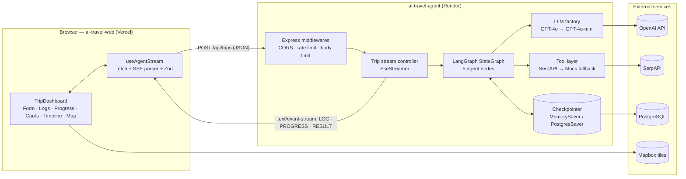
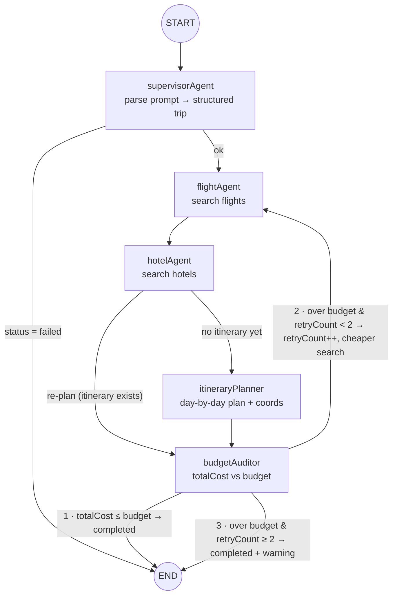

# AI Travel Planner — Technical Architecture

> Source of truth for the whole system. Component-level specifications live in
> [`apps/agent/CLAUDE.md`](./apps/agent/CLAUDE.md) (backend) and
> [`apps/web/CLAUDE.md`](./apps/web/CLAUDE.md) (frontend).
> Derived from *Enterprise Multi-Agent AI Travel Planner — Architecture Blueprint* (2026-10-25).

---

## 1. Overview

A user describes a trip in natural language ("5 days in Paris from Tashkent, $1,000").
A multi-agent LangGraph workflow parses the request, searches flights and hotels, builds a
day-by-day itinerary with map coordinates, and audits the total cost against the budget —
re-planning up to twice if the trip is too expensive. Every step is streamed live to the
browser as typed SSE packets.

### Design pillars

| Pillar | Mechanism |
| --- | --- |
| **Type safety end to end** | TypeScript strict mode everywhere; Zod schemas in `packages/contracts` shared by both apps |
| **State persistence & resiliency** | LangGraph Checkpointer (`MemorySaver` in dev, `PostgresSaver` in prod); a run that fails at step N resumes from the last checkpoint |
| **Standardized stream protocol** | Every SSE packet is one of `LOG` / `PROGRESS` / `RESULT`, validated by Zod on send and on receive |
| **Fallbacks & rate limits** | GPT-4o → GPT-4o-mini; SerpAPI → Mock engine; retries with backoff; `express-rate-limit` on the API |
| **Bounded loops** | Budget Auditor re-plans at most 2 times (`retryCount`), then returns the best result with a warning |

---

## 2. Technology stack

| Layer | Technology | Purpose |
| --- | --- | --- |
| Language | TypeScript 5.x (`strict`) | 100% type safety, Zod for runtime validation |
| Monorepo | pnpm workspaces + Turborepo | One install, one command, ordered + cached builds |
| Backend service | Node.js (LTS) + Express | REST + SSE stream controller, CORS, rate limiting |
| AI orchestration | `@langchain/langgraph` | `StateGraph`, conditional edges, Checkpointer |
| LLM | OpenAI via LangChain (`@langchain/openai`) | GPT-4o with Structured Outputs (Zod), GPT-4o-mini fallback |
| Validation | Zod | Contracts, env config, LLM outputs, request bodies |
| Tools / data | SerpAPI (Google Flights / Google Hotels), Tavily (optional), Mock engine | Flight & hotel search with offline fallback |
| Frontend | Next.js 16 (App Router, Turbopack) | RSC shell + client streaming dashboard |
| UI | Tailwind CSS v4 + shadcn/ui (`base-nova`, Base UI primitives) + Framer Motion | Components and animation |
| Maps | Mapbox GL (`react-map-gl`) | Interactive itinerary map |
| Testing | Vitest (+ React Testing Library, Playwright for e2e) | Unit, component, end-to-end |
| Deployment | Render (agent) + Vercel (web) | Independent deploys from one repo |

---

## 3. System architecture



### Request lifecycle

1. The user submits `TripInputForm`. `useAgentStream` sends `POST /api/trips` with a `TripRequest` body
   (validated client-side with the shared Zod schema).
2. The agent validates the body again, creates a `threadId` (UUID), returns `200` with
   `Content-Type: text/event-stream` and an `X-Thread-Id` header, and starts the graph with
   `configurable.thread_id = threadId`.
3. Each completed node produces a state update. The stream controller converts it into `LOG`
   packets (the node's new log entries) and a `PROGRESS` packet.
4. When the graph reaches `END`, the controller reads the final state from the checkpointer and
   sends one `RESULT` packet, then closes the stream.
5. If anything fails after the stream opened, the controller sends `RESULT` with `status: "failed"`.
   The checkpoint still holds the last successful node, so `POST /api/trips/:threadId/resume`
   continues from there instead of starting over.

> **Why POST + streamed response instead of `EventSource`?** `EventSource` only supports `GET`
> and cannot send a JSON body. The web app reads the SSE stream from a `fetch` response body and
> parses it itself (see `apps/web/CLAUDE.md` §5). The wire format is still standard SSE.

> **Why the browser calls the agent directly:** proxying a long-lived stream through a Vercel
> function would hit function duration limits. The agent is a public, CORS-restricted API.

---

## 4. Multi-agent workflow (LangGraph)

### 4.1 Graph



Node names carry an `Agent`/`Planner`/`Auditor` suffix on purpose: LangGraph rejects node names that
collide with state keys, and the state already has `budget`, `flights`, `hotels`, `itinerary`.

On a re-plan the graph skips `itineraryPlanner` — cheaper flights or hotels do not change the
itinerary, so re-running the LLM planner would only cost tokens and time.

### 4.2 Node responsibilities

| # | Node | Uses LLM | Reads | Writes | Status after |
| --- | --- | --- | --- | --- | --- |
| 1 | `supervisorAgent` | Yes (structured output) | `prompt`, request overrides | `origin`, `destination`, `budget`, `durationDays`, `startDate` | `searching` (or `failed`) |
| 2 | `flightAgent` | No | trip fields, `searchMode` | `flights` (sorted, `[0]` = selected) | `searching` |
| 3 | `hotelAgent` | No | trip fields, `searchMode` | `hotels` (sorted, `[0]` = selected) | `planning` / `auditing` |
| 4 | `itineraryPlanner` | Yes (structured output) | `destination`, `durationDays` | `itinerary`, `dailyExpensesEstimate` | `auditing` |
| 5 | `budgetAuditor` | No (pure arithmetic) | everything | `totalCost`, `retryCount`, `searchMode`, `overBudgetBy`, `warnings` | `completed` or `searching` |

The LLM is used only where language understanding is needed (parsing and planning). Searching and
auditing are deterministic code — cheaper, faster, and unit-testable.

### 4.3 Budget Auditor rules

```
totalCost = flights[0].price
          + hotels[0].pricePerNight × durationDays
          + dailyExpensesEstimate × durationDays
```

| Condition | Check | Action |
| --- | --- | --- |
| 1 · Success | `totalCost <= budget` | `status = "completed"` → END |
| 2 · Re-plan | `totalCost > budget && retryCount < 2` | `retryCount++`, `searchMode = "cheaper"`, `overBudgetBy = totalCost - budget`, `status = "searching"` → `flightAgent` |
| 3 · Fallback | `totalCost > budget && retryCount >= 2` | `status = "completed"`, push warning "Budget exceeded by $X" → END |

`MAX_BUDGET_RETRIES = 2` — at most three search rounds in total. In `cheaper` mode the flight and
hotel nodes must never return a selection more expensive than the current one; if nothing cheaper
is found they keep the previous options. Condition 3 therefore always returns the cheapest
combination found.

### 4.4 Central state

The blueprint's `TravelAgentState`, extended with the fields the workflow needs to run
(additions marked `+`). Implemented as a LangGraph `Annotation.Root` in `apps/agent/src/agent/state.ts`;
domain types come from `@ai-travel/contracts`.

```typescript
interface TravelAgentState {
  // Input
  prompt: string;                    // + raw user text
  origin: string | null;             // + departure city (needed for flight search)
  destination: string;
  budget: number;                    // USD, total for the trip
  durationDays: number;
  startDate: string | null;          // + ISO date; flight/hotel search needs dates

  // Accumulated data (sorted; index 0 is the selected option)
  flights: Flight[];
  hotels: Hotel[];
  itinerary: ItineraryDay[];
  dailyExpensesEstimate: number;     // + USD per day, produced by the planner

  // Execution & audit meta
  totalCost: number;
  retryCount: number;                // max 2
  searchMode: 'standard' | 'cheaper'; // + instruction for the re-plan loop
  overBudgetBy: number;              // +
  warnings: string[];                // + e.g. budget exceeded, mock data used
  error: string | null;              // + reason when status = 'failed'
  status: 'parsing' | 'searching' | 'planning' | 'auditing' | 'completed' | 'failed';
  logs: LogEntry[];                  // append-only (reducer: concat)
}
```

**Reducers:** `logs` and `warnings` append; every other key is last-write-wins.

### 4.5 Persistence & resume

| Environment | Checkpointer | Selected when |
| --- | --- | --- |
| Local / test | `MemorySaver` (in-process, lost on restart) | `DATABASE_URL` not set |
| Production | `PostgresSaver` (`@langchain/langgraph-checkpoint-postgres`) | `DATABASE_URL` set; run `setup()` once on boot |

- One run = one `thread_id` (`threadId` UUID). A checkpoint is written after every node.
- Resume after an error: `graph.stream(null, { configurable: { thread_id } })` continues from the last
  successful node.
- `recursionLimit: 20` as a hard safety net (the longest valid path is 11 node executions).

---

## 5. Shared contracts (`packages/contracts`)

Package name `@ai-travel/contracts`, consumed by both apps with `"workspace:*"`. It is the only
place where cross-service types are defined. **Never redeclare these types in an app.**

The listings below are the actual source (Zod 4 API: `z.iso.datetime()`, `z.iso.date()`, `z.uuid()`).
Tests live in `packages/contracts/test/schemas.test.ts`.

### 5.1 `src/trip.ts` — domain + request

```typescript
import { z } from 'zod';

/** Where an option came from. `mock` means live prices were unavailable. */
export const DataSourceSchema = z.enum(['serpapi', 'mock']);

export const FlightSchema = z.object({
  airline: z.string().min(1),
  /** USD, round trip, one traveller. */
  price: z.number().nonnegative(),
  /** ISO 8601 date-time; airline-local offsets are allowed. */
  departure: z.iso.datetime({ offset: true }),
  source: DataSourceSchema,
});

export const HotelSchema = z.object({
  name: z.string().min(1),
  /** USD. */
  pricePerNight: z.number().nonnegative(),
  rating: z.number().min(0).max(5),
  source: DataSourceSchema,
});

export const PlaceSchema = z.object({
  name: z.string().min(1),
  lat: z.number().min(-90).max(90),
  lng: z.number().min(-180).max(180),
});

export const ItineraryDaySchema = z.object({
  day: z.number().int().min(1),
  title: z.string().min(1),
  places: z.array(PlaceSchema),
});

export const TripStatusSchema = z.enum([
  'parsing',
  'searching',
  'planning',
  'auditing',
  'completed',
  'failed',
]);

export const AgentNameSchema = z.enum([
  'System',
  'Supervisor',
  'FlightAgent',
  'HotelAgent',
  'ItineraryPlanner',
  'BudgetAuditor',
]);

/** POST /api/trips body. Explicit fields override what the Supervisor parses from `prompt`. */
export const TripRequestSchema = z.object({
  prompt: z.string().trim().min(3).max(1000),
  origin: z.string().trim().min(2).max(100).optional(),
  budget: z.number().positive().max(1_000_000).optional(),
  durationDays: z.number().int().min(1).max(30).optional(),
  /** YYYY-MM-DD */
  startDate: z.iso.date().optional(),
});

export type DataSource = z.infer<typeof DataSourceSchema>;
export type Flight = z.infer<typeof FlightSchema>;
export type Hotel = z.infer<typeof HotelSchema>;
export type Place = z.infer<typeof PlaceSchema>;
export type ItineraryDay = z.infer<typeof ItineraryDaySchema>;
export type TripStatus = z.infer<typeof TripStatusSchema>;
export type AgentName = z.infer<typeof AgentNameSchema>;
export type TripRequest = z.infer<typeof TripRequestSchema>;
```

### 5.2 `src/sse-events.ts` — stream protocol

```typescript
import { z } from 'zod';
import {
  AgentNameSchema,
  FlightSchema,
  HotelSchema,
  ItineraryDaySchema,
  TripStatusSchema,
} from './trip.js';

export const LogLevelSchema = z.enum(['info', 'warn', 'error']);

export const LogPayloadSchema = z.object({
  /** 1-based index of the node execution in the run. */
  step: z.number().int().min(1),
  agent: AgentNameSchema,
  message: z.string().min(1),
  timestamp: z.iso.datetime(),
  level: LogLevelSchema.default('info'),
});

export const ProgressPayloadSchema = z.object({
  progressPercent: z.number().int().min(0).max(100),
  currentStatus: TripStatusSchema,
});

export const ResultPayloadSchema = z.object({
  threadId: z.uuid(),
  status: z.enum(['completed', 'failed']),
  origin: z.string().nullable(),
  /** Empty string if the Supervisor failed before parsing a destination. */
  destination: z.string(),
  durationDays: z.number().int().min(0),
  startDate: z.iso.date().nullable(),
  totalCost: z.number().nonnegative(),
  budget: z.number().nonnegative(),
  currency: z.literal('USD'),
  /** Sorted; index 0 is the selected option. */
  flights: z.array(FlightSchema),
  /** Sorted; index 0 is the selected option. */
  hotels: z.array(HotelSchema),
  itinerary: z.array(ItineraryDaySchema),
  /** USD per day. */
  dailyExpensesEstimate: z.number().nonnegative(),
  warnings: z.array(z.string()),
  /** Set when status is 'failed'. */
  error: z.string().nullable(),
});

export const LogEventSchema = z.object({ type: z.literal('LOG'), payload: LogPayloadSchema });
export const ProgressEventSchema = z.object({ type: z.literal('PROGRESS'), payload: ProgressPayloadSchema });
export const ResultEventSchema = z.object({ type: z.literal('RESULT'), payload: ResultPayloadSchema });

export const SseEventSchema = z.discriminatedUnion('type', [
  LogEventSchema,
  ProgressEventSchema,
  ResultEventSchema,
]);

export type LogLevel = z.infer<typeof LogLevelSchema>;
export type LogPayload = z.infer<typeof LogPayloadSchema>;
export type ProgressPayload = z.infer<typeof ProgressPayloadSchema>;
export type ResultPayload = z.infer<typeof ResultPayloadSchema>;
export type LogEvent = z.infer<typeof LogEventSchema>;
export type ProgressEvent = z.infer<typeof ProgressEventSchema>;
export type ResultEvent = z.infer<typeof ResultEventSchema>;
export type SseEvent = z.infer<typeof SseEventSchema>;
/** Shape accepted by `SseEventSchema.parse` (e.g. `level` may be omitted). */
export type SseEventInput = z.input<typeof SseEventSchema>;
```

`src/index.ts` re-exports both files. The package builds to `dist/` with `tsc` (ESM + `.d.ts`)
and exposes it through `"exports"`; its `dev` script is `tsc --watch`.

---

## 6. SSE stream protocol

### 6.1 Wire format

```
id: 7
data: {"type":"LOG","payload":{"step":2,"agent":"FlightAgent","message":"Found a $500 flight on the Tashkent -> Paris route.","timestamp":"2026-10-25T10:25:00Z","level":"info"}}

id: 8
data: {"type":"PROGRESS","payload":{"progressPercent":35,"currentStatus":"searching"}}

: ping

```

- One JSON object per `data:` line, one event per blank-line-terminated block.
- `id` is a per-stream sequence number (debugging/ordering only).
- `: ping` comment every 15 s keeps proxies (Render, corporate networks) from closing idle streams.
  Comments are not packets and the client ignores them.
- Exactly one `RESULT` is the last packet of every stream, success or failure.

### 6.2 Packet types

| Type | When sent | Frontend consumer |
| --- | --- | --- |
| `LOG` | For every log entry a node adds to state | `AgentTerminalLogs` |
| `PROGRESS` | On stream open and after every node | Progress bar |
| `RESULT` | Once, at the end (completed or failed) | `FlightHotelCards`, `ItineraryTimeline`, `MapboxViewer`, budget summary |

### 6.3 Progress mapping

| Moment | `currentStatus` | `progressPercent` |
| --- | --- | --- |
| Stream opened | `parsing` | 5 |
| `supervisorAgent` done | `searching` | 15 |
| `flightAgent` done | `searching` | 35 |
| `hotelAgent` done | `planning` | 55 |
| `itineraryPlanner` done | `auditing` | 75 |
| `budgetAuditor` done (re-plan) | `searching` | unchanged |
| `budgetAuditor` done (final) | `completed` | 95 |
| `RESULT` sent | `completed` / `failed` | 100 |

Progress is **monotonic**: the server never sends a lower percentage than it already sent, so
re-plan rounds do not move the bar backwards.

### 6.4 Log `step`

`step` is the 1-based index of the node execution in the run (supervisor = 1, flight = 2, …). Each node
computes it as `lastLog.step + 1`, so it keeps counting through re-plans and survives a resume.

---

## 7. API surface (ai-travel-agent)

| Method & path | Body | Response |
| --- | --- | --- |
| `GET /health` | — | `200 {"status":"ok"}` (Render health check) |
| `POST /api/trips` | `TripRequest` | `200 text/event-stream` + `X-Thread-Id` header |
| `POST /api/trips/:threadId/resume` | — | `200 text/event-stream`, continues from last checkpoint |
| `GET /api/trips/:threadId` | — | `200 ResultPayload` built from the latest checkpoint, `404` if unknown |

Errors **before** the stream opens are JSON: `{ "error": { "code": "VALIDATION_ERROR", "message": "…" } }`
with `400 / 404 / 429 / 500`. Errors **after** the stream opens are a `RESULT` packet with
`status: "failed"`. Full details in `apps/agent/CLAUDE.md`.

---

## 8. Resiliency & fallbacks

| Failure | Handling |
| --- | --- |
| OpenAI error / timeout / 429 on GPT-4o | SDK retries (`maxRetries: 2`), then `.withFallbacks([gpt-4o-mini])` |
| Both models fail | Node throws → `RESULT failed`, checkpoint kept → resumable |
| LLM output does not match schema | Structured Outputs + Zod parse; a parse failure counts as a model failure and triggers the fallback |
| SerpAPI error / timeout (10 s) / 429 | 2 retries with exponential backoff + jitter, then Mock engine; a `warn` LOG and a `warnings` entry ("Live prices unavailable, showing estimates") |
| No SerpAPI key configured | Mock engine directly (`TOOLS_MODE=auto`) |
| Budget never satisfiable | Condition 3: completed with warning after 2 re-plans |
| Client disconnects | `AbortController` cancels the graph run; no further LLM/tool spend |
| Run takes too long | Global run timeout (120 s) via `AbortSignal.timeout`, ends with `RESULT failed` |
| Abuse / spam | `express-rate-limit` per IP, JSON body limit 10 kb, prompt length cap 1,000 chars |

---

## 9. Security

- **Secrets only on the agent.** `OPENAI_API_KEY`, `SERPAPI_API_KEY`, `TAVILY_API_KEY`, `DATABASE_URL`
  live in Render env vars. The web app has only public values (`NEXT_PUBLIC_AGENT_URL`,
  URL-restricted `NEXT_PUBLIC_MAPBOX_TOKEN`).
- **CORS** allows only `WEB_ORIGIN`; `X-Thread-Id` is listed in `Access-Control-Expose-Headers`.
- **Input validation** at both ends with the same Zod schema; the agent never trusts the client.
- **Prompt injection containment:** user text reaches only the Supervisor, whose output is forced into a
  strict schema. Tools are called by code, not by the model, so a prompt cannot trigger arbitrary tool use.
- **Env validation on boot** (`config.ts`): the agent refuses to start with a malformed configuration.
- `trust proxy` set to `1` on Render so rate limiting sees the real client IP.

---

## 10. Observability

- Structured JSON logs on the agent (one line per request/run with `threadId`, duration, outcome,
  fallbacks used).
- Optional LangSmith tracing (`LANGSMITH_TRACING=true`, `LANGSMITH_API_KEY`) for node-level traces.
- `threadId` is shown in the UI on failure so a user report can be traced to a run.

---

## 11. Repository layout

```text
ai-travel-planner/
├── apps/
│   ├── agent/                  # ai-travel-agent → Render   (spec: apps/agent/CLAUDE.md)
│   └── web/                    # ai-travel-web   → Vercel   (spec: apps/web/CLAUDE.md)
├── packages/
│   └── contracts/              # @ai-travel/contracts (Zod schemas + types)
│       └── src/{index.ts, trip.ts, sse-events.ts}
├── ARCHITECTURE.md             # this file
├── package.json                # root scripts → turbo
├── pnpm-workspace.yaml         # apps/*, packages/* + catalog
├── turbo.json                  # task pipeline
└── tsconfig.base.json          # shared strict TS config
```

Per-app trees are in `apps/agent/CLAUDE.md` §2 and `apps/web/CLAUDE.md` §2.

---

## 12. Monorepo tooling

### 12.1 Roles

- **pnpm** — installs once into a content-addressed store, links `@ai-travel/contracts` into both apps
  (`workspace:*`), one `pnpm-lock.yaml`. A **catalog** pins shared versions (`zod`, `typescript`) once.
- **Turborepo** — builds `contracts` first (`dependsOn: ["^build"]`), then `agent` and `web` in parallel,
  and skips packages whose inputs have not changed.

### 12.2 Configuration

`pnpm-workspace.yaml`

```yaml
packages:
  - "apps/*"
  - "packages/*"

# Shared versions: reference them in a package.json as "<name>": "catalog:"
catalog:
  "@types/node": ^24.0.0
  typescript: ^5.9.3
  vitest: ^4.1.12
  zod: ^4.6.7

# Native postinstall scripts we don't need (same choice as the create-next-app template).
ignoredBuiltDependencies:
  - esbuild # binary ships via @esbuild/<platform>; postinstall only verifies it
  - sharp
  - unrs-resolver
```

Packages reference catalog versions with `"zod": "catalog:"`. Zod 4 is pinned for every package and
verified with `@langchain/core` 1.3 / `@langchain/openai` 1.7: `withStructuredOutput(schema, { strict: true })`
emits a strict JSON schema, `withFallbacks` works, and malformed model output fails with a `ZodError`.
Tooling that only one app uses (ESLint presets, `tsx`, Next.js) is declared in that app's `package.json`,
not in the catalog.

`turbo.json`

```json
{
  "$schema": "https://turbo.build/schema.json",
  "tasks": {
    "build": {
      "dependsOn": ["^build"],
      "outputs": ["dist/**", ".next/**", "!.next/cache/**"],
      "env": ["NEXT_PUBLIC_AGENT_URL", "NEXT_PUBLIC_MAPBOX_TOKEN"]
    },
    "dev": {
      "dependsOn": ["^build"],
      "cache": false,
      "persistent": true,
      "passThroughEnv": ["CONDUCTOR_PORT", "PORT"]
    },
    "test": { "dependsOn": ["^build"] },
    "typecheck": { "dependsOn": ["^build"] },
    "lint": {}
  }
}
```

Turborepo 2 runs tasks in strict env mode: environment variables that are not declared are hidden
from tasks. `env` makes build-time public variables part of the cache key; `passThroughEnv` lets
`CONDUCTOR_PORT` reach the dev servers. Do **not** set a custom `cacheDir` — it disables the cache
sharing between Conductor worktrees.

Root `package.json`

```json
{
  "name": "ai-travel-planner",
  "private": true,
  "packageManager": "pnpm@10.34.9",
  "engines": {
    "node": ">=24"
  },
  "scripts": {
    "dev": "turbo run dev",
    "build": "turbo run build",
    "test": "turbo run test",
    "typecheck": "turbo run typecheck",
    "lint": "turbo run lint"
  },
  "devDependencies": {
    "turbo": "^2.11.10"
  }
}
```


`tsconfig.base.json` — shared compiler options:

```json
{
  "compilerOptions": {
    "target": "ES2022",
    "strict": true,
    "noUncheckedIndexedAccess": true,
    "noImplicitOverride": true,
    "exactOptionalPropertyTypes": true,
    "isolatedModules": true,
    "esModuleInterop": true,
    "skipLibCheck": true,
    "forceConsistentCasingInFileNames": true,
    "resolveJsonModule": true,
    "declaration": true,
    "sourceMap": true
  }
}
```

Each package extends it and sets its own `module`/`moduleResolution`: `NodeNext` for `agent` and
`contracts`, `Bundler` for `web`. The web app turns `exactOptionalPropertyTypes` off because the
generated shadcn/ui components don't compile with it; everything else stays on.

### 12.3 Commands (repo root)

| Command | Effect |
| --- | --- |
| `pnpm install` | Install everything, link workspace packages |
| `pnpm dev` | Build `contracts`, then run `contracts` (watch), agent and web together |
| `pnpm build` | `contracts` → (`agent` ∥ `web`), cached |
| `pnpm test` / `pnpm lint` / `pnpm typecheck` | Across all packages, cached |
| `pnpm dev --filter=ai-travel-agent...` | Agent + its dependencies only |

### 12.4 Ports

| Service | Default | Under Conductor |
| --- | --- | --- |
| web | 3000 | `$CONDUCTOR_PORT` |
| agent | 4000 | `$CONDUCTOR_PORT + 1` |

Both apps derive the other side's URL from the same rule (agent CORS origin, web `NEXT_PUBLIC_AGENT_URL`),
so several workspaces can run `pnpm dev` in parallel. Explicit `PORT` / `WEB_ORIGIN` /
`NEXT_PUBLIC_AGENT_URL` always win.

### 12.5 Conductor

- Repository settings live in `.conductor/settings.toml` (the legacy `conductor.json` is not used).
  The Mac app reads it from `main` on the remote, so it takes effect once merged.
- Setup script: `corepack enable pnpm && pnpm install`. Corepack ships with Node 24 and provides the pnpm
  version pinned in `packageManager`; the `pnpm` shim must be on `PATH` because Turborepo spawns `pnpm` itself.
- Run actions: `dev` → `pnpm dev` (local only, uses `CONDUCTOR_PORT`), `test` → `pnpm test`. `run_mode = "concurrent"`.
- Turborepo's local cache is shared across Git worktrees automatically, so new workspaces start warm.
- Turborepo's strict env mode hides shell variables from tasks, so agent secrets go in `apps/agent/.env`
  (read from disk by dotenv), not in the shell that runs `pnpm dev`.

### 12.6 Ownership of shared files

The root setup, `packages/contracts` and this document belong to the project, not to the frontend or the
backend. Both apps depend on them, so they change in a controlled way:

| Area | Owner | How it changes |
| --- | --- | --- |
| Root config (`package.json`, `pnpm-workspace.yaml`, `turbo.json`, `tsconfig.base.json`, `.conductor/`, `.gitignore`) | Shared | Small, focused PRs that touch nothing else; merged quickly |
| `packages/contracts` | Shared (the API contract) | Contracts first, then **both** apps updated in the same PR |
| `ARCHITECTURE.md` | Shared | Any PR, limited to the section the change affects |
| `apps/agent/**` | Backend | Backend tickets (`apps/agent/PLAN.md`) |
| `apps/web/**` | Frontend | Frontend tickets (`apps/web/PLAN.md`) |

Rules:

1. **`main` is the source of truth.** Before starting a ticket, branch from the latest `main`; if the shared
   files already exist there, build on them instead of creating your own. Rebase before opening a PR.
2. **Never duplicate shared setup in an app branch.** If an app needs something shared (a catalog entry, a
   Turbo setting), add the smallest possible change to the existing file and call it out in the PR.
3. **Keep shared PRs small** so parallel workspaces can rebase onto them easily.
4. **A contracts change is a cross-app change**: update or at least type-check the other app in the same PR.

---

## 13. Deployment

| | `ai-travel-web` (Vercel) | `ai-travel-agent` (Render) |
| --- | --- | --- |
| Root directory | `apps/web` | repo root (empty) |
| Build command | `turbo run build` | `pnpm install --frozen-lockfile && pnpm turbo run build --filter=ai-travel-agent` |
| Start command | managed by Vercel | `pnpm --filter ai-travel-agent start` |
| Rebuild only when | Ignored Build Step: `npx turbo-ignore` | Build filters: `apps/agent/**`, `packages/contracts/**`, `pnpm-lock.yaml` |
| Env vars | `NEXT_PUBLIC_MAPBOX_TOKEN`; `NEXT_PUBLIC_AGENT_URL` once the agent is deployed (unset = UI-only mode) | see `apps/agent/CLAUDE.md` §4 |
| Health check | — | `GET /health` |

The agent builds from the repo root on purpose: Render auto-deploys only on changes inside the
service's root directory, so with `apps/agent` as root a change to `packages/contracts` would not
redeploy it. Make sure Render uses the pnpm version from `packageManager` (Corepack).

Production database: a managed PostgreSQL instance (Render Postgres) for `PostgresSaver`.

**Until the agent is deployed** the web app ships in *UI-only mode*: Vercel builds have no
`NEXT_PUBLIC_AGENT_URL`, the dashboard shows a "planning agent not connected" banner and submitting
is disabled (see `apps/web/CLAUDE.md` §4.1). Setting the variable later switches it on — no code change.

---

## 14. Testing strategy

| Level | Scope | Tooling |
| --- | --- | --- |
| Contracts | Schema accepts blueprint examples, rejects malformed packets | Vitest |
| Agent unit | Budget router (all 3 conditions), cost formula, each node with fake LLM + mock tools, SerpAPI → mock fallback | Vitest |
| Agent integration | Full graph run with `MemorySaver` + `TOOLS_MODE=mock`; resume after an injected failure; SSE output parses with `SseEventSchema` | Vitest + supertest |
| Web unit | SSE parser with chunks split at arbitrary byte boundaries, hook reducer, components | Vitest + React Testing Library |
| E2E | Submit form → logs stream → result cards + map render | Playwright against agent in mock mode |

CI runs `pnpm lint typecheck test build`; Turborepo only re-runs affected packages.

---

## 15. Additions to the blueprint

Everything above follows the blueprint. These items were added because the blueprint's design needs
them to work; review them before implementation.

| Addition | Reason |
| --- | --- |
| `origin`, `startDate` in state and request | Flight and hotel search need a departure city and dates; the blueprint's state had neither |
| `dailyExpensesEstimate` in state | The audit formula includes "Daily Expenses Estimate" but nothing produced it; the planner now does |
| `searchMode`, `overBudgetBy` | Carries the "find cheaper options" instruction from the auditor to the search nodes |
| `warnings`, `error` in state and `RESULT` | Condition 3 must "stop with a warning", and failures need a reason; the blueprint had no field for either |
| `threadId`, trip summary (`origin`, `destination`, `durationDays`, `startDate`), `currency`, `source`, `level` fields in packets | Resume support, cards can show hotel totals and headings without extra calls, explicit currency, mock-data badge, log colouring |
| Node names with suffixes (`budgetAuditor`, …) | LangGraph forbids node names equal to state keys (`budget`) |
| Re-plan skips `itineraryPlanner` | Cheaper flights/hotels do not change the plan; avoids an extra LLM call per retry |
| POST + `fetch` stream parsing instead of `EventSource` | `EventSource` cannot POST a body |
| Extra files: `agent/llm.ts`, `agent/runTrip.ts`, `tools/index.ts` (agent); `components/TripDashboard.tsx`, `lib/env.ts`, `lib/sse.ts` (web) | Keep `page.tsx` a Server Component and give the LLM factory, stream controller, tool fallback and SSE parser one home each |
| Hotel cost uses `durationDays` nights | Blueprint formula, kept as is (one night per day). Switch to `durationDays - 1` if trips should end on a departure day |
| Single traveller, USD only | Not specified in the blueprint; easy to extend later via `TripRequest` |
