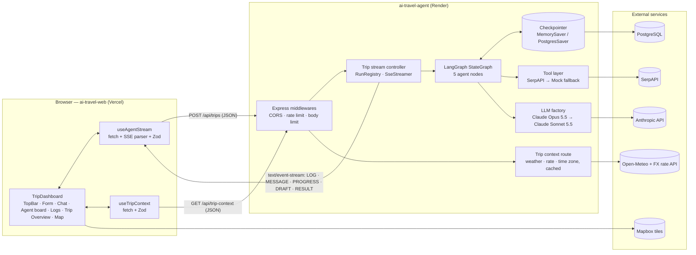
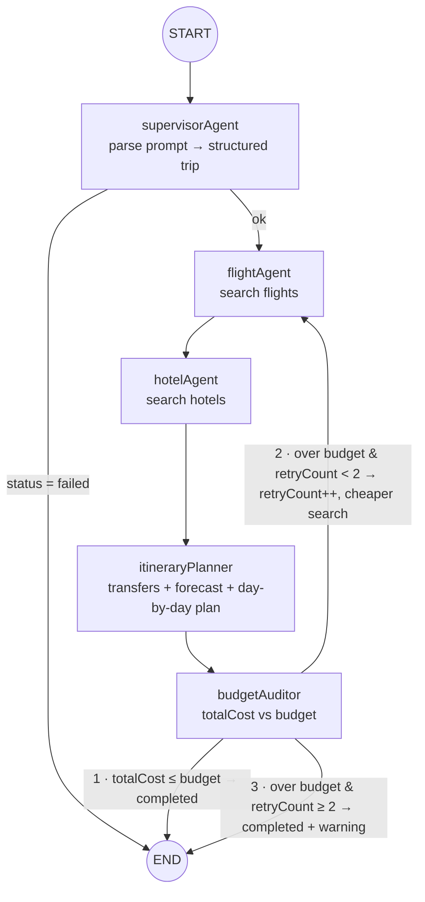

# AI Travel Planner — Technical Architecture

> Source of truth for the whole system. Component-level specifications and implementation plans live in
> [`apps/agent/PLAN.md`](./apps/agent/PLAN.md) (backend) and
> [`apps/web/SPEC.md`](./apps/web/SPEC.md) (frontend).
> Derived from *Enterprise Multi-Agent AI Travel Planner — Architecture Blueprint* (2026-10-25).

---

## 1. Overview

A user describes a trip in natural language ("5 days in Paris from Tashkent, $1,000").
A multi-agent LangGraph workflow parses the request, searches flights and hotels, builds a
day-by-day itinerary with map coordinates, and audits the total cost against the budget —
re-planning up to twice if the trip is too expensive. Every step is streamed live to the
browser as typed SSE packets: a technical log for the terminal view, plain-language chat messages
(some flagged as confirmed decisions), progress, the trip as it takes shape (`DRAFT`), and the final result.
Besides flights and hotels the Planner chooses airport transfers and checks the weather forecast for each day.
Next to the run, a destination bar shows the place, live weather, currency rate and local time, served by a
separate lookup endpoint as soon as the Supervisor has parsed the destination.

### Design pillars

| Pillar | Mechanism |
| --- | --- |
| **Type safety end to end** | TypeScript strict mode everywhere; Zod schemas in `packages/contracts` shared by both apps |
| **State persistence & resiliency** | LangGraph Checkpointer (`MemorySaver` in dev, `PostgresSaver` in prod); a run that fails at step N resumes from the last checkpoint |
| **Standardized stream protocol** | Every SSE packet is one of `LOG` / `MESSAGE` / `PROGRESS` / `DRAFT` / `RESULT`, validated by Zod on send and on receive |
| **Runs outlive connections** | A run is not tied to the HTTP request: a dropped stream reconnects and replays what it missed (§6.5) |
| **Fallbacks & rate limits** | Claude Opus 5.5 → Claude Sonnet 5.5; SerpAPI → Mock engine; retries with backoff; `express-rate-limit` on the API |
| **Bounded loops** | Budget Auditor re-plans at most 2 times (`retryCount`), then returns the best result with a warning |

---

## 2. Technology stack

| Layer | Technology | Purpose |
| --- | --- | --- |
| Language | TypeScript 5.x (`strict`) | 100% type safety, Zod for runtime validation |
| Monorepo | pnpm workspaces + Turborepo | One install, one command, ordered + cached builds |
| Backend service | Node.js (LTS) + Express | REST + SSE stream controller, CORS, rate limiting |
| AI orchestration | `@langchain/langgraph` | `StateGraph`, conditional edges, Checkpointer |
| LLM | Anthropic via LangChain (`@langchain/anthropic`) | Claude Opus 5.5 with structured outputs (Zod), Claude Sonnet 5.5 fallback |
| Validation | Zod | Contracts, env config, LLM outputs, request bodies |
| Tools / data | SerpAPI (Google Flights / Google Hotels), Tavily (optional), Mock engine | Flight & hotel search with offline fallback |
| Destination lookup | Open-Meteo (geocoding, current weather, daily forecast, time zone; no API key), a keyless exchange-rate API (USD base; provider pinned in the ticket) | Destination bar, per-day weather for the Planner |
| Frontend | Next.js 16 (App Router, Turbopack) | RSC shell + client streaming dashboard |
| UI | Tailwind CSS v4 + shadcn/ui (`base-nova`, Base UI primitives) + Framer Motion | Components and animation |
| Maps | Mapbox GL (`react-map-gl`) | Interactive itinerary map |
| Testing | Vitest (+ React Testing Library, Playwright for e2e) | Unit, component, end-to-end |
| Deployment | Render (agent) + Vercel (web) | Independent deploys from one repo |

---

## 3. System architecture



### Request lifecycle

1. The user submits `TripInputForm`. `useAgentStream` sends `POST /api/trips` with a `TripRequest` body
   (validated client-side with the shared Zod schema).
2. The agent validates the body again, creates a `threadId` (UUID), registers the run in the `RunRegistry`,
   returns `200` with `Content-Type: text/event-stream` and an `X-Thread-Id` header, and starts the graph with
   `configurable.thread_id = threadId`. The run belongs to the registry, not to this HTTP request.
3. Each completed node produces a state update. The stream controller converts it into `LOG`
   packets (the node's new technical log entries), `MESSAGE` packets (the node's new chat messages,
   §4.6), a `DRAFT` packet (the trip so far) and a `PROGRESS` packet. Every packet is also appended to the
   run's replay buffer (§6.5).
4. When the graph reaches `END`, the controller reads the final state from the checkpointer and
   sends one `RESULT` packet, then closes the stream.
5. If anything fails after the stream opened, the controller sends `RESULT` with `status: "failed"`.
   The checkpoint still holds the last successful node, so `POST /api/trips/:threadId/resume`
   continues from there instead of starting over.
6. If the connection drops, the run keeps going. The browser reconnects with `GET /api/trips/:threadId/stream`
   and `Last-Event-ID`, and the agent replays the missed packets before following the live ones (§6.5).
   The user can end a run on purpose with `POST /api/trips/:threadId/cancel`.
7. Independently of the run, once the browser knows the destination (from the first `DRAFT` that carries it, or
   from the `RESULT` when a stored trip is reopened) it calls `GET /api/trip-context?destination=…&origin=…`
   for the destination bar (§7.1). This call is not part of the graph and its failure never affects the run.

> **Why POST + streamed response instead of `EventSource`?** `EventSource` only supports `GET`
> and cannot send a JSON body. The web app reads the SSE stream from a `fetch` response body and
> parses it itself (see `apps/web/SPEC.md` §5). The wire format is still standard SSE.

> **Why the browser calls the agent directly:** proxying a long-lived stream through a Vercel
> function would hit function duration limits. The agent is a public, CORS-restricted API.

---

## 4. Multi-agent workflow (LangGraph)

### 4.1 Graph



Node names carry an `Agent`/`Planner`/`Auditor` suffix on purpose: LangGraph rejects node names that
collide with state keys, and the state already has `budget`, `flights`, `hotels`, `itinerary`.

On a re-plan the planner runs again. A different hotel moves the start and end of every day, and the cheaper
pass picks cheaper airport transfers (train instead of taxi), so the design shows the Planner re-routing the days
("Re-routing day 3 around the new hotel"). To keep the cost down it reuses the places of the earlier pass and
only re-orders or swaps the stops that depend on the hotel (§8.4 of `apps/agent/PLAN.md`).

### 4.2 Node responsibilities

| # | Node | Uses LLM | Reads | Writes | Status after |
| --- | --- | --- | --- | --- | --- |
| 1 | `supervisorAgent` | Yes (structured output) | `prompt`, request overrides | `origin`, `destination`, `budget`, `durationDays`, `startDate`, `preferences` | `searching` (or `failed`) |
| 2 | `flightAgent` | Only to pick among soft preferences | trip fields, `preferences`, `searchMode` | `flights` (scored, `[0]` = selected) | `searching` |
| 3 | `hotelAgent` | Only to pick among soft preferences | trip fields, `preferences`, `searchMode` | `hotels` (scored, `[0]` = selected) | `planning` |
| 4 | `itineraryPlanner` | Yes (structured output, one call per day) | trip fields, selected flight and hotel, day forecast, `searchMode` | `transfers`, `itinerary` (with place photos), `dailyExpensesEstimate` | `auditing` |
| 5 | `budgetAuditor` | No (pure arithmetic) | everything | `totalCost`, `passes`, `retryCount`, `searchMode`, `overBudgetBy`, `suggestions`, `warnings` | `completed` or `searching` |

Flight and hotel choice (`agent/ranking.ts`, `agent/pick.ts`): code applies hard filters (budget, cheaper mode,
"direct only"), scores options (price vs budget, travel time, stops, long layovers, red-eyes; hotel price, rating,
distance to the centre, transit) and keeps the top 5. Without soft preferences the top score wins. With them the LLM
returns only an index and reason tags (`Flight.picked` / `Hotel.picked`); an invalid answer or LLM error falls back to
the top score. Place photos (`Place.photoUrl`, `photoCredit`) come from Wikipedia, cached, under a 3 s cap.

The LLM is used only where language understanding is needed (parsing, planning and the preference pick). Searching and
auditing are deterministic code — cheaper, faster, and unit-testable.

### 4.3 Budget Auditor rules

```
totalCost = flights[0].price
          + hotels[0].pricePerNight × durationDays
          + Σ transfers[i].priceUsd
          + dailyExpensesEstimate × durationDays
```

| Condition | Check | Action |
| --- | --- | --- |
| 1 · Success | `totalCost <= budget` | `status = "completed"` → END |
| 2 · Re-plan | `totalCost > budget && retryCount < 2` | `retryCount++`, `searchMode = "cheaper"`, `overBudgetBy = totalCost - budget`, `status = "searching"` → `flightAgent` |
| 3 · Fallback | `totalCost > budget && retryCount >= 2` | `status = "completed"`, push warning "Budget exceeded by $X", set `suggestions` (raise the budget to the next $100, or try one day less) → END |

`MAX_BUDGET_RETRIES = 2` — at most three search rounds in total. In `cheaper` mode the flight and
hotel nodes must never return a selection more expensive than the current one; if nothing cheaper
is found they keep the previous options; the Planner picks the cheapest transfer modes. Condition 3
therefore always returns the cheapest combination found. After every audit the Auditor appends a
`BudgetPass` (flight, hotel, transfers, daily, total) to `passes`, which the UI shows as "what changed on re-plan".

### 4.4 Central state

The blueprint's `TravelAgentState`, extended with the fields the workflow needs to run
(additions marked `+`). Implemented as a LangGraph `Annotation.Root` in `apps/agent/src/agent/state.ts`;
domain types come from `@ai-travel/contracts`.

```typescript
interface TravelAgentState {
  // Input
  prompt: string;                    // + raw user text
  origin: string | null;             // + departure city (needed for flight search)
  destination: string;
  budget: number;                    // USD, total for the trip
  durationDays: number;
  startDate: string | null;          // + ISO date; flight/hotel search needs dates

  // Accumulated data (sorted; index 0 is the selected option)
  flights: Flight[];
  hotels: Hotel[];
  transfers: Transfer[];             // + airport ↔ hotel legs, produced by the planner
  itinerary: ItineraryDay[];
  dailyExpensesEstimate: number;     // + USD per day, produced by the planner

  // Execution & audit meta
  totalCost: number;
  retryCount: number;                // max 2
  searchMode: 'standard' | 'cheaper'; // + instruction for the re-plan loop
  overBudgetBy: number;              // +
  passes: BudgetPass[];              // + one entry per search round, append-only
  suggestions: Suggestions | null;   // + set by condition 3
  confirmed: DecisionTopic[];        // + topics already confirmed in chat, append-only
  warnings: string[];                // + e.g. budget exceeded, mock data used
  error: string | null;              // + reason when status = 'failed'
  status: 'parsing' | 'searching' | 'planning' | 'auditing' | 'completed' | 'failed';
  logs: LogEntry[];                  // append-only (reducer: concat)
  messages: ChatMessage[];           // + friendly chat messages, append-only (reducer: concat)
}
```

**Reducers:** `logs`, `messages`, `warnings`, `passes` and `confirmed` append; every other key is last-write-wins.

### 4.5 Persistence & resume

| Environment | Checkpointer | Selected when |
| --- | --- | --- |
| Local / test | `MemorySaver` (in-process, lost on restart) | `DATABASE_URL` not set |
| Production | `PostgresSaver` (`@langchain/langgraph-checkpoint-postgres`) | `DATABASE_URL` set; run `setup()` once on boot |

- One run = one `thread_id` (`threadId` UUID). A checkpoint is written after every node.
- Resume after an error: `graph.stream(null, { configurable: { thread_id } })` continues from the last
  successful node.
- `recursionLimit: 20` as a hard safety net (the longest valid path is 14 node executions: supervisor plus
  three rounds of flight, hotel, planner and auditor).
- The run is owned by the `RunRegistry`, not by the HTTP request: a closed connection does not abort it
  (§6.5). Only `cancel`, the run timeout or a server shutdown do.

### 4.6 Chat messages & confirmed decisions

`logs` stay technical (they feed the terminal view). `messages` is a second, parallel stream written for
the user: short, friendly sentences from the agents that the chat panel shows as a conversation.

- Each node returns its own `messages` next to its `logs`, with the same `step`. A node returns 0–4.
- Messages are **built by code from state, not by the LLM** — no extra model calls or tokens, deterministic,
  unit-testable. English only for now.
- A message is either an ordinary update (`decision: null`) or a **confirmed decision**
  (`decision: <topic>`). A message can also carry a `callout`, a highlighted tag under the text
  ("Over budget by $125 · re-plan 1 of 2", "Weather prep · Day 3 moved indoors").
- **Who confirms.** In the first pass flight, hotel and transfers are *proposed* in ordinary messages. The
  agents confirm their own pick in a re-plan (`cheaper`) pass, because that pass exists to find the cheapest
  option ("Flight confirmed · TAS → IST → CDG · $420 · saves $80"). Anything still unconfirmed when the run
  completes (state `confirmed`) is confirmed by the Budget Auditor together with `budget`. A topic can be
  confirmed again by a later re-plan; the UI shows the newest confirmation and needs no "superseded" state.

| Node | Ordinary messages | Confirmed decisions (`topic`) |
| --- | --- | --- |
| `supervisorAgent` | Failure: asks for the missing details ("Could you tell me how many days and your budget?") | Success: "Got it — 5 days in Paris from Tashkent on a $1,000 budget." (`trip`) |
| `flightAgent` | First pass: "I found 4 flights — the best option is Uzbekistan Airways at $500." Mock data: adds "Live prices weren't available, so these are estimates." | Re-plan pass: "Turkish Airlines via Istanbul is $420. The layover is 1 h 50 m — enough to change gates." (`flight`, saves $80) |
| `hotelAgent` | First pass: "Hotel Lumière looks like a good fit: $95 a night, rated 8.6." | Re-plan pass: "Found a great stay near République for $66 a night! Rated 8.2, saving us $145." (`hotel`) |
| `itineraryPlanner` | First pass: transfer proposal ("Landing at 13:55 with bags, a taxi is the simplest way in…"); "Saturday looks wet, so Day 3 is now an indoor day" (callout `Weather prep`) | Re-plan pass: "Taxi in, train out." (`transfers`); once per run: "Your 5-day plan is ready: Eiffel Tower, Louvre and more." (`itinerary`) |
| `budgetAuditor` — re-plan | "That comes to $1,125 against $1,000. We need to find about $125." with callout `Over budget by $125 · re-plan 1 of 2` | — |
| `budgetAuditor` — condition 1 or 3 | Condition 3 only: "This is the cheapest combination I could find." | Any of `flight`, `hotel`, `transfers` not yet confirmed, then the final cost (`budget`): "All in, that's $975 of $1,000 with $25 to spare. Approved!" / "Best I could do is $1,084, $84 over budget." |

The supervisor's decision (`trip`) is the first of at most six confirmed decisions per run: `trip`, `flight`,
`hotel`, `transfers`, `itinerary`, `budget`. The design's "Brief · Flight · Hotel · Transfers · Itinerary · Budget"
list in the finished trip is exactly this set. Messages can @-mention another agent by display name
("@Flight Agent and @Hotel Agent, you're up."); the UI highlights `@Name` tokens, no extra field is needed.

The web app renders decisions with a "Confirmed" badge in the chat. There is **no user approval step**:
"confirmed" means the agent will not change it. A human-in-the-loop confirmation (LangGraph `interrupt`) is
out of scope for this version.

---

## 5. Shared contracts (`packages/contracts`)

Package name `@ai-travel/contracts`, consumed by both apps with `"workspace:*"`. It is the only
place where cross-service types are defined. **Never redeclare these types in an app.**

The listings below are the actual source (Zod 4 API: `z.iso.datetime()`, `z.iso.date()`, `z.uuid()`, `z.url()`),
copied from the package. They follow the design in `.context/design` (Foundations, Components, Web-Live, Web-Trip),
which is the source of truth for the data the UI shows: rich flight legs, hotel details, airport transfers,
per-day weather, the `DRAFT` packet and the budget passes. Tests live in `packages/contracts/test/schemas.test.ts`.

### 5.1 `src/trip.ts` — domain + request

```typescript
import { z } from 'zod';

/** Where an option came from. `mock` means live prices were unavailable. */
export const DataSourceSchema = z.enum(['serpapi', 'mock']);

/** Weather bucket the UI maps to an icon. Shared by the top bar and the per-day forecast. */
export const WeatherIconSchema = z.enum(['clear', 'partly-cloudy', 'cloudy', 'fog', 'rain', 'snow', 'storm']);

export const AirportSchema = z.object({
  /** IATA code, e.g. "TAS". */
  code: z.string().min(3).max(4),
  /** e.g. "Tashkent International". */
  name: z.string().min(1),
});

/** An intermediate stop of a flight leg. */
export const FlightStopSchema = z.object({
  airport: AirportSchema,
  layoverMinutes: z.number().int().nonnegative(),
});

/** One direction of a round trip. */
export const FlightLegSchema = z.object({
  from: AirportSchema,
  to: AirportSchema,
  /** ISO 8601 date-time; airline-local offsets are allowed. */
  departure: z.iso.datetime({ offset: true }),
  arrival: z.iso.datetime({ offset: true }),
  /** Arrival terminal, when the provider reports it. */
  terminal: z.string().min(1).nullable(),
  /** Empty array = direct. */
  stops: z.array(FlightStopSchema),
});

export const FlightSchema = z.object({
  airline: z.string().min(1),
  /** USD, round trip, one traveller. */
  price: z.number().nonnegative(),
  outbound: FlightLegSchema,
  /** `null` when the provider returned the outbound leg only. */
  return: FlightLegSchema.nullable(),
  /** "View fare" link, when the provider gives one. */
  bookingUrl: z.url().nullable(),
  source: DataSourceSchema,
});

export const PlaceSchema = z.object({
  name: z.string().min(1),
  lat: z.number().min(-90).max(90),
  lng: z.number().min(-180).max(180),
  /** Short hint shown next to the stop, e.g. "Morning". */
  note: z.string().min(1).nullable(),
  photoUrl: z.url().nullish(),
  photoCredit: z.object({ name: z.string().min(1), url: z.url() }).nullish(),
});

export const HotelSchema = z.object({
  name: z.string().min(1),
  /** Neighbourhood, e.g. "11th arrondissement". */
  area: z.string().min(1).nullable(),
  /** USD. */
  pricePerNight: z.number().nonnegative(),
  /** 0–10 (Google Hotels' 0–5 is doubled by the tool). */
  rating: z.number().min(0).max(10),
  photoUrl: z.url().nullable(),
  /** HH:mm, 24 h. */
  checkInTime: z.string().regex(/^\d{2}:\d{2}$/).nullable(),
  checkOutTime: z.string().regex(/^\d{2}:\d{2}$/).nullable(),
  /** Nearest public transport, e.g. "République · lines 3, 5, 8, 9, 11". */
  transit: z.string().min(1).nullable(),
  /** For the hotel marker on the map. */
  location: z.object({ lat: z.number().min(-90).max(90), lng: z.number().min(-180).max(180) }).nullable(),
  bookingUrl: z.url().nullable(),
  source: DataSourceSchema,
});

export const TransferModeSchema = z.enum(['taxi', 'train', 'metro', 'bus', 'shuttle', 'walk']);

/** Airport ↔ hotel leg chosen by the Planner. */
export const TransferSchema = z.object({
  /** Itinerary day the transfer happens on (arrival day, departure day). */
  day: z.number().int().min(1),
  mode: TransferModeSchema,
  /** e.g. "CDG Terminal 1 → hotel". */
  description: z.string().min(1),
  /** USD, whole leg. */
  priceUsd: z.number().nonnegative(),
  durationMinutes: z.number().int().positive().nullable(),
  /** e.g. "Fixed fare €56" or "Leave the hotel by 16:00". */
  note: z.string().min(1).nullable(),
});

/** Forecast for one itinerary day. */
export const DayWeatherSchema = z.object({
  highC: z.number(),
  lowC: z.number(),
  /** Short label for display, e.g. "Partly cloudy". */
  condition: z.string().min(1),
  icon: WeatherIconSchema,
});

export const ItineraryDaySchema = z.object({
  day: z.number().int().min(1),
  /** YYYY-MM-DD; `null` when the trip has no start date. */
  date: z.iso.date().nullable(),
  title: z.string().min(1),
  /** `null` when the date is beyond the forecast range or the lookup failed. */
  weather: DayWeatherSchema.nullable(),
  places: z.array(PlaceSchema),
});

export const TripStatusSchema = z.enum([
  'parsing',
  'searching',
  'planning',
  'auditing',
  'completed',
  'failed',
]);

export const AgentNameSchema = z.enum([
  'System',
  'Supervisor',
  'FlightAgent',
  'HotelAgent',
  'Planner',
  'BudgetAuditor',
]);

/** What a confirmed decision is about. */
export const DecisionTopicSchema = z.enum(['trip', 'flight', 'hotel', 'transfers', 'itinerary', 'budget']);

/** POST /api/trips body. Explicit fields override what the Supervisor parses from `prompt`. */
export const TripRequestSchema = z.object({
  prompt: z.string().trim().min(3).max(1000),
  origin: z.string().trim().min(2).max(100).optional(),
  budget: z.number().positive().max(1_000_000).optional(),
  durationDays: z.number().int().min(1).max(30).optional(),
  /** YYYY-MM-DD */
  startDate: z.iso.date().optional(),
});

export type DecisionTopic = z.infer<typeof DecisionTopicSchema>;
export type DataSource = z.infer<typeof DataSourceSchema>;
export type WeatherIcon = z.infer<typeof WeatherIconSchema>;
export type Airport = z.infer<typeof AirportSchema>;
export type FlightStop = z.infer<typeof FlightStopSchema>;
export type FlightLeg = z.infer<typeof FlightLegSchema>;
export type Flight = z.infer<typeof FlightSchema>;
export type Hotel = z.infer<typeof HotelSchema>;
export type TransferMode = z.infer<typeof TransferModeSchema>;
export type Transfer = z.infer<typeof TransferSchema>;
export type Place = z.infer<typeof PlaceSchema>;
export type DayWeather = z.infer<typeof DayWeatherSchema>;
export type ItineraryDay = z.infer<typeof ItineraryDaySchema>;
export type TripStatus = z.infer<typeof TripStatusSchema>;
export type AgentName = z.infer<typeof AgentNameSchema>;
export type TripRequest = z.infer<typeof TripRequestSchema>;
```

### 5.2 `src/sse-events.ts` — stream protocol

```typescript
import { z } from 'zod';
import {
  AgentNameSchema,
  DecisionTopicSchema,
  FlightSchema,
  HotelSchema,
  ItineraryDaySchema,
  TransferSchema,
  TripStatusSchema,
} from './trip.js';

export const LogLevelSchema = z.enum(['info', 'warn', 'error']);

/** What a log line means to the UI: plain output, a checkpoint row, or a fallback that fired. */
export const LogKindSchema = z.enum(['log', 'checkpoint', 'llm-fallback', 'search-fallback']);

/** Technical entry for the terminal view. */
export const LogPayloadSchema = z.object({
  /** 1-based index of the node execution in the run. */
  step: z.number().int().min(1),
  agent: AgentNameSchema,
  message: z.string().min(1),
  timestamp: z.iso.datetime(),
  level: LogLevelSchema.default('info'),
  kind: LogKindSchema.default('log'),
});

/** Highlighted tag under a chat message, e.g. "Over budget by $125 · re-plan 1 of 2". */
export const CalloutSchema = z.object({
  tone: z.enum(['info', 'warn']),
  label: z.string().min(1),
});

/** Friendly sentence for the chat panel; see ARCHITECTURE.md §4.6. */
export const MessagePayloadSchema = z.object({
  /** Same `step` as the node's logs. */
  step: z.number().int().min(1),
  agent: AgentNameSchema,
  /** Plain-language text, already formatted for display. */
  text: z.string().min(1),
  timestamp: z.iso.datetime(),
  /** `null` = ordinary update; a topic = confirmed decision. A topic may be confirmed again after a re-plan. */
  decision: DecisionTopicSchema.nullable().default(null),
  callout: CalloutSchema.nullable().default(null),
});

/** Facts for the "Run details" panel. */
export const RunInfoSchema = z.object({
  model: z.string().min(1),
  checkpointer: z.enum(['memory', 'postgres']),
  /** Step of the last saved checkpoint; `null` before the first node finishes. */
  lastCheckpointStep: z.number().int().min(1).nullable(),
});

export const ProgressPayloadSchema = z.object({
  progressPercent: z.number().int().min(0).max(100),
  currentStatus: TripStatusSchema,
  /** Sub-step label, e.g. "Day 4 of 5". */
  detail: z.string().min(1).nullable().default(null),
  /** Search round: 1 = first pass, 2–3 = re-plans. */
  pass: z.number().int().min(1).max(3).default(1),
  run: RunInfoSchema.nullable().default(null),
});

/** One search round, kept so the UI can show "what changed on re-plan". */
export const BudgetPassSchema = z.object({
  pass: z.number().int().min(1).max(3),
  /** USD. */
  flight: z.number().nonnegative(),
  hotel: z.number().nonnegative(),
  transfers: z.number().nonnegative(),
  daily: z.number().nonnegative(),
  totalCost: z.number().nonnegative(),
  /** e.g. "$500 direct" / "$420 via IST". */
  flightLabel: z.string().min(1),
  /** e.g. "5 × $95". */
  hotelLabel: z.string().min(1),
});

/** Ready-made ways out when the trip is still over budget after the last re-plan. */
export const SuggestionsSchema = z.object({
  raiseBudgetTo: z.number().positive(),
  tryDays: z.number().int().min(1),
});

export const ResultPayloadSchema = z.object({
  threadId: z.uuid(),
  status: z.enum(['completed', 'failed']),
  origin: z.string().nullable(),
  /** Empty string if the Supervisor failed before parsing a destination. */
  destination: z.string(),
  durationDays: z.number().int().min(0),
  startDate: z.iso.date().nullable(),
  totalCost: z.number().nonnegative(),
  budget: z.number().nonnegative(),
  currency: z.literal('USD'),
  /** Sorted; index 0 is the selected option. */
  flights: z.array(FlightSchema),
  /** Sorted; index 0 is the selected option. */
  hotels: z.array(HotelSchema),
  /** The selected airport ↔ hotel transfers. */
  transfers: z.array(TransferSchema),
  itinerary: z.array(ItineraryDaySchema),
  /** USD per day. */
  dailyExpensesEstimate: z.number().nonnegative(),
  /** Number of budget re-plans that ran (0–2). */
  replans: z.number().int().min(0).max(2),
  /** One entry per search round, oldest first. */
  passes: z.array(BudgetPassSchema),
  /** Set only when the trip is over budget after the last re-plan. */
  suggestions: SuggestionsSchema.nullable(),
  warnings: z.array(z.string()),
  /** Set when status is 'failed'. */
  error: z.string().nullable(),
});

/** The trip so far, sent while agents work. Every field is optional: it fills in as agents decide. */
export const DraftPayloadSchema = ResultPayloadSchema.pick({
  origin: true,
  destination: true,
  durationDays: true,
  startDate: true,
  budget: true,
  totalCost: true,
  flights: true,
  hotels: true,
  transfers: true,
  itinerary: true,
  dailyExpensesEstimate: true,
}).partial();

export const LogEventSchema = z.object({ type: z.literal('LOG'), payload: LogPayloadSchema });
export const MessageEventSchema = z.object({ type: z.literal('MESSAGE'), payload: MessagePayloadSchema });
export const ProgressEventSchema = z.object({ type: z.literal('PROGRESS'), payload: ProgressPayloadSchema });
export const DraftEventSchema = z.object({ type: z.literal('DRAFT'), payload: DraftPayloadSchema });
export const ResultEventSchema = z.object({ type: z.literal('RESULT'), payload: ResultPayloadSchema });

export const SseEventSchema = z.discriminatedUnion('type', [
  LogEventSchema,
  MessageEventSchema,
  ProgressEventSchema,
  DraftEventSchema,
  ResultEventSchema,
]);

export type LogLevel = z.infer<typeof LogLevelSchema>;
export type LogKind = z.infer<typeof LogKindSchema>;
export type LogPayload = z.infer<typeof LogPayloadSchema>;
export type Callout = z.infer<typeof CalloutSchema>;
export type MessagePayload = z.infer<typeof MessagePayloadSchema>;
export type RunInfo = z.infer<typeof RunInfoSchema>;
export type ProgressPayload = z.infer<typeof ProgressPayloadSchema>;
export type BudgetPass = z.infer<typeof BudgetPassSchema>;
export type Suggestions = z.infer<typeof SuggestionsSchema>;
export type DraftPayload = z.infer<typeof DraftPayloadSchema>;
export type ResultPayload = z.infer<typeof ResultPayloadSchema>;
export type LogEvent = z.infer<typeof LogEventSchema>;
export type MessageEvent = z.infer<typeof MessageEventSchema>;
export type ProgressEvent = z.infer<typeof ProgressEventSchema>;
export type DraftEvent = z.infer<typeof DraftEventSchema>;
export type ResultEvent = z.infer<typeof ResultEventSchema>;
export type SseEvent = z.infer<typeof SseEventSchema>;
/** Shape accepted by `SseEventSchema.parse` (e.g. `level` may be omitted). */
export type SseEventInput = z.input<typeof SseEventSchema>;
```

### 5.3 `src/trip-context.ts` — top-bar lookup

Response of `GET /api/trip-context` (§7.1). Weather, currency/rate and time zone are independently
nullable: one provider failing must not blank the others.

```typescript
import { z } from 'zod';
import { WeatherIconSchema } from './trip.js';

/** Query string of GET /api/trip-context. */
export const TripContextQuerySchema = z.object({
  /** City or place name; the agent geocodes it. */
  destination: z.string().trim().min(2).max(100),
  /** Departure city; only used to work out the time difference. */
  origin: z.string().trim().min(2).max(100).optional(),
});

export const WeatherSchema = z.object({
  temperatureC: z.number(),
  /** Short label for display, e.g. "Partly cloudy". */
  condition: z.string().min(1),
  /** Coarse bucket the UI maps to an icon. */
  icon: WeatherIconSchema,
  todayLowC: z.number(),
  todayHighC: z.number(),
  /** One-line outlook for the next days, e.g. "rain Saturday"; `null` when nothing notable. */
  outlook: z.string().min(1).nullable(),
});

export const CurrencySchema = z.object({
  /** ISO 4217 code of the destination's currency. */
  code: z.string().length(3),
  /** e.g. "€"; `null` when unknown. */
  symbol: z.string().min(1).nullable(),
});

export const ExchangeRateSchema = z.object({
  base: z.literal('USD'),
  /** ISO 4217 code of the destination's currency. */
  quote: z.string().length(3),
  /** 1 USD = `rate` × `quote`. */
  rate: z.number().positive(),
  /** When the provider last updated the rate. */
  asOf: z.iso.datetime(),
});

export const TripContextSchema = z.object({
  /** Resolved place, e.g. "Paris, France". */
  location: z.string().min(1),
  /** `null` when the weather lookup failed. */
  weather: WeatherSchema.nullable(),
  /** `null` when the destination's currency is unknown or already USD. */
  currency: CurrencySchema.nullable(),
  /** `null` when the lookup failed, the currency is unknown, or the destination already uses USD. */
  exchangeRate: ExchangeRateSchema.nullable(),
  /** IANA zone of the destination, e.g. "Europe/Paris"; the browser formats the local time. */
  timeZone: z.string().min(1).nullable(),
  /** IANA zone of `origin`, when it was given and found. */
  originTimeZone: z.string().min(1).nullable(),
  /** `mock` only when the agent runs with `TOOLS_MODE=mock` (tests, e2e). */
  source: z.enum(['live', 'mock']),
});

export type TripContextQuery = z.infer<typeof TripContextQuerySchema>;
export type Weather = z.infer<typeof WeatherSchema>;
export type Currency = z.infer<typeof CurrencySchema>;
export type ExchangeRate = z.infer<typeof ExchangeRateSchema>;
export type TripContext = z.infer<typeof TripContextSchema>;
```

`src/index.ts` re-exports all three files. The package builds to `dist/` with `tsc` (ESM + `.d.ts`)
and exposes it through `"exports"`; its `dev` script is `tsc --watch`.

---

## 6. SSE stream protocol

### 6.1 Wire format

```
id: 7
data: {"type":"LOG","payload":{"step":2,"agent":"FlightAgent","message":"Found a $500 flight on the Tashkent -> Paris route.","timestamp":"2026-10-25T10:25:00Z","level":"info"}}

id: 8
data: {"type":"MESSAGE","payload":{"step":2,"agent":"FlightAgent","text":"I found 4 flights — the best option is Uzbekistan Airways at $500.","timestamp":"2026-10-25T10:25:00Z","decision":null}}

id: 9
data: {"type":"MESSAGE","payload":{"step":5,"agent":"BudgetAuditor","text":"Total $940 — within your $1,000 budget.","timestamp":"2026-10-25T10:25:09Z","decision":"budget"}}

id: 10
data: {"type":"DRAFT","payload":{"flights":[{"airline":"Uzbekistan Airways","price":500,"…":"…"}]}}

id: 11
data: {"type":"PROGRESS","payload":{"progressPercent":35,"currentStatus":"searching","detail":null,"pass":1,"run":{"model":"claude-opus-5-5","checkpointer":"postgres","lastCheckpointStep":2}}}

: ping

```

- One JSON object per `data:` line, one event per blank-line-terminated block.
- `id` is the run's event sequence number. It is what a reconnecting client sends back as `Last-Event-ID`
  (§6.5).
- `: ping` comment every 15 s keeps proxies (Render, corporate networks) from closing idle streams.
  Comments are not packets and the client ignores them.
- Exactly one `RESULT` is the last packet of every stream, success or failure.

### 6.2 Packet types

| Type | When sent | Frontend consumer |
| --- | --- | --- |
| `LOG` | For every log entry a node adds to state. `kind` marks checkpoint rows and model / search fallbacks | `AgentTerminalLogs` (technical view), fallback banners |
| `MESSAGE` | For every chat message a node adds to state, right after that node's `LOG` packets | `AgentChat` (`decision` ≠ `null` renders a "Confirmed" badge) |
| `DRAFT` | After every node, and after each day the Planner finishes. Carries only the fields that exist so far | Live `TripOverview` (budget breakdown, selected flight, transfers, hotel, map, days) and the destination bar |
| `PROGRESS` | On stream open, after every node, and when the Planner starts a day (`detail`: "Day 4 of 5") | Progress bar, agent board, run details |
| `RESULT` | Once, at the end (completed or failed) | The final `TripOverview`, budget meter, "what changed on re-plan" table |

### 6.3 Progress mapping

| Moment | `currentStatus` | `progressPercent` |
| --- | --- | --- |
| Stream opened | `parsing` | 5 |
| `supervisorAgent` done | `searching` | 15 |
| `flightAgent` done | `searching` | 35 |
| `hotelAgent` done | `planning` | 55 |
| `itineraryPlanner` working | `planning` | 55 → 75, in equal steps per finished day (`detail` "Day 4 of 5") |
| `itineraryPlanner` done | `auditing` | 75 |
| `budgetAuditor` done (re-plan) | `searching`, `pass` + 1 | unchanged |
| `budgetAuditor` done (final) | `completed` | 95 |
| `RESULT` sent | `completed` / `failed` | 100 |

Progress is **monotonic**: the server never sends a lower percentage than it already sent, so
re-plan rounds do not move the bar backwards. `pass` is 1 for the first search round and goes up by one
for every re-plan (max 3); the agent board uses it to show "pass 2".

### 6.4 Log `step`

`step` is the 1-based index of the node execution in the run (supervisor = 1, flight = 2, …). Each node
computes it as `lastLog.step + 1`, so it keeps counting through re-plans and survives a resume.
A node's `MESSAGE` packets carry the same `step` as its `LOG` packets.

### 6.5 Reconnect and replay

A run belongs to the agent's in-memory `RunRegistry`, keyed by `threadId`, not to the HTTP request that
started it. The registry keeps every packet of a run in a replay buffer (capped at 500 packets) while the run is
active and for 10 minutes after it ends.

- A client whose stream drops calls `GET /api/trips/:threadId/stream` with the header
  `Last-Event-ID: <last id it saw>`. The agent replays the packets after that id, then keeps streaming live ones
  until the `RESULT`. Unknown `threadId` or an expired buffer → `404`, and the client falls back to
  `GET /api/trips/:threadId` (finished) or `POST …/resume` (stopped).
- The web app retries up to 5 times with backoff (1 s, 2 s, 4 s, 8 s, 15 s) and shows "Reconnecting · attempt N"
  with a "Reconnect now" button. When the stream is back, the log catches up from the buffer.
- If the agent process restarts the buffer is gone; the run is recovered from its checkpoint with `resume`.
- The registry is per process. A single Render instance is assumed; scaling out needs a shared store.

Beyond the buffer, `MESSAGE`, `LOG` and `DRAFT` packets are live-only: `GET /api/trips/:threadId` returns a
`ResultPayload`, so a trip reopened later shows its results but not the chat history. Every confirmed decision
is still visible in the result itself (selected flight, hotel and transfers, itinerary, total vs budget,
passes).

---

## 7. API surface (ai-travel-agent)

| Method & path | Body | Response |
| --- | --- | --- |
| `GET /health` | — | `200 {"status":"ok"}` (Render health check) |
| `POST /api/trips` | `TripRequest` | `200 text/event-stream` + `X-Thread-Id` header |
| `GET /api/trips/:threadId/stream` | header `Last-Event-ID` (optional) | `200 text/event-stream`: replays missed packets, then follows the live run; `404` if the run is not in the registry |
| `POST /api/trips/:threadId/cancel` | — | `204`; aborts the run, which ends with `RESULT failed` ("Run stopped") and stays resumable; `404` if unknown |
| `POST /api/trips/:threadId/resume` | — | `200 text/event-stream`, continues from last checkpoint |
| `GET /api/trips/:threadId` | — | `200 ResultPayload` built from the latest checkpoint, `404` if unknown |
| `GET /api/trip-context?destination=…&origin=…` | query: `TripContextQuery` | `200 TripContext`, `400` bad query, `404` destination not found |

Errors **before** the stream opens are JSON: `{ "error": { "code": "VALIDATION_ERROR", "message": "…" } }`
with `400 / 404 / 429 / 500`. A `429` also carries `retryAfterSeconds` in the error object (and the standard
`Retry-After` header, exposed through CORS) so the form can show a countdown ("Plan trip in 0:42"). Errors **after** the stream opens are a `RESULT` packet with
`status: "failed"`. Full details in `apps/agent/PLAN.md`.

### 7.1 Trip context lookup (top bar)

A plain JSON route next to the stream routes; it does not touch the graph or the checkpointer.

1. **Geocode** `destination` with Open-Meteo geocoding → coordinates, country code, resolved name. No
   match → `404 NOT_FOUND`.
2. **Weather:** current conditions and today's low/high at those coordinates, plus a one-line `outlook` built from
   the next days' forecast (e.g. "rain Saturday"). The provider's weather code is mapped to `condition` + `icon`.
3. **Currency and exchange rate:** country code → ISO 4217 currency and symbol through a small static table in
   the agent (`tools/currencies.ts`), then the USD→currency rate. Unknown country or a USD destination →
   `currency: null, exchangeRate: null`; a failed rate call → `exchangeRate: null` only.
4. **Time zone:** the geocoder returns the destination's IANA zone. When `origin` is given it is geocoded the same
   way (failure → `originTimeZone: null`). The browser formats the local time and the difference to the origin
   with `Intl`.
5. Steps 2 and 3 run in parallel (`Promise.allSettled`), each with a 5 s timeout and one retry. A failure
   becomes `null` for that field; the route still answers `200`.
6. **Cache** (in-process, keyed by normalised destination): geocoding 24 h, weather 30 min, rate 6 h. Failures
   are not cached. This keeps the provider free tiers safe and makes repeated opens instant.

Unlike flights and hotels there is **no mock fallback on failure**: a made-up temperature or rate in the
header would look like real data. The UI simply hides the chip that is `null`. With `TOOLS_MODE=mock`
(tests, e2e) the route returns fixed fixtures with `source: "mock"`.

The route sits behind `generalLimiter` (not the stricter run limiter) and needs no secrets. It reports the
*current* weather and a short outlook. The per-day forecast for the trip's own dates is fetched separately by the
Planner (`tools/weather.ts` `getForecast`, Open-Meteo reaches ~16 days ahead; later dates get `weather: null`).

---

## 8. Resiliency & fallbacks

| Failure | Handling |
| --- | --- |
| Anthropic API error / timeout / 429 on Opus 5.5 | SDK retries (`maxRetries: 2`), then `.withFallbacks([claude-sonnet-5-5])` |
| Both models fail | Node throws → `RESULT failed`, checkpoint kept → resumable |
| LLM output does not match schema | Structured Outputs + Zod parse; a parse failure counts as a model failure and triggers the fallback |
| SerpAPI error / timeout (10 s) / 429 | 2 retries with exponential backoff + jitter, then Mock engine; a `warn` LOG and a `warnings` entry ("Live prices unavailable, showing estimates") |
| No SerpAPI key configured | Mock engine directly (`TOOLS_MODE=auto`) |
| Weather or exchange-rate provider error / timeout (5 s) | One retry, then `null` for that field (no mock data); `200` with the other field intact; top bar hides the missing chip |
| Destination cannot be geocoded | `404 NOT_FOUND`; the top bar shows nothing and the trip run is unaffected |
| Budget never satisfiable | Condition 3: completed with warning after 2 re-plans |
| Client disconnects (network change, sleeping tab) | The run keeps going. The client reconnects with `Last-Event-ID` and the registry replays what it missed (§6.5). A run nobody reconnects to still finishes within the run timeout |
| User presses "Stop run" | `POST …/cancel` aborts the graph; the checkpoint stays, so the run can be resumed |
| LLM falls back to Sonnet 5.5 | A `warn` LOG with `kind: "llm-fallback"`; the UI shows a "Running on fallback model" banner |
| Live search falls back to the Mock engine | A `warn` LOG with `kind: "search-fallback"` plus a `warnings` entry; cards show an "Estimate" badge |
| Forecast unavailable or beyond 16 days | The Planner plans without weather; `itinerary[].weather` is `null` and no weather callout is sent |
| Run takes too long | Global run timeout (120 s) via `AbortSignal.timeout`, ends with `RESULT failed` |
| Abuse / spam | `express-rate-limit` per IP (429 with `retryAfterSeconds`), JSON body limit 10 kb, prompt length cap 1,000 chars |

---

## 9. Security

- **Secrets only on the agent.** `ANTHROPIC_API_KEY`, `SERPAPI_API_KEY`, `TAVILY_API_KEY`, `DATABASE_URL`
  live in Render env vars. The web app has only public values (`NEXT_PUBLIC_AGENT_URL`,
  URL-restricted `NEXT_PUBLIC_MAPBOX_TOKEN`).
- **CORS** allows only `WEB_ORIGIN`; `X-Thread-Id` and `Retry-After` are listed in `Access-Control-Expose-Headers`.
- **Input validation** at both ends with the same Zod schema; the agent never trusts the client.
- **Prompt injection containment:** user text reaches only the Supervisor, whose output is forced into a
  strict schema. Tools are called by code, not by the model, so a prompt cannot trigger arbitrary tool use.
- **Trip context route:** `destination` is validated with `TripContextQuerySchema` (2–100 chars) and
  URL-encoded when passed to providers; provider hosts are fixed in code, so the route cannot be used to
  make the agent fetch arbitrary URLs. The providers need no API keys.
- **Env validation on boot** (`config.ts`): the agent refuses to start with a malformed configuration.
- `trust proxy` set to `1` on Render so rate limiting sees the real client IP.

---

## 10. Observability

- Structured JSON logs on the agent (one line per request/run with `threadId`, duration, outcome,
  fallbacks used).
- Optional LangSmith tracing (`LANGSMITH_TRACING=true`, `LANGSMITH_API_KEY`) for node-level traces.
- `threadId` is shown in the UI on failure so a user report can be traced to a run.

---

## 11. Repository layout

```text
ai-travel-planner/
├── apps/
│   ├── agent/                  # ai-travel-agent → Render   (spec: apps/agent/PLAN.md)
│   └── web/                    # ai-travel-web   → Vercel   (spec: apps/web/SPEC.md)
├── packages/
│   └── contracts/              # @ai-travel/contracts (Zod schemas + types)
│       └── src/{index.ts, trip.ts, sse-events.ts, trip-context.ts}
├── ARCHITECTURE.md             # this file
├── package.json                # root scripts → turbo
├── pnpm-workspace.yaml         # apps/*, packages/* + catalog
├── turbo.json                  # task pipeline
└── tsconfig.base.json          # shared strict TS config
```

Per-app trees are in `apps/agent/PLAN.md` §2 and `apps/web/SPEC.md` §2.

---

## 12. Monorepo tooling

### 12.1 Roles

- **pnpm** — installs once into a content-addressed store, links `@ai-travel/contracts` into both apps
  (`workspace:*`), one `pnpm-lock.yaml`. A **catalog** pins shared versions (`zod`, `typescript`) once.
- **Turborepo** — builds `contracts` first (`dependsOn: ["^build"]`), then `agent` and `web` in parallel,
  and skips packages whose inputs have not changed.

### 12.2 Configuration

`pnpm-workspace.yaml`

```yaml
packages:
  - "apps/*"
  - "packages/*"

# Shared versions: reference them in a package.json as "<name>": "catalog:"
catalog:
  "@types/node": ^24.0.0
  typescript: ^5.9.3
  vitest: ^4.1.12
  zod: ^4.6.7

# Native postinstall scripts we don't need (same choice as the create-next-app template).
ignoredBuiltDependencies:
  - esbuild # binary ships via @esbuild/<platform>; postinstall only verifies it
  - sharp
  - unrs-resolver
```

Packages reference catalog versions with `"zod": "catalog:"`. Zod 4 is pinned for every package and
checked with `@langchain/core` 1.3 (the structured-output spike must be re-run against `@langchain/anthropic`;
see `apps/agent/PLAN.md` Part 1, open question 2).
Tooling that only one app uses (ESLint presets, `tsx`, Next.js) is declared in that app's `package.json`,
not in the catalog.

`turbo.json`

```json
{
  "$schema": "https://turbo.build/schema.json",
  "tasks": {
    "build": {
      "dependsOn": ["^build"],
      "outputs": ["dist/**", ".next/**", "!.next/cache/**"],
      "env": ["NEXT_PUBLIC_AGENT_URL", "NEXT_PUBLIC_MAPBOX_TOKEN"]
    },
    "dev": {
      "dependsOn": ["^build"],
      "cache": false,
      "persistent": true,
      "passThroughEnv": ["CONDUCTOR_PORT", "PORT"]
    },
    "test": { "dependsOn": ["^build"] },
    "typecheck": { "dependsOn": ["^build"] },
    "lint": {}
  }
}
```

Turborepo 2 runs tasks in strict env mode: environment variables that are not declared are hidden
from tasks. `env` makes build-time public variables part of the cache key; `passThroughEnv` lets
`CONDUCTOR_PORT` reach the dev servers. Do **not** set a custom `cacheDir` — it disables the cache
sharing between Conductor worktrees.

Root `package.json`

```json
{
  "name": "ai-travel-planner",
  "private": true,
  "packageManager": "pnpm@10.34.9",
  "engines": {
    "node": ">=24"
  },
  "scripts": {
    "dev": "turbo run dev",
    "build": "turbo run build",
    "test": "turbo run test",
    "typecheck": "turbo run typecheck",
    "lint": "turbo run lint"
  },
  "devDependencies": {
    "turbo": "^2.11.10"
  }
}
```


`tsconfig.base.json` — shared compiler options:

```json
{
  "compilerOptions": {
    "target": "ES2022",
    "strict": true,
    "noUncheckedIndexedAccess": true,
    "noImplicitOverride": true,
    "exactOptionalPropertyTypes": true,
    "isolatedModules": true,
    "esModuleInterop": true,
    "skipLibCheck": true,
    "forceConsistentCasingInFileNames": true,
    "resolveJsonModule": true,
    "declaration": true,
    "sourceMap": true
  }
}
```

Each package extends it and sets its own `module`/`moduleResolution`: `NodeNext` for `agent` and
`contracts`, `Bundler` for `web`. The web app turns `exactOptionalPropertyTypes` off because the
generated shadcn/ui components don't compile with it; everything else stays on.

### 12.3 Commands (repo root)

| Command | Effect |
| --- | --- |
| `pnpm install` | Install everything, link workspace packages |
| `pnpm dev` | Build `contracts`, then run `contracts` (watch), agent and web together |
| `pnpm build` | `contracts` → (`agent` ∥ `web`), cached |
| `pnpm test` / `pnpm lint` / `pnpm typecheck` | Across all packages, cached |
| `pnpm dev --filter=ai-travel-agent...` | Agent + its dependencies only |

### 12.4 Ports

| Service | Default | Under Conductor |
| --- | --- | --- |
| web | 3000 | `$CONDUCTOR_PORT` |
| agent | 4000 | `$CONDUCTOR_PORT + 1` |

Both apps derive the other side's URL from the same rule (agent CORS origin, web `NEXT_PUBLIC_AGENT_URL`),
so several workspaces can run `pnpm dev` in parallel. Explicit `PORT` / `WEB_ORIGIN` /
`NEXT_PUBLIC_AGENT_URL` always win.

### 12.5 Conductor

- Repository settings live in `.conductor/settings.toml` (the legacy `conductor.json` is not used).
  The Mac app reads it from `main` on the remote, so it takes effect once merged.
- Setup script: `corepack enable pnpm && pnpm install`. Corepack ships with Node 24 and provides the pnpm
  version pinned in `packageManager`; the `pnpm` shim must be on `PATH` because Turborepo spawns `pnpm` itself.
- Run actions: `dev` → `pnpm dev` (local only, uses `CONDUCTOR_PORT`), `test` → `pnpm test`. `run_mode = "concurrent"`.
- Turborepo's local cache is shared across Git worktrees automatically, so new workspaces start warm.
- Turborepo's strict env mode hides shell variables from tasks, so agent secrets go in `apps/agent/.env`
  (read from disk by dotenv), not in the shell that runs `pnpm dev`.

### 12.6 Ownership of shared files

The root setup, `packages/contracts` and this document belong to the project, not to the frontend or the
backend. Both apps depend on them, so they change in a controlled way:

| Area | Owner | How it changes |
| --- | --- | --- |
| Root config (`package.json`, `pnpm-workspace.yaml`, `turbo.json`, `tsconfig.base.json`, `.conductor/`, `.gitignore`) | Shared | Small, focused PRs that touch nothing else; merged quickly |
| `packages/contracts` | Shared (the API contract) | Contracts first, then **both** apps updated in the same PR |
| `ARCHITECTURE.md` | Shared | Any PR, limited to the section the change affects |
| `apps/agent/**` | Backend | Backend tickets (`apps/agent/PLAN.md` Part 1) |
| `apps/web/**` | Frontend | Frontend tickets (`apps/web/SPEC.md` §12) |

Rules:

1. **`main` is the source of truth.** Before starting a ticket, branch from the latest `main`; if the shared
   files already exist there, build on them instead of creating your own. Rebase before opening a PR.
2. **Never duplicate shared setup in an app branch.** If an app needs something shared (a catalog entry, a
   Turbo setting), add the smallest possible change to the existing file and call it out in the PR.
3. **Keep shared PRs small** so parallel workspaces can rebase onto them easily.
4. **A contracts change is a cross-app change**: update or at least type-check the other app in the same PR.

---

## 13. Deployment

| | `ai-travel-web` (Vercel) | `ai-travel-agent` (Render) |
| --- | --- | --- |
| Root directory | `apps/web` | repo root (empty) |
| Build command | `turbo run build` | `pnpm install --frozen-lockfile && pnpm turbo run build --filter=ai-travel-agent` |
| Start command | managed by Vercel | `pnpm --filter ai-travel-agent start` |
| Rebuild only when | Ignored Build Step: `npx turbo-ignore` | Build filters: `apps/agent/**`, `packages/contracts/**`, `pnpm-lock.yaml` |
| Env vars | `NEXT_PUBLIC_MAPBOX_TOKEN`; `NEXT_PUBLIC_AGENT_URL` once the agent is deployed (unset = UI-only mode) | see `apps/agent/PLAN.md` §4 |
| Health check | — | `GET /health` |

The agent builds from the repo root on purpose: Render auto-deploys only on changes inside the
service's root directory, so with `apps/agent` as root a change to `packages/contracts` would not
redeploy it. Make sure Render uses the pnpm version from `packageManager` (Corepack).

Production database: a managed PostgreSQL instance (Render Postgres) for `PostgresSaver`.

**Until the agent is deployed** the web app ships in *UI-only mode*: Vercel builds have no
`NEXT_PUBLIC_AGENT_URL`, the dashboard shows a "planning agent not connected" banner and submitting
is disabled (see `apps/web/SPEC.md` §4.1). Setting the variable later switches it on — no code change.

---

## 14. Testing strategy

| Level | Scope | Tooling |
| --- | --- | --- |
| Contracts | Schema accepts blueprint and design examples (flight legs, transfers, `DRAFT`, passes, trip context), rejects malformed packets | Vitest |
| Agent unit | Budget router (all 3 conditions), cost formula, each node with fake LLM + mock tools, SerpAPI → mock fallback; message builders (text, `decision` topic per node and per auditor condition); trip-context route (weather-only / rate-only failure, USD destination, unknown city, cache hit) with a stubbed `fetch` | Vitest |
| Agent integration | Full graph run with `MemorySaver` + `TOOLS_MODE=mock`; resume after an injected failure; SSE output parses with `SseEventSchema`; every completed run emits exactly the confirmed decisions in §4.6; a reconnect with `Last-Event-ID` replays the missed packets once | Vitest + supertest |
| Web unit | SSE parser with chunks split at arbitrary byte boundaries (incl. `MESSAGE`), hook reducer, components (chat shows "Confirmed" only for decisions; top bar hides `null` chips) | Vitest + React Testing Library |
| E2E | Submit form → chat + logs stream → trip overview fills in → result cards + map render; destination bar shows weather, rate and local time; dropped stream reconnects | Playwright against agent in mock mode |

CI runs `pnpm lint typecheck test build`; Turborepo only re-runs affected packages.

---

## 15. Additions to the blueprint

Everything above follows the blueprint. These items were added because the blueprint's design needs
them to work; review them before implementation.

| Addition | Reason |
| --- | --- |
| `origin`, `startDate` in state and request | Flight and hotel search need a departure city and dates; the blueprint's state had neither |
| `dailyExpensesEstimate` in state | The audit formula includes "Daily Expenses Estimate" but nothing produced it; the planner now does |
| `searchMode`, `overBudgetBy` | Carries the "find cheaper options" instruction from the auditor to the search nodes |
| `warnings`, `error` in state and `RESULT` | Condition 3 must "stop with a warning", and failures need a reason; the blueprint had no field for either |
| `threadId`, trip summary (`origin`, `destination`, `durationDays`, `startDate`), `currency`, `source`, `level` fields in packets | Resume support, cards can show hotel totals and headings without extra calls, explicit currency, mock-data badge, log colouring |
| Node names with suffixes (`budgetAuditor`, …) | LangGraph forbids node names equal to state keys (`budget`) |
| Re-plan re-runs `itineraryPlanner` (reusing earlier places) | The design shows the Planner re-routing days around the cheaper hotel and choosing cheaper transfers; reuse keeps the extra LLM cost small |
| POST + `fetch` stream parsing instead of `EventSource` | `EventSource` cannot POST a body |
| Extra files: `agent/llm.ts`, `agent/runTrip.ts`, `tools/index.ts` (agent); `components/TripDashboard.tsx`, `lib/env.ts`, `lib/sse.ts` (web) | Keep `page.tsx` a Server Component and give the LLM factory, stream controller, tool fallback and SSE parser one home each |
| `MESSAGE` packet, `messages` in state, `DecisionTopic` | `LOG` is technical by design; the chat needs separate user-facing text and a per-message "confirmed decision" flag. Kept out of `LogPayload` so the terminal view and the chat evolve independently |
| Messages built by code; agents confirm their own pick in a re-plan pass | No extra LLM cost, deterministic tests. The design shows "Flight confirmed" during the re-plan, so a topic may be confirmed again by a later re-plan; the UI shows the newest |
| `GET /api/trip-context`, `src/trip-context.ts` | The top bar needs weather and an exchange rate; the backend had no lookup for either. Separate from the graph because it is not part of planning and must never fail a run |
| No mock fallback for weather / rate | Fake values in the header would look real; the chip is hidden instead |
| Extra files: `tools/weather.ts`, `tools/exchangeRate.ts`, `tools/currencies.ts`, `agent/messages.ts` (agent); `components/TopBar.tsx`, `components/AgentChat.tsx`, `hooks/useTripContext.ts` (web) | One home each for the lookups, the message builders, and the two new UI areas |
| `Transfer`, `Planner` chooses airport transfers | The design budgets transfers ($75 in the example) and shows them under the flight; `totalCost` includes them |
| Rich `Flight` / `Hotel` fields (legs, stops, terminals, area, photo, check-in, transit, location, links), rating 0–10 | The design's flight and hotel cards show them; the old three-field flight could not draw them |
| Per-day `weather`, `date` and place `note` | "Day by day" shows temperature and conditions per day, and the Planner moves outdoor stops on wet days |
| `DRAFT` packet | The design's Trip Overview "fills in as agents decide", and the destination bar appears during the run, so the browser needs the trip before the `RESULT` |
| `PROGRESS.detail`, `pass`, `run`; `LOG.kind` | "Day 4 of 5", "pass 2", the run-details panel, checkpoint rows in the log, fallback banners |
| `passes`, `replans`, `suggestions` in `RESULT` | The "what changed on re-plan" table, "re-planned once", and the "Raise to $1,100 / Try 4 days / Keep these" actions |
| `callout` on `MESSAGE` | Tags such as "Over budget by $125 · re-plan 1 of 2" and "Weather prep · Day 3 moved indoors" |
| `RunRegistry`, `GET …/stream`, `POST …/cancel`, `retryAfterSeconds` | Reconnect-and-catch-up, "Stop run", and the rate-limit countdown from the design's resilience states |
| Trip context: currency, time zone, outlook, optional `origin` | The destination bar shows currency, local time and the difference to the traveller's home time |
| `AgentName` `Planner` (was `ItineraryPlanner`) | The design's log lines and agent colours use `Planner`; the display name stays "Itinerary Planner" |
| Hotel cost uses `durationDays − 1` nights (min. 1) | The last day is the departure day; flight return date and hotel check-out are `startDate + nights` |
| Single traveller, USD only | Not specified in the blueprint; easy to extend later via `TripRequest` |
