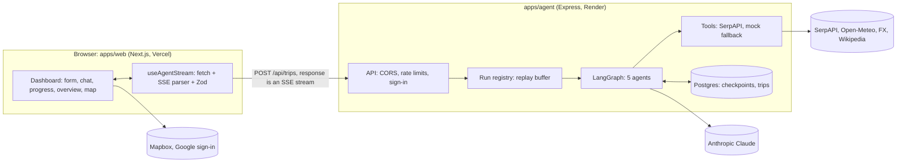
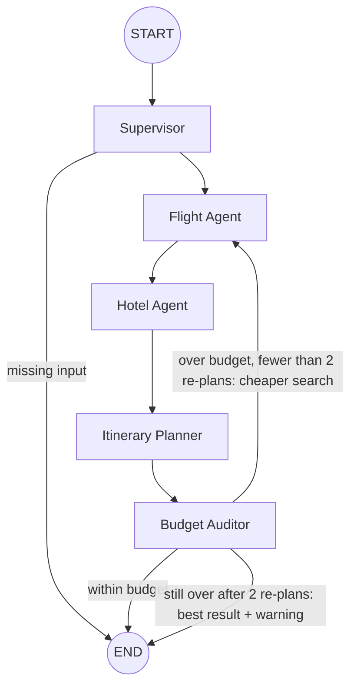

# AI Travel Planner: Project Overview

A high-level description of the project as built: what it does, how the frontend, backend and agents fit together,
how they talk, and the rules for changing them. Details live in the code; this file only says where to look.

- Where this file and the code disagree, the code is right: fix this file in the same PR.
- [`ARCHITECTURE.md`](./ARCHITECTURE.md) is the longer design narrative (why things are the way they are).
- The visual design is the two PNGs at the repo root (`design-agents-planning.png`, `design-trip-overview.png`).
  **The design wins over this document** for anything visual.
- `docs/archive/` holds finished tickets. History only.

---

## 1. Product

The traveller describes a trip in one sentence ("5 days in Paris from Tashkent in mid-November, $2,500 all-in.
Museums and good food.") and five AI agents plan it live in the browser. The page shows a plain-language agent chat
with "Confirmed" decisions, a progress bar, and a Trip Overview that fills in as the agents decide: budget, flight,
hotel, map and day by day. A destination bar shows the place, live weather, the currency rate and local time.

Runs survive dropped connections (reconnect and replay) and server restarts (resume from the last checkpoint).
Optional Google sign-in keeps "My trips" per account; each account gets a limited number of plans.
Single traveller, USD only, English only.

---

## 2. System overview



**The browser talks to the agent directly**, never through a Next.js route handler: a run is a long-lived stream and
a Vercel function would cut it off. The agent is a public, CORS-restricted, rate-limited API that holds every secret.

**A run, step by step**

1. The form sends `POST /api/trips` with a `TripRequest`. The agent validates it again, creates a `threadId` and
   opens an SSE response.
2. The run belongs to the **run registry**, not to the HTTP request. Each finished agent produces packets
   (logs, chat messages, the trip so far, progress) that are numbered, kept in a replay buffer and sent to every
   subscriber.
3. At the end the agent sends one `RESULT` packet, saves the trip and closes the stream.
4. If the connection drops, the run keeps going. The browser reconnects with `Last-Event-ID` and the agent replays
   what it missed. If a run fails, `POST /api/trips/:id/resume` continues from its last checkpoint.

---

## 3. Repository layout

pnpm workspaces + Turborepo, Node 24, TypeScript strict, Zod at every boundary.

| Path | What |
| --- | --- |
| `apps/agent` | Backend `ai-travel-agent`: Express 5 + LangGraph. `agent/` (graph, nodes, run registry), `tools/` (travel data), `routes/`, `middlewares/`, `storage/`, `config.ts` |
| `apps/web` | Frontend `ai-travel-web`: Next.js 16, React 19, Tailwind v4, shadcn/ui. `app/`, `components/`, `hooks/`, `lib/` |
| `packages/contracts` | `@ai-travel/contracts`: the Zod schemas and types both apps share (trip, SSE packets, errors, trip context) |
| `docs/archive`, `scripts`, `.github` | Finished tickets, the hard-coded-data check, CI (lint, typecheck, build) |

---

## 4. Backend: `apps/agent`

- **Boot** (`server.ts`): validate env (`config.ts` is the only reader of `process.env`), create the tools, the
  checkpointer, the graph, the trip store and the registry, then listen. On shutdown, running runs are aborted with a
  "Server restarting, resume to continue" result.
- **API** (`routes/`): start, resume, stream, cancel, read and delete trips; "My trips"; trip context (destination
  bar); place suggestions; usage; Google sign-in. All behind helmet, CORS (`WEB_ORIGIN` only) and per-IP rate limits.
- **Run registry** (`agent/runRegistry.ts`, `runTrip.ts`): owns live runs, turns graph updates into packets, keeps the
  replay buffer, saves finished trips.
- **LLM** (`agent/llm.ts`): Claude Opus 5.5 with Sonnet 5.5 as the fallback (Sonnet first for the Planner's many
  small calls). Structured output only, validated with Zod.
- **Tools** (`tools/`): flights, hotels and place checks from SerpAPI; weather, rates, photos and city suggestions from
  keyless services. Without a key, or when a provider fails, a deterministic mock engine answers.
- **Persistence**: Postgres for LangGraph checkpoints, finished trips and plan usage; in memory without
  `DATABASE_URL`.
- **Identity**: guests are a random owner id (`X-Owner-Id`); with Google sign-in the agent verifies the Google ID token
  and issues its own session token. A trip belonging to an account answers `404` to anyone else.

---

## 5. The agents: LangGraph workflow



**The LLM is used only where language is needed** (reading the prompt, planning days, choosing transfer modes, a
preference pick). Searching, ranking and the audit are deterministic code. Tools are called by code, never by the
model. Every node returns only the state keys it changes; routers are pure; each loop has a counter and a maximum.

| Agent | What it does |
| --- | --- |
| **Supervisor** | Extracts origin, destination, days, budget, dates, pace and interests from the sentence. Never invents a budget or duration; missing input ends the run with a message asking for it |
| **Flight Agent** | Searches round trips, filters and scores them (price, flying time, stops, layovers), shortlists five. Google lists outbound legs only, so it runs a second search for the real return leg |
| **Hotel Agent** | Searches hotels and ranks them on price, rating, distance to the centre and transit. Nights = days − 1 (the last day is the departure day) |
| **Itinerary Planner** | Works out free hours from the flight times, picks airport transfers (the model chooses the mode, prices come from a per-city baseline), reads the per-day forecast, and plans each day. Every stop is checked on Google Maps for existence and opening hours; rejected ones go back to the model once, then are dropped |
| **Budget Auditor** | Pure code: flight + hotel × nights + transfers + daily expenses × days on the ground. Over budget it sends the trip back for a cheaper search, at most twice, then returns the best result with a warning and two ready fixes (raise the budget, try one day less) |

**Days without activities.** A day spent on the plane before an overnight flight lands is a "travel day" with no
places, no weather and no daily spend. Any other day that ends up empty (late arrival, early departure, failed place
checks) carries a `note` that says why, so the UI never shows a blank day without an explanation.

**Chat.** `logs` are technical; `messages` are the friendly chat. Chat text is built by code from the state, never by
the LLM. A message with a `decision` is a "Confirmed" decision (`trip`, `flight`, `hotel`, `transfers`, `itinerary`,
`budget`). There is no user approval step.

---

## 6. Frontend: `apps/web`

- **Pages**: `/` (the planner dashboard, also `/?trip=<id>` to reopen a trip), `/trips` (My trips), `/auth/google`
  (receives the Google sign-in on phones). Server Components by default; `'use client'` only for the dashboard and
  interactive pieces.
- **Data**: one hook, `useAgentStream`, sends the request, parses the SSE stream with `lib/sse.ts`, validates every
  packet with the contracts schema, and reconnects with `Last-Event-ID`. Components are presentational and never
  derive business values; they display what the agents decided.
- **Screens**: start form, live run (chat, progress, technical log), finished Trip Overview (budget breakdown,
  flight with transfers, hotel, day-by-day timeline, map), My trips, destination bar.
- **Maps**: Mapbox GL with a public URL-restricted token; a schematic SVG map without one.
- **Sign-in**: Google Identity Services (popup on desktop, redirect on phones). The session token lives in
  `localStorage`.
- **UI-only mode**: without `NEXT_PUBLIC_AGENT_URL` the app builds and shows the form but cannot plan.
- **Design**: the "Departure board" design system on shadcn `base-nova`. Must work at 375 px with 44 px touch targets.

---

## 7. How frontend and backend communicate

All types come from `@ai-travel/contracts`; the same schemas validate on both sides.

**Start a run** with `POST /api/trips` (JSON body). The response is a standard SSE stream, read with `fetch` (not
`EventSource`, which cannot POST a body or send `Authorization`). Other calls are plain JSON:
`GET /api/trips` (My trips), `GET /api/trips/:id` and `/record` (a stored trip and its chat), `POST …/resume`,
`GET …/stream` (follow or reconnect), `POST …/cancel`, `DELETE …`, `GET /api/trip-context`, `GET /api/places`,
`GET /api/usage`, `POST /api/auth/google`, `GET /health` and `/readyz`.

**Packets** (`id: n` + `data: {type, payload}`; one `RESULT` is always the last):

| Type | Meaning | Used for |
| --- | --- | --- |
| `LOG` | Technical log line | Technical log, banners |
| `MESSAGE` | Friendly chat message, optionally a "Confirmed" decision | Agent chat |
| `DRAFT` | The trip so far (merged by the client) | Live Trip Overview, destination bar |
| `PROGRESS` | Percent, phase, "Day 4 of 5", re-plan pass | Progress card |
| `RESULT` | The final trip, or `failed` with an error | Final Trip Overview |

**Errors.** Before the stream opens, errors are JSON `{ error: { code, message } }` with codes
`VALIDATION_ERROR | UNAUTHORIZED | NOT_FOUND | CONFLICT | RATE_LIMITED | INTERNAL`. After it opens, an error is a
`RESULT { status: "failed" }` and the checkpoint stays so the run can be resumed.

**Reconnect.** The registry keeps each run's packets for a few minutes. The browser reconnects with `Last-Event-ID`
and ignores packets it already has, so nothing is duplicated. The same stream lets a browser follow a run it did not
start (a link or "My trips" opened mid-run).

---

## 8. Resiliency and security

Every external call has a **timeout, a fallback and a `source` field**, so a vendor outage never fails a run: the UI
shows "Estimate" or hides the chip.

| Failure | Result |
| --- | --- |
| LLM error or invalid output | Retry, then the other model; both fail: the run fails but can be resumed |
| SerpAPI error or no key | Retry, then the mock engine, a warning and "Estimate" badges (`TOOLS_MODE=live` fails instead of guessing) |
| Place check, forecast, FX, photos fail | The stop is kept as "Hours not checked", or the field is `null` and the chip is hidden |
| Client disconnects | The run keeps going; reconnect replays the gap |
| Run too long (120 s), server restart | The run ends as failed; resume continues from the checkpoint |
| Abuse or LLM bill | Per-IP run limits, a per-account plan allowance, small request bodies, sign-in required when configured |

**Security.** Secrets live only on the agent. CORS allows only `WEB_ORIGIN`; env is validated on boot. User text
reaches the model only through strict output schemas, and tools are called by code, so a prompt cannot trigger a tool.
The owner id is a bearer-like secret and is only revealed through "Copy link for another device".

---

## 9. Configuration, local development and deployment

**Configuration.** The agent reads env only in `apps/agent/src/config.ts` (see `apps/agent/.env.example`); the web
app only in `lib/env.ts` and `next.config.ts` (see `apps/web/.env.example`). Only `ANTHROPIC_API_KEY` is required to
run locally. Production also needs `NODE_ENV=production`, `WEB_ORIGIN` and `DATABASE_URL`.

| Group | Variables |
| --- | --- |
| Agent core | `ANTHROPIC_API_KEY`, `ANTHROPIC_MODEL`, `ANTHROPIC_FALLBACK_MODEL`, `WEB_ORIGIN`, `DATABASE_URL` |
| Travel data | `SERPAPI_API_KEY`, `TAVILY_API_KEY` (optional), `TOOLS_MODE` (`auto` / `live` / `mock`) |
| Sign-in | `GOOGLE_CLIENT_ID` + `SESSION_SECRET` (agent), `NEXT_PUBLIC_GOOGLE_CLIENT_ID` (web) |
| Limits | `RUN_TIMEOUT_MS`, `RATE_LIMIT_*`, `USER_MAX_RUNS` |
| Web | `NEXT_PUBLIC_AGENT_URL`, `NEXT_PUBLIC_MAPBOX_TOKEN`, `NEXT_PUBLIC_SHOW_TECH_LOG`, `WEB_PORT` (dev, default 55360) |

**Local development.**

```bash
pnpm install
cp apps/agent/.env.example apps/agent/.env      # set ANTHROPIC_API_KEY
cp apps/web/.env.example apps/web/.env.local    # optional
pnpm dev                                        # contracts (watch) + agent + web
```

The web dev server is on `http://localhost:55360`, the agent on `4000`; put `WEB_ORIGIN=http://localhost:55360` in
`apps/agent/.env`. Without `SERPAPI_API_KEY` everything runs on the mock engine. Local Postgres: `docker compose up -d`
in `apps/agent`. Checks: `pnpm lint`, `pnpm typecheck`, `pnpm build`.

**Deployment.** Web on Vercel (root `apps/web`, see [`apps/web/DEPLOY.md`](./apps/web/DEPLOY.md)); agent and Postgres on
Render. CI runs lint, typecheck, build and the hard-coded-data check on every PR. Point Render's health check at
`/health` and an external monitor at `/readyz`.

**Run exactly one agent instance.** The run registry, replay buffers, rate limits and caches are in process memory; a
second instance would not find the first one's runs. Scaling out needs a shared store first (§12).

---

## 10. Engineering rules

- Cross-service types come only from `@ai-travel/contracts`. A packet or result change goes into the contracts first,
  then both apps in the same PR; a change that would break a stored result bumps `RESULT_SCHEMA_VERSION` and adds an
  `upgradeResultPayload` step.
- Every new external API gets a timeout, a fallback and a `source` field (§8).
- Agent: every packet goes through `SseStreamer.send`; routers are pure; chat text comes from `agent/messages.ts`,
  never the LLM; a run never depends on its HTTP connection; throw `AppError`.
- Web: no business logic, no hard-coded trip data (CI checks it), no secrets, no calls from the browser except the
  agent, Mapbox and Google; shadcn/ui primitives before custom ones.
- Before calling a change done: `pnpm lint && pnpm typecheck` (and `pnpm build` for the web app).
- If code changes behaviour described here, update this file in the same PR. Match surrounding code; no drive-by
  refactors. One ticket = one branch = one PR.
- Design check: for UI work or any change to packets, `DRAFT` or `RESULT`, open both design PNGs and report mismatches
  (the `design-check` skill).

---

## 11. Key decisions

| Decision | Reason |
| --- | --- |
| Claude Opus 5.5 primary, Sonnet 5.5 fallback | Both worked in every live run; Sonnet first keeps the Planner fast and cheap |
| LLM only for language; search, ranking and audit are code | Cheaper, faster, deterministic |
| Transfer prices and daily spend from a per-city baseline | The same trip always costs the same; no unchecked fares from the model |
| Hotel nights = days − 1 | The last day is the departure day |
| One Planner call per day, 4 in parallel | The Planner was 40 of 44 seconds of a run |
| POST + fetch stream, not `EventSource` | `EventSource` cannot POST a body or send `Authorization` |
| Runs outlive connections; replay with `Last-Event-ID` | Network changes and sleeping tabs must not lose a run |
| Chat text built by code; no user approval step | No extra LLM cost; the planner stays fully automatic |
| One agent instance, in-memory registry | Simple; a shared store comes before scaling out |
| Optional Google sign-in; guests keep an anonymous owner id | "My trips" across devices without forcing accounts |
| Per-account plan allowance plus per-IP caps | A public LLM endpoint needs a spending ceiling |
| The traveller does not swap individual picks | A swap costs about one re-plan; steer with the prompt, the fields and the over-budget actions |

---

## 12. Open work

Only what is not done. When an item is done, delete it here.

| Area | Item | Why |
| --- | --- | --- |
| Agent | Live verification with real keys, a Render deploy and the production Postgres | The recent changes were checked with mock tools only |
| Agent | Retention: delete checkpoints and trips older than 30 days | Both grow forever |
| Agent | Dollar cost per run | The run summary logs tokens, not money |
| Agent | Shared run store (before a second instance) | Registry, replay buffer and rate limits are per process |
| Web | Mobile boards detail pass and a live check on a phone | Usable at 375 px, not yet matched to the Mobile boards or tried in iOS Safari |
| Both | Automated tests | The suite was removed (#40); CI runs lint, typecheck and build only |
