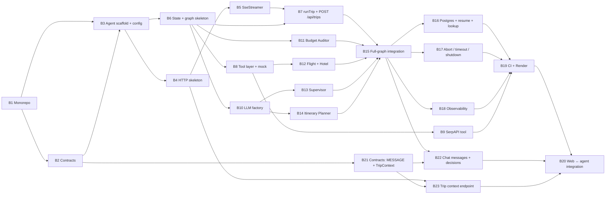

# ai-travel-agent — Backend Technical Specification

> All paths below are relative to `apps/agent/`.
> System-wide design (graph, SSE protocol, contracts, deploy) is in [`../../ARCHITECTURE.md`](../../ARCHITECTURE.md);
> this file specifies how the agent service implements it.

---

## 1. Responsibilities

- Expose the trip API over HTTP and stream progress as typed SSE packets: technical `LOG`s, friendly
  `MESSAGE`s (some flagged as confirmed decisions), `PROGRESS` and one `RESULT`.
- Serve the web top bar: `GET /api/trip-context` returns the destination's weather and USD exchange rate.
- Run the 5-node LangGraph workflow with checkpointing, bounded re-planning and fallbacks.
- Own every secret and every external call (Anthropic, SerpAPI, Tavily, Open-Meteo, the exchange-rate API, PostgreSQL).
- Validate everything that crosses a boundary with Zod: env, request bodies, LLM outputs, outgoing packets.

Package name `ai-travel-agent`, ESM (`"type": "module"`), Node.js LTS, Express 5.

---

## 2. Folder structure

```text
apps/agent/
├── src/
│   ├── agent/
│   │   ├── state.ts               # Annotation.Root state, reducers, initial state
│   │   ├── graph.ts               # StateGraph wiring, routers, checkpointer, compile()
│   │   ├── llm.ts                 # + ChatAnthropic factory with Opus 5.5 → Sonnet 5.5 fallback
│   │   ├── runTrip.ts             # + maps graph stream → SSE packets (stream controller)
│   │   ├── messages.ts            # + pure builders for friendly chat messages (§8.5)
│   │   └── nodes/
│   │       ├── supervisor.node.ts
│   │       ├── flight.node.ts
│   │       ├── hotel.node.ts
│   │       ├── planner.node.ts
│   │       └── budget.node.ts
│   ├── tools/
│   │   ├── types.ts               # + TravelSearchTool interface, query types, ToolUnavailableError
│   │   ├── serpApi.tool.ts        # live SerpAPI implementation
│   │   ├── mockTravel.tool.ts     # deterministic offline implementation
│   │   ├── index.ts               # + withFallback(primary, mock) + tool selection by TOOLS_MODE
│   │   ├── weather.ts             # + Open-Meteo geocoding + current weather (§10.1)
│   │   ├── exchangeRate.ts        # + USD → destination currency rate (§10.1)
│   │   ├── currencies.ts          # + country code → ISO 4217 table (§10.1)
│   │   └── tripContext.ts         # + lookupTripContext(): geocode → weather ∥ rate, cached (§10.1)
│   ├── middlewares/
│   │   ├── errorHandler.ts        # global error → JSON (pre-stream only)
│   │   └── rateLimiter.ts         # express-rate-limit instances
│   ├── utils/
│   │   ├── sseStreamer.ts         # SSE writer, validates every packet with SseEventSchema
│   │   ├── errors.ts              # + AppError + error codes
│   │   ├── ttlCache.ts            # + tiny in-process TTL cache for the trip-context lookups
│   │   └── logger.ts              # + structured JSON logger
│   ├── app.ts                     # + createApp(deps): middlewares + routes, no listen (supertest)
│   ├── server.ts                  # boot: loadConfig → createApp → listen, graceful shutdown
│   └── config.ts                  # Zod-validated env
├── test/                          # Vitest unit + integration tests
├── .env.example                   # every variable from §4
├── package.json                   # name: ai-travel-agent
├── tsconfig.json                  # extends ../../tsconfig.base.json, NodeNext, src + test (typecheck)
├── tsconfig.build.json            # src only → dist/
└── eslint.config.js               # @eslint/js + typescript-eslint, Node globals
```

Files marked `+` are not in the blueprint tree; see ARCHITECTURE.md §15 for why they exist.

---

## 3. Dependencies

| Package | Purpose |
| --- | --- |
| `@ai-travel/contracts` (`workspace:*`) | Shared Zod schemas & types — the only source of cross-service types |
| `express` (v5) | HTTP server; v5 forwards rejected async handlers to the error handler |
| `cors`, `helmet` | CORS allow-list, security headers |
| `express-rate-limit` | Per-IP throttling |
| `@langchain/langgraph` | `StateGraph`, `Annotation`, `MemorySaver`, `START`/`END` |
| `@langchain/langgraph-checkpoint-postgres` | `PostgresSaver` for production |
| `@langchain/anthropic`, `@langchain/core` | `ChatAnthropic`, `withStructuredOutput`, `withFallbacks` |
| `zod` (`catalog:`) | Validation |
| `dotenv` | Load `apps/agent/.env` in development (`loadDotenv({ quiet: true })` inside `loadConfig()`) |
| dev: `typescript`, `tsx`, `vitest`, `supertest` | Build, watch mode, tests |

Scripts:

```json
{
  "dev": "tsx watch src/server.ts",
  "build": "tsc -p tsconfig.build.json",
  "start": "node dist/server.js",
  "test": "vitest run",
  "typecheck": "tsc --noEmit",
  "lint": "eslint ."
}
```

---

## 4. Configuration — `src/config.ts`

`parseConfig(env)` is a pure Zod parser (unit-tested); `loadConfig()` loads `.env`, parses `process.env`,
prints the issues and `process.exit(1)` on failure. `server.ts` calls `loadConfig()` once and **injects** the
typed `Config` (`createApp({ config, … })`, later `buildGraph`, `runTrip`), so importing a module never
triggers env parsing. Nothing outside `config.ts` reads `process.env`.

Blank values (`KEY=` copied from `.env.example`) count as unset. `WEB_ORIGIN` entries are normalised to
origins (`https://x.com/` → `https://x.com`) because CORS compares them to the browser's `Origin` exactly.

| Variable | Type / default | Notes |
| --- | --- | --- |
| `NODE_ENV` | `development \| test \| production`, default `development` | |
| `PORT` | int; default `CONDUCTOR_PORT + 1` if set, else `4000` | Render sets `PORT` |
| `CONDUCTOR_PORT` | int, optional | Conductor workspace base port |
| `WEB_ORIGIN` | comma-separated URLs; default `http://localhost:${CONDUCTOR_PORT ?? 3000}` | CORS allow-list |
| `ANTHROPIC_API_KEY` | string, **required** | |
| `ANTHROPIC_MODEL` | default `claude-opus-5-5` | Primary model |
| `ANTHROPIC_FALLBACK_MODEL` | default `claude-sonnet-5-5` | Fallback model |
| `SERPAPI_API_KEY` | string, optional | Missing → mock tools in `auto` mode |
| `TAVILY_API_KEY` | string, optional | Optional place research for the planner |
| `TOOLS_MODE` | `auto \| live \| mock`, default `auto` | `auto` = live if key present, else mock; tests use `mock` |
| `DATABASE_URL` | URL, optional | Present → `PostgresSaver`, else `MemorySaver` |
| `RUN_TIMEOUT_MS` | int, default `120000` | Whole-run timeout |
| `RATE_LIMIT_WINDOW_MS` | int, default `900000` (15 min) | |
| `RATE_LIMIT_MAX_RUNS` | int, default `10` | Max trip runs per IP per window |
| `LANGSMITH_TRACING`, `LANGSMITH_API_KEY` | optional | LangGraph tracing |

Cross-field rules: in `production`, `WEB_ORIGIN` must be set explicitly (no localhost default);
`TOOLS_MODE=live` requires `SERPAPI_API_KEY`; `LANGSMITH_TRACING=true` requires `LANGSMITH_API_KEY`;
`DATABASE_URL` must be a `postgres://` / `postgresql://` URL.

---

## 5. HTTP layer — `src/server.ts`

### 5.1 Middleware order

1. `app.set('trust proxy', 1)` — Render sits behind one proxy; rate limiting needs the client IP.
2. `helmet()`
3. `cors({ origin: config.WEB_ORIGIN, methods: ['GET', 'POST'], exposedHeaders: ['X-Thread-Id'] })`
4. `express.json({ limit: '10kb' })`
5. `generalLimiter` on all `/api` routes; `runLimiter` additionally on the two run-starting routes
6. Routes
7. 404 handler → `AppError('NOT_FOUND')`
8. `errorHandler` (last)

**Do not add `compression()`** — it buffers the response and breaks SSE.

### 5.2 Routes

| Route | Behaviour |
| --- | --- |
| `GET /health` | `200 { status: "ok" }`. No rate limit. |
| `POST /api/trips` | `TripRequestSchema.safeParse(body)`; invalid → `400 VALIDATION_ERROR`. Otherwise `threadId = crypto.randomUUID()`, open SSE, call `runTrip({ threadId, request })`. |
| `POST /api/trips/:threadId/resume` | `threadId` must be a UUID and have a checkpoint (`graph.getState`), else `404`. If the run already reached `END` (`state.next` is empty), send its `RESULT` and close. Otherwise open SSE and call `runTrip({ threadId, resume: true })`. |
| `GET /api/trips/:threadId` | Latest checkpoint → `ResultPayload` JSON, `404` if unknown. Used by the web app after a reload. |
| `GET /api/trip-context?destination=…` | `TripContextQuerySchema.safeParse(query)`; invalid → `400 VALIDATION_ERROR`. `lookupTripContext` (§10.1) → `TripContext` JSON; destination not found → `404 NOT_FOUND`. Plain JSON, no SSE, behind `generalLimiter` only. |

### 5.3 Errors — `utils/errors.ts`, `middlewares/errorHandler.ts`

```typescript
type ErrorCode = 'VALIDATION_ERROR' | 'NOT_FOUND' | 'RATE_LIMITED' | 'INTERNAL';
class AppError extends Error { constructor(public code: ErrorCode, message: string, public status: number) }
```

- Response shape: `{ "error": { "code": "...", "message": "..." } }`. `ZodError` → `400` with the
  flattened issues in `message`; unknown errors → `500 INTERNAL` with a generic message (stack only in logs).
- Body-parser errors keep the code set small: malformed JSON → `400 VALIDATION_ERROR`, body over 10 kb →
  `413 VALIDATION_ERROR`.
- **If `res.headersSent` is true (stream already open), the error handler must not write JSON.**
  Stream errors are handled inside `runTrip` (§7) — the handler only logs and ends the response.

### 5.4 Rate limiting — `middlewares/rateLimiter.ts`

| Limiter | Scope | Limit |
| --- | --- | --- |
| `generalLimiter` | `/api/*` | 100 requests / minute / IP |
| `runLimiter` | `POST /api/trips`, `POST /api/trips/:id/resume` | `RATE_LIMIT_MAX_RUNS` / `RATE_LIMIT_WINDOW_MS` / IP |

Use `standardHeaders: 'draft-7'`, `legacyHeaders: false`, and a handler that responds with the
standard error shape and code `RATE_LIMITED` (`429`). In-memory store is acceptable for a single
Render instance; switch to a shared store (e.g. Redis) before scaling horizontally.

### 5.5 Startup & shutdown

- Boot: validate config → create checkpointer (`PostgresSaver.fromConnString(url)` + `await setup()`) →
  compile graph → `listen(config.PORT)`.
- `SIGTERM`/`SIGINT`: stop accepting connections, abort all active runs (their streams end with
  `RESULT failed: "Server restarting, resume to continue"`), close the Postgres pool, exit within 10 s.
  The checkpoint makes these runs resumable.

---

## 6. SSE writer — `src/utils/sseStreamer.ts`

```typescript
class SseStreamer {
  constructor(res: Response);
  open(threadId: string): void;   // headers + flushHeaders() + start heartbeat
  send(event: SseEvent): void;    // SseEventSchema.parse → "id: n\ndata: <json>\n\n"
  close(): void;                  // stop heartbeat, res.end()
  get isClosed(): boolean;        // client gone or closed by us
}
```

- Headers: `Content-Type: text/event-stream; charset=utf-8`, `Cache-Control: no-cache, no-transform`,
  `Connection: keep-alive`, `X-Accel-Buffering: no`, `X-Thread-Id: <threadId>`.
- Heartbeat: write `: ping\n\n` every 15 s.
- `send` validates with `SseEventSchema.parse`. A validation failure is a server bug: it throws, and
  `runTrip` turns it into a failed `RESULT`.
- `send` after close is a no-op (never throws on a closed socket).
- Progress monotonicity is enforced here: a `PROGRESS` with a lower percent than the last one sent is
  raised to the last value.

---

## 7. Stream controller — `src/agent/runTrip.ts`

```typescript
async function runTrip(args: {
  graph: CompiledTravelGraph;
  streamer: SseStreamer;
  threadId: string;
  request?: TripRequest;   // new run
  resume?: boolean;        // continue from last checkpoint
  signal: AbortSignal;     // client disconnect
}): Promise<void>;
```

1. `streamer.open(threadId)`; send `PROGRESS { 5, "parsing" }`.
2. `const signal = AbortSignal.any([clientAbort, AbortSignal.timeout(config.RUN_TIMEOUT_MS)])`.
   `clientAbort` comes from an `AbortController` aborted on `res.on('close')` when the response did not finish.
3. Input: new run → `initialState(request)`; resume → `null`.
4. `for await (const chunk of graph.stream(input, { configurable: { thread_id: threadId }, streamMode: 'updates', recursionLimit: 20, signal }))`
   - `chunk` is `{ [nodeName]: partialUpdate }`.
   - For each entry in `partialUpdate.logs ?? []` → `LOG` packet (these are only the node's new logs).
   - Then for each entry in `partialUpdate.messages ?? []` → `MESSAGE` packet (`text`, `decision`, same `step`).
   - Then `PROGRESS` from the table in ARCHITECTURE.md §6.3, keyed by node name and the update's `status`.
5. After the loop: `const { values } = await graph.getState(config)` → send `RESULT` built from `values`
   (`status: values.status === 'failed' ? 'failed' : 'completed'`), then `streamer.close()`.
6. `catch`:
   - Aborted by client → just close (nobody is listening); log `outcome=aborted`.
   - Timeout or any other error → send `LOG { agent: "System", level: "error" }` and
     `RESULT { status: "failed", error: <safe message>, ... }` built from the latest checkpoint (partial
     data is fine), then close. Never leak stack traces or API keys in `error`.

---

## 8. LangGraph implementation

### 8.1 State — `src/agent/state.ts`

```typescript
import { Annotation } from '@langchain/langgraph';
import type { Flight, Hotel, ItineraryDay, TripStatus, AgentName, TripRequest, DecisionTopic } from '@ai-travel/contracts';

export interface LogEntry { timestamp: string; agent: AgentName; message: string; step: number; level: 'info' | 'warn' | 'error' }
export interface ChatMessage { timestamp: string; agent: AgentName; text: string; step: number; decision: DecisionTopic | null }

const replace = <T>(fallback: () => T) => Annotation<T>({ reducer: (_prev, next) => next, default: fallback });
const append = <T>() => Annotation<T[]>({ reducer: (prev, next) => prev.concat(next), default: () => [] });

export const TravelAgentStateAnnotation = Annotation.Root({
  prompt: replace<string>(() => ''),
  overrides: replace<Omit<TripRequest, 'prompt'>>(() => ({})),
  origin: replace<string | null>(() => null),
  destination: replace<string>(() => ''),
  budget: replace<number>(() => 0),
  durationDays: replace<number>(() => 0),
  startDate: replace<string | null>(() => null),

  flights: replace<Flight[]>(() => []),
  hotels: replace<Hotel[]>(() => []),
  itinerary: replace<ItineraryDay[]>(() => []),
  dailyExpensesEstimate: replace<number>(() => 0),

  totalCost: replace<number>(() => 0),
  retryCount: replace<number>(() => 0),
  searchMode: replace<'standard' | 'cheaper'>(() => 'standard'),
  overBudgetBy: replace<number>(() => 0),
  status: replace<TripStatus>(() => 'parsing'),
  error: replace<string | null>(() => null),
  warnings: append<string>(),
  logs: append<LogEntry>(),
  messages: append<ChatMessage>(),
});

export type TravelAgentState = typeof TravelAgentStateAnnotation.State;
export type TravelAgentUpdate = typeof TravelAgentStateAnnotation.Update;
export const MAX_BUDGET_RETRIES = 2;
```

Helpers in the same file: `initialState(request)`, `nextStep(state)` (= last log's `step` + 1, or 1),
`log(state, agent, message, level?)` that builds a `LogEntry` with the current ISO timestamp, and
`say(state, agent, text, decision?)` that builds a `ChatMessage` the same way (`decision` defaults to `null`).

### 8.2 Graph — `src/agent/graph.ts`

```typescript
export function buildGraph(deps: { checkpointer: BaseCheckpointSaver; tools: TravelSearchTool; llm: LlmFactory }) {
  return new StateGraph(TravelAgentStateAnnotation)
    .addNode('supervisorAgent', supervisorNode(deps), { retryPolicy: { maxAttempts: 2 } })
    .addNode('flightAgent', flightNode(deps))
    .addNode('hotelAgent', hotelNode(deps))
    .addNode('itineraryPlanner', plannerNode(deps), { retryPolicy: { maxAttempts: 2 } })
    .addNode('budgetAuditor', budgetNode)
    .addEdge(START, 'supervisorAgent')
    .addConditionalEdges('supervisorAgent', routeAfterSupervisor, ['flightAgent', END])
    .addEdge('flightAgent', 'hotelAgent')
    .addConditionalEdges('hotelAgent', routeAfterHotel, ['itineraryPlanner', 'budgetAuditor'])
    .addEdge('itineraryPlanner', 'budgetAuditor')
    .addConditionalEdges('budgetAuditor', routeAfterAudit, ['flightAgent', END])
    .compile({ checkpointer: deps.checkpointer });
}

export const routeAfterSupervisor = (s: TravelAgentState) => (s.status === 'failed' ? END : 'flightAgent');
export const routeAfterHotel      = (s: TravelAgentState) => (s.itinerary.length > 0 ? 'budgetAuditor' : 'itineraryPlanner');
export const routeAfterAudit      = (s: TravelAgentState) => (s.status === 'searching' ? 'flightAgent' : END);
```

- Routers are **pure** and only read state; all decisions and counters are written by nodes.
- Dependencies are injected (`buildGraph(deps)`) so tests can pass a fake LLM and mock tools.
- Node names must never equal a state key (LangGraph throws at compile time).

### 8.3 Node contract

Every node is `(state: TravelAgentState) => Promise<TravelAgentUpdate>` and:

- returns **only** the keys it changes, including its own `logs` (1–3 entries, same `step`) and, where §8.5
  says so, `messages` (0–4 entries, same `step`);
- never mutates `state`;
- throws only for unrecoverable errors (after its own fallbacks), which ends the run as `failed` and
  leaves the previous checkpoint intact for resume;
- uses `AgentName` values from contracts in logs: `Supervisor`, `FlightAgent`, `HotelAgent`,
  `ItineraryPlanner`, `BudgetAuditor`.

### 8.4 Nodes

**`supervisor.node.ts` — Supervisor** (LLM)
- Structured output schema: `{ origin: string | null, destination: string | null, budget: number | null, durationDays: number | null, startDate: string | null }`.
- System prompt: extract trip parameters only; never invent a budget or duration; return `null` when absent.
- Merge: request `overrides` win over parsed values. Default `startDate` = today + 30 days.
- Missing `destination`, `budget` or `durationDays` after merge → `{ status: 'failed', error: 'Please include …' }`
  with a `warn` log. This is a user-input failure, not a crash (the graph ends normally, `RESULT` has `status: failed`).
- Success → `status: 'searching'`, log e.g. `Planning 5 days in Paris from Tashkent, budget $1,000.`
- Messages: success → decision `trip` ("Got it — 5 days in Paris from Tashkent on a $1,000 budget."); failure → an ordinary
  message asking for the missing details.

**`flight.node.ts` — Flight Agent** (no LLM)
- `tools.searchFlights({ origin, destination, departDate, returnDate, mode: searchMode, maxPrice })`.
  `returnDate = startDate + durationDays`. In `cheaper` mode `maxPrice = flights[0].price` (exclusive).
- Sort ascending by price. In `cheaper` mode, if nothing cheaper came back, keep the previous `flights`
  and log `No cheaper flight found, keeping $500 option.`
- Log e.g. `Found a $500 flight on the Tashkent -> Paris route.` Fallback to mock → extra `warn` log and
  a `warnings` entry.
- Message (ordinary): `I found 4 flights — the best option is Uzbekistan Airways at $500.` Mock data adds
  "Live prices weren't available, so these are estimates." Never a decision (the Budget Auditor confirms it).

**`hotel.node.ts` — Hotel Agent** (no LLM)
- `tools.searchHotels({ destination, checkIn, checkOut, mode, maxPricePerNight })`.
- Ordering: among hotels with `rating >= 3.5`, cheapest first; if none qualify, cheapest overall. `[0]` is selected.
- Hotel cost = `hotels[0].pricePerNight × durationDays` (blueprint formula).
- Same "never more expensive in cheaper mode" rule as flights.
- `status`: `planning` if `itinerary` is empty, else `auditing`.
- Message (ordinary): `Hotel Lumière looks like a good fit: $80 a night, rated 4.5.` Never a decision.

**`planner.node.ts` — Itinerary Planner** (LLM)
- Structured output: `{ dailyExpensesEstimate: number, days: ItineraryDay[] }`, validated with
  `ItineraryDaySchema` from contracts; exactly `durationDays` days, `day` = 1..N, 2–5 places per day.
- Prompt asks for real, well-known places with accurate coordinates near the destination, and a
  realistic per-day spend (food, local transport, entry fees) in USD for one traveller.
- Post-validation: drop places whose coordinates are more than ~100 km from the day's median point
  (hallucination guard); if a day ends up empty, keep the title and an empty `places` array.
- Optional: when `TAVILY_API_KEY` is set, fetch top attractions first and pass them as context.
- `status: 'auditing'`.
- Message: decision `itinerary` ("Your 5-day plan is ready: Eiffel Tower, Louvre and more.") — a re-plan skips this node, so it is never repeated.

**`budget.node.ts` — Budget Auditor** (pure, no I/O)
- `computeTotalCost(state)` exported separately for unit tests; round to 2 decimals.
- Applies the three conditions from ARCHITECTURE.md §4.3:
  - ≤ budget → `{ status: 'completed', totalCost }`, log `Total $900 fits the $1,000 budget.`
  - over & `retryCount < MAX_BUDGET_RETRIES` → `{ status: 'searching', retryCount: +1, searchMode: 'cheaper', overBudgetBy, totalCost }`,
    log `Over budget by $120, re-planning (attempt 1/2).`
  - over & retries exhausted → `{ status: 'completed', totalCost, warnings: ['Budget exceeded by $120'] }`, `warn` log.
- Messages: re-plan → one ordinary message ("That comes to $1,150, which is $150 over budget. Let me look for cheaper options (attempt 1 of 2).").
  Conditions 1 and 3 → three decisions in order: `flight`, `hotel`, `budget` ("Total $940 — within your $1,000 budget." /
  "Best I could do is $1,080, $80 over budget."); condition 3 adds an ordinary "This is the cheapest combination I could find." first.

### 8.5 Chat messages — `src/agent/messages.ts`

`logs` stay technical; `messages` are the friendly stream for the chat panel (ARCHITECTURE.md §4.6).

- Pure functions `(state-derived values) => string`, one per message in the ARCHITECTURE.md §4.6 table. Nodes
  call them through `say(state, agent, text, decision?)`. **Never ask the LLM to write chat text** — no extra tokens, deterministic tests.
- All money goes through one `formatUsd()` helper; English only.
- A message with `decision: <topic>` is a **confirmed decision**: only emit it when no later node can change
  that choice. Flight and hotel are therefore confirmed by the Budget Auditor, never by the search nodes, so a
  re-plan never contradicts an earlier decision. Do not add a "superseded" concept.
- Messages are live-only: they are not part of `ResultPayload` and are not replayed by `GET /api/trips/:threadId`.

---

## 9. LLM layer — `src/agent/llm.ts`

```typescript
export interface LlmFactory {
  structured<T extends z.ZodType>(schema: T, name: string): Runnable<BaseMessageLike[], z.infer<T>>;
}
```

- Primary: `new ChatAnthropic({ model: config.ANTHROPIC_MODEL, maxRetries: 2, timeout: 30_000 })`.
- Fallback: same with `config.ANTHROPIC_FALLBACK_MODEL`.
- `primary.withStructuredOutput(schema, { name }).withFallbacks([fallback.withStructuredOutput(schema, { name })])`.
- Do not set `temperature` / `top_p` / `top_k`: Claude Opus 5.5 and Sonnet 5.5 reject non-default sampling values (HTTP 400).
  Thinking cannot be disabled on Opus 5.5 and its effort defaults to `medium`; forced `tool_choice` (`any` / `tool`) is also a 400,
  so structured output must use the API's JSON-schema output format, not a forced tool call (verify in the B2 spike).
- Structured outputs require every field to be present; model optional values as `nullable()`,
  not `optional()`.
- When the fallback model answers, add a `warn` log (`Primary model unavailable, used claude-sonnet-5-5`).
- Tests inject a fake factory returning canned objects — no network calls in tests.

---

## 10. Tool layer — `src/tools/`

```typescript
// types.ts
export interface FlightQuery { origin: string; destination: string; departDate: string; returnDate: string; mode: 'standard' | 'cheaper'; maxPrice?: number }
export interface HotelQuery  { destination: string; checkIn: string; checkOut: string; mode: 'standard' | 'cheaper'; maxPricePerNight?: number }
export interface TravelSearchTool {
  readonly name: 'serpapi' | 'mock';
  searchFlights(q: FlightQuery, signal?: AbortSignal): Promise<Flight[]>;
  searchHotels(q: HotelQuery, signal?: AbortSignal): Promise<Hotel[]>;
}
export class ToolUnavailableError extends Error {}
```

**`serpApi.tool.ts`**
- Google Flights (`engine=google_flights`, round trip, `currency=USD`) and Google Hotels
  (`engine=google_hotels`) via `fetch`.
- City → airport code: try the city name first; keep a small lookup map for common cities as a fallback.
- Per request `AbortSignal.timeout(10_000)` combined with the run signal.
- Retry 2× on network errors, `429` and `5xx` with exponential backoff (500 ms, 1500 ms) + jitter; no retry on `4xx`.
- Map responses through `FlightSchema` / `HotelSchema` (`source: 'serpapi'`); drop items that fail parsing.
- Zero valid results or exhausted retries → `ToolUnavailableError`.

**`mockTravel.tool.ts`**
- Deterministic: prices derived from a hash of `origin + destination + date`, so tests are stable.
- Returns 3–5 flights and 3–5 hotels with `source: 'mock'`; `cheaper` mode returns options at least
  15% below `maxPrice` when one is given.
- Small artificial delay (≈300 ms, `0` when `NODE_ENV=test`) so the UI stream looks realistic.

**`index.ts`**
- `withFallback(primary, mock, onFallback)` → a `TravelSearchTool` that catches `ToolUnavailableError`
  (and timeouts) from the primary, calls `onFallback(reason)` and retries on the mock.
- `createTravelTool(config)`: `mock` → mock; `live` → SerpAPI (fails hard); `auto` → SerpAPI with mock fallback
  if `SERPAPI_API_KEY` is set, otherwise mock.
- Nodes call tools directly in code. Tools are **not** exposed to the LLM for tool-calling.

### 10.1 Trip context lookup (top bar) — `tools/tripContext.ts`

Not part of the graph and not a `TravelSearchTool`: a standalone service behind `GET /api/trip-context`
(ARCHITECTURE.md §7.1). No API keys and no new env variables; the TTLs are constants in the tool modules.

```typescript
export async function lookupTripContext(destination: string, deps: { fetch: typeof fetch; mode: 'live' | 'mock'; now: () => Date }): Promise<TripContext>;
```

- **Geocode** (`weather.ts`): Open-Meteo geocoding → `{ name, country, countryCode, lat, lng }`; no match → `AppError('NOT_FOUND')`.
- **Weather** (`weather.ts`): current temperature and weather code → `{ temperatureC, condition, icon }` through one
  code → label/icon table.
- **Exchange rate** (`exchangeRate.ts` + `currencies.ts`): `countryCode` → ISO 4217 via the static table, then USD →
  currency. Unknown country, a USD destination, or a failed call → `null`.
- Weather and rate run in parallel with `Promise.allSettled`; each call has `AbortSignal.timeout(5_000)` and one
  retry on network / 429 / 5xx. A rejected call becomes `null` for that field — the lookup itself still resolves.
- `utils/ttlCache.ts`, keyed by the normalised destination (trim, lower-case, collapsed spaces): geocode 24 h,
  weather 30 min, rate 6 h. Failures are never cached.
- **No mock fallback on failure** — a made-up temperature or rate would look real. `mode: 'mock'`
  (`TOOLS_MODE=mock`) returns fixed fixtures with `source: 'mock'` for tests and e2e.
- Provider hosts are constants; `destination` is always `encodeURIComponent`-ed. The final value is parsed with
  `TripContextSchema` before it is sent.

---

## 11. Persistence

- `config.DATABASE_URL` set → `PostgresSaver.fromConnString(url)`; call `await checkpointer.setup()` on boot
  (idempotent, creates tables).
- Not set → `new MemorySaver()` (dev/test only; log a warning at boot in `production`).
- Retention: checkpoints are small; add a periodic cleanup of threads older than 30 days once in production.
- `GET /api/trips/:threadId` and resume both use `graph.getState({ configurable: { thread_id } })`.

---

## 12. Logging

- Structured JSON to stdout: `{ level, msg, threadId, node, durationMs, fallback, outcome }`.
- One line per HTTP request and one summary line per run (`outcome: completed | failed | aborted | timeout`,
  `retryCount`, `llmFallbackUsed`, `toolFallbackUsed`, `totalMs`).
- Never log API keys, full prompts in production (log the length), or raw third-party responses.

---

## 13. Testing

| File | What it proves |
| --- | --- |
| `test/budget.node.test.ts` | Cost formula; condition 1, 2 (retry increments, `searchMode='cheaper'`), 3 (warning, stops) |
| `test/graph.routes.test.ts` | Each router for every relevant status / itinerary combination |
| `test/nodes/*.test.ts` | Supervisor merge + missing-field failure; flight/hotel sorting and "never more expensive" rule; planner day count + coordinate guard |
| `test/tools.test.ts` | SerpAPI mapping from fixture JSON; retry on 429/5xx; fallback to mock and `onFallback` call |
| `test/runTrip.test.ts` | Full run with `MemorySaver`, fake LLM, mock tools: packets parse with `SseEventSchema`, exactly one `RESULT`, progress monotonic, over-budget scenario loops twice then warns; `MESSAGE` packets follow their node's `LOG`s, and a completed run confirms `trip, itinerary, flight, hotel, budget` once each |
| `test/resume.test.ts` | Inject a failure in `itineraryPlanner`, assert `RESULT failed`, resume → completes without re-running supervisor/flight/hotel |
| `test/server.test.ts` | supertest: 400 on bad body, 429 on limit, CORS headers incl. `X-Thread-Id` exposure, `/health` |
| `test/messages.test.ts` | Exact text per message builder, USD rounding |
| `test/tripContext.test.ts` | Stubbed `fetch`: weather-only / rate-only failure, USD destination, unknown country, unknown city → 404, cache hit and no failure caching, timeout → `null`; route `400`/`404`/`200` shapes |

No test may hit Anthropic or SerpAPI. Use `TOOLS_MODE=mock` and the fake `LlmFactory`.

---

## 14. Rules for working in this package

- Import shared types from `@ai-travel/contracts`; never redefine `Flight`, `Hotel`, `ItineraryDay`, SSE packets.
  A contract change goes into `packages/contracts` first, then both apps are updated in the same PR.
- Never read `process.env` outside `config.ts`.
- Every outgoing packet goes through `SseStreamer.send` (validated). Never `res.write` packets by hand.
- Keep routers pure and nodes side-effect free except for their injected tools/LLM.
- Any new loop in the graph must have an explicit counter in state and a max constant.
- Chat text comes from `agent/messages.ts`, never from the LLM; mark a message as a decision only when it can no longer change.
- The trip-context lookup must never fail a run or throw past its route: provider errors become `null` fields, not mock data.
- ESM with `NodeNext`: relative imports use the `.js` extension (`./state.js`).
- Run `pnpm --filter ai-travel-agent test typecheck` before committing.

---

## 15. Implementation plan

> Step-by-step plan for building this service from the spec in §1–§14 and
> [`../../ARCHITECTURE.md`](../../ARCHITECTURE.md). Each ticket is one branch / one PR, small enough to
> review on its own.

---

### Overview

| Milestone | Tickets | Outcome |
| --- | --- | --- |
| **M1 · Foundation** | B1 – B4 | Monorepo, shared contracts, Express app with config, errors, CORS, rate limits and `/health` |
| **M2 · Streaming skeleton** | B5 – B7 | `POST /api/trips` streams real SSE packets from a graph of stub nodes — the web app can switch from its mock agent |
| **M3 · Agent brain** | B8 – B15 | Tools, LLM factory and all five real nodes; full graph runs end to end in tests with no network |
| **M4 · Persistence & resilience** | B16 – B18 | PostgreSQL checkpoints, resume, trip lookup, abort/timeout/shutdown, structured logs |
| **M5 · Ship** | B19 – B20 | CI, Render deploy with Postgres, web app wired to the real agent |
| **M6 · Chat & top bar** | B21 – B23 | Agents send friendly chat messages with confirmed decisions (`MESSAGE` packet); `GET /api/trip-context` serves weather and exchange rate. Land before B20 so the integration pass covers them |

#### Dependency graph



**Parallel work:** after B7 is merged, B8, B10 and B11 can start at the same time in separate
Conductor workspaces. After B8 and B10, B9 / B12 / B13 / B14 touch separate files and can also run
in parallel.

**Why a stub graph first (B6–B7):** the riskiest parts of the backend are the streaming plumbing
(SSE headers, heartbeats, packet validation, progress mapping) and the graph wiring (routers,
re-plan loop, checkpointer). Building them with stub nodes that return canned data proves the whole
pipe end to end on day 3, gives the frontend a real server to talk to, and lets each real node later
replace its stub without touching anything else.

**Shared with the web plan:** B1 and B2 are the same work as web T1 and T2
([`../web/CLAUDE.md`](../web/CLAUDE.md) §12). They landed on `main` through the web branch (PR #1), so the
backend builds on that setup. Shared files follow the ownership rules in ARCHITECTURE.md §12.6.

#### Definition of done (every ticket)

- `pnpm --filter ai-travel-agent typecheck lint test` passes (and `build` from B3 on).
- Cross-service types come only from `@ai-travel/contracts`; `process.env` is read only in `src/config.ts`.
- No test calls Anthropic, SerpAPI, Tavily or a real database (fake `LlmFactory`, `TOOLS_MODE=mock`, `MemorySaver`).
- Relative imports use the `.js` extension (ESM + `NodeNext`).
- New behaviour has tests as listed in the ticket.
- If the implementation has to deviate from the spec in §1–§14, update the spec in the same PR.

Size: **S** ≈ half a day · **M** ≈ 1 day · **L** ≈ 2 days.

#### Status

| Ticket | Status |
| --- | --- |
| B1 – B2 | ✅ Done as web T1 / T2 (PR #1); the Zod 4 ↔ LangChain check from B2 was done here |
| B3 – B4 | ✅ Done |
| B5 – B20 | ⬜ Not started |
| B21 – B23 | ⬜ Not started (specified in ARCHITECTURE.md §4.6, §5.2–§5.3, §7.1) |

---

### M1 · Foundation

#### B1 — Monorepo foundation · S

**Goal:** one `pnpm install` and `pnpm dev` at the repo root (ARCHITECTURE.md §12). *Same as web T1.*

**Depends on:** —

**Tasks**
- Root `package.json` (`private`, `packageManager: pnpm@<exact>`, scripts `dev/build/test/typecheck/lint` → `turbo run …`, `turbo` dev dependency).
- `pnpm-workspace.yaml` with `apps/*`, `packages/*` and the `catalog` (`typescript`, `zod`, `vitest`).
- `turbo.json` and `tsconfig.base.json` exactly as in ARCHITECTURE.md §12.2.
- `.gitignore` (`node_modules`, `dist`, `.next`, `.turbo`, `.env*` except `.env.example`), `.nvmrc` (Node LTS, ≥ 20 for `AbortSignal.any`).
- Conductor setup script `pnpm install`, run script `pnpm dev`.

**Acceptance**
- Fresh clone → `pnpm install` succeeds; `pnpm build` runs. Lockfile committed.

---

#### B2 — Shared contracts package (`@ai-travel/contracts`) · M

**Goal:** the single source of cross-service types (ARCHITECTURE.md §5). *Same as web T2.*

**Depends on:** B1

**Tasks**
- `packages/contracts/package.json`: name `@ai-travel/contracts`, `"type": "module"`, `exports` → `dist/index.js` + `.d.ts`, scripts `build: tsc`, `dev: tsc --watch`, `test`, `typecheck`.
- `src/trip.ts`, `src/sse-events.ts`, `src/index.ts` exactly as in §5.1 / §5.2.
- **Zod 4 check:** confirm the pinned `zod` version works with `@langchain/core` / `@langchain/anthropic` `withStructuredOutput` (a 10-line spike is enough). If not, pin the catalog to a compatible version now — both apps depend on this choice.
- Tests: blueprint example packets parse; malformed packets rejected (wrong `type`, missing fields, percent > 100, bad coordinates, non-UUID `threadId`); `TripRequestSchema` bounds.

**Acceptance**
- `pnpm --filter @ai-travel/contracts build test` passes; `dist/` contains JS + `.d.ts`.

---

#### B3 — Agent scaffold + validated config · M

**Goal:** an empty `ai-travel-agent` that builds, starts on the right port and refuses bad env (§1–§4).

**Depends on:** B1, B2

**Tasks**
- `apps/agent/package.json`: name `ai-travel-agent`, `"type": "module"`, dependencies and scripts from §3, `@ai-travel/contracts: workspace:*`.
- `tsconfig.json` extending the base with `module`/`moduleResolution: NodeNext`, `outDir: dist`.
- ESLint flat config (`typescript-eslint`), Vitest config (`environment: node`, `NODE_ENV=test`).
- `src/config.ts`: Zod schema for every variable in §4 — `PORT` derived from `CONDUCTOR_PORT + 1` / 4000, `WEB_ORIGIN` comma list with the localhost default (required in `production`), `TOOLS_MODE`, `RUN_TIMEOUT_MS`, rate-limit values, optional keys. Print issues and `process.exit(1)` on failure. Export a pure `parseConfig(env)` for tests.
- `.env.example` with every variable and a one-line comment each.
- Placeholder `src/server.ts` that logs the port and listens.
- Tests: `test/config.test.ts` — defaults, `CONDUCTOR_PORT` derivation, `PORT` wins, `WEB_ORIGIN` list parsing, production without `WEB_ORIGIN` fails, missing `ANTHROPIC_API_KEY` fails.

**Acceptance**
- `pnpm dev` from the root starts the agent on `$CONDUCTOR_PORT + 1` (or 4000) next to the web app.
- `pnpm --filter ai-travel-agent build typecheck lint test` passes; `node dist/server.js` starts.

---

#### B4 — HTTP skeleton: middlewares, errors, `/health` · M

**Goal:** the Express app with everything except the trip routes (§5.1, §5.3, §5.4).

**Depends on:** B3

**Tasks**
- Split `server.ts` into `createApp(deps)` (pure, testable with supertest) and a `main()` that boots and listens.
- Middleware order from §5.1: `trust proxy`, `helmet`, `cors` (allow-list + `exposedHeaders: ['X-Thread-Id']`), `express.json({ limit: '10kb' })`, limiters, routes, 404, `errorHandler`. No `compression()`.
- `utils/errors.ts`: `AppError`, `ErrorCode`, helpers (`notFound()`, `validation(zodError)`).
- `middlewares/errorHandler.ts`: standard JSON shape; `ZodError` → 400; unknown → 500 generic; if `res.headersSent`, only log and end.
- `middlewares/rateLimiter.ts`: `generalLimiter` (100/min) and `runLimiter` (config values), `draft-7` headers, `429 RATE_LIMITED` body.
- `GET /health` (no rate limit).
- Tests: `test/server.test.ts` — `/health`, unknown route 404 shape, CORS allowed vs. rejected origin, `X-Thread-Id` in `Access-Control-Expose-Headers`, body > 10 kb rejected, 429 after the limit (with a low test limit).

**Acceptance**
- `curl /health` → `{"status":"ok"}`; all error responses use the standard shape.

---

### M2 · Streaming skeleton

#### B5 — `SseStreamer` · S

**Goal:** the only way packets reach the wire (§6, ARCHITECTURE.md §6.1).

**Depends on:** B4

**Tasks**
- `utils/sseStreamer.ts`: `open(threadId)` (headers incl. `X-Accel-Buffering: no` and `X-Thread-Id`, `flushHeaders()`, 15 s `: ping` heartbeat), `send(event)` (`SseEventSchema.parse` → `id: n\ndata: <json>\n\n`), `close()`, `isClosed`.
- Progress monotonicity enforced in `send`; `send` after close is a no-op; listens to `res.on('close')` to mark closed.
- Heartbeat interval injectable (or use fake timers) for tests.
- Tests: `test/sseStreamer.test.ts` — headers, wire format, sequence ids, invalid packet throws, lower progress raised, heartbeat written, no write after close.

**Acceptance**
- Output of a test stream parses back with `SseEventSchema` packet by packet.

---

#### B6 — State, graph wiring and stub nodes · M

**Goal:** the real `StateGraph` with real routers and loop, running on placeholder nodes (§8.1–§8.3).

**Depends on:** B3

**Tasks**
- `agent/state.ts`: `TravelAgentStateAnnotation` (replace / append reducers), `MAX_BUDGET_RETRIES`, `initialState(request)`, `nextStep(state)`, `log(state, agent, message, level?)`.
- `agent/graph.ts`: `buildGraph(deps)` with the five nodes, edges and the three pure routers exactly as in §8.2; `retryPolicy` on supervisor and planner; export `CompiledTravelGraph` type.
- `createCheckpointer(config)` returning `MemorySaver` for now (Postgres in B16).
- Stub node factories in `agent/nodes/*.node.ts` that return canned, contract-valid data and logs — each later ticket replaces one stub.
- Tests: `test/graph.routes.test.ts` — every router for every relevant status / itinerary combination; `test/state.test.ts` — reducers (logs/warnings append, others replace), `nextStep` across re-plans; a compile test proving no node name collides with a state key.

**Acceptance**
- `graph.invoke(initialState(req), { configurable: { thread_id } })` with stubs reaches `END` with `status: 'completed'`.

---

#### B7 — `runTrip` stream controller + `POST /api/trips` · M

**Goal:** a real SSE stream from the API, end to end (§5.2, §7; ARCHITECTURE.md §6.3).

**Depends on:** B5, B6

**Tasks**
- `agent/runTrip.ts`: open stream, `PROGRESS 5/parsing`, `graph.stream(..., { streamMode: 'updates', recursionLimit: 20, signal })`, node logs → `LOG` packets, node + status → `PROGRESS` per the §6.3 table, final `getState` → exactly one `RESULT`, close.
- `buildResultPayload(threadId, values)` as a separate pure function (reused by B16's `GET /api/trips/:id`).
- Error path: `System` error `LOG` + `RESULT failed` built from the latest checkpoint; safe error messages only (no stack, no keys). Client-abort path: just close.
- `POST /api/trips`: validate with `TripRequestSchema` → 400; `threadId = crypto.randomUUID()`; `runLimiter`; client-disconnect `AbortController` wired to `res.on('close')`.
- Tests: `test/runTrip.test.ts` (stub graph) — every packet parses, exactly one `RESULT` and it is last, progress monotonic and ends at 100, a node that throws ends in `RESULT failed`; supertest: 400 on bad body, `X-Thread-Id` header present.

**Acceptance**
- `curl -N -X POST localhost:4000/api/trips -H 'content-type: application/json' -d '{"prompt":"5 days in Paris"}'` prints a valid stream.
- The web app's `useAgentStream` (web T7) works against this server, not only against its mock.

---

### M3 · Agent brain

#### B8 — Tool layer + mock travel engine · M

**Goal:** a `TravelSearchTool` the nodes can call, working fully offline (§10).

**Depends on:** B6

**Tasks**
- `tools/types.ts`: `FlightQuery`, `HotelQuery`, `TravelSearchTool`, `ToolUnavailableError`.
- `tools/mockTravel.tool.ts`: deterministic prices from a hash of the query, 3–5 flights / 3–5 hotels, `source: 'mock'`, `cheaper` mode ≥ 15% below `maxPrice`, ~300 ms delay (0 in tests), respects `signal`.
- `tools/index.ts`: `withFallback(primary, mock, onFallback)`, `createTravelTool(config)` for `mock | live | auto` (SerpAPI slot throws "not implemented" until B9).
- Tests: `test/tools.test.ts` — determinism, schema validity of every result, cheaper-mode bound, fallback calls `onFallback` and returns mock data, `TOOLS_MODE` selection.

**Acceptance**
- All mock output parses with `FlightSchema` / `HotelSchema`.

---

#### B9 — SerpAPI tool (live flights & hotels) · L

**Goal:** real prices from Google Flights / Google Hotels with safe degradation (§10).

**Depends on:** B8

**Tasks**
- `tools/serpApi.tool.ts`: `engine=google_flights` (round trip, `currency=USD`) and `engine=google_hotels` via `fetch`.
- City → airport code: city name first, small lookup map for common cities as fallback (incl. Tashkent `TAS`).
- `AbortSignal.any([run signal, AbortSignal.timeout(10_000)])`; retry 2× on network / 429 / 5xx with 500 ms → 1500 ms backoff + jitter; no retry on other 4xx.
- Map items through `FlightSchema` / `HotelSchema` with `source: 'serpapi'`; drop items that fail; zero valid items → `ToolUnavailableError`.
- Record real responses once (keys stripped) as fixtures in `test/fixtures/serpapi/`.
- Tests: mapping from fixtures, retry/backoff (fake timers + mocked `fetch`), no retry on 400, timeout → `ToolUnavailableError`, `auto` mode falls back to mock.
- Manual check: one live call with a real key, documented in the PR.

**Acceptance**
- With `SERPAPI_API_KEY` set and `TOOLS_MODE=auto`, a run returns `source: 'serpapi'` options; with a bad key it falls back to mock with a warning.

---

#### B10 — LLM factory + fake factory · S

**Goal:** one place that builds structured-output models with fallback (§9).

**Depends on:** B6

**Tasks**
- `agent/llm.ts`: `LlmFactory.structured(schema, name, opts?)` → primary `ChatAnthropic` (`maxRetries: 2`, `timeout: 30_000`; no `temperature`) `.withStructuredOutput(schema, { name })` `.withFallbacks([fallback…])`.
- Report which model answered (so nodes can add the "used claude-sonnet-5-5" `warn` log) — e.g. return `{ data, model }` or expose an `onFallback` callback.
- `test/helpers/fakeLlm.ts`: fake factory returning canned objects per schema name, with an option to throw (for fallback/failure tests).
- Tests: fallback is used when the primary throws (with fake chat models), strict-schema helper rejects `optional()` fields.

**Acceptance**
- No node constructs `ChatAnthropic` directly; everything goes through `LlmFactory`.

---

#### B11 — Budget Auditor node · S

**Goal:** the deterministic cost check and re-plan decision (§8.4, ARCHITECTURE.md §4.3).

**Depends on:** B6

**Tasks**
- `agent/nodes/budget.node.ts`: export `computeTotalCost(state)` (2-decimal rounding) and `budgetNode`.
- The three conditions with the exact state updates and log texts from the spec; `MAX_BUDGET_RETRIES` from `state.ts`.
- Replace the B6 stub.
- Tests: `test/budget.node.test.ts` — formula, exact-budget boundary, condition 1, condition 2 (retry++ / `searchMode: 'cheaper'` / `overBudgetBy`), condition 3 (warning text, stops), no I/O.

**Acceptance**
- 100% branch coverage of `budget.node.ts`.

---

#### B12 — Flight Agent + Hotel Agent nodes · M

**Goal:** search, sort and select flights and hotels, honouring cheaper mode (§8.4).

**Depends on:** B8

**Tasks**
- `flight.node.ts`: build `FlightQuery` (`returnDate = startDate + durationDays`), `maxPrice` in cheaper mode, sort ascending, keep previous selection if nothing cheaper, fallback warning + `warnings` entry.
- `hotel.node.ts`: `checkIn/checkOut`, rating ≥ 3.5 preference, cheapest-first, same "never more expensive" rule, `status` `planning` vs `auditing`.
- Shared date helper (`addDays(isoDate, n)`) with tests.
- Replace the B6 stubs.
- Tests: `test/nodes/flight.node.test.ts`, `test/nodes/hotel.node.test.ts` — sorting, rating rule, cheaper mode never increases price, "keeping $X option" log, fallback warning, `step` numbering.

**Acceptance**
- Over three rounds against the mock tool, selected flight and hotel prices never go up.

---

#### B13 — Supervisor node · M

**Goal:** turn free text into a structured trip, safely (§8.4, ARCHITECTURE.md §9).

**Depends on:** B10

**Tasks**
- Structured schema (all fields `nullable`), system prompt: extract only, never invent budget/duration.
- Merge: request overrides win; default `startDate` = today + 30 days (clock injectable for tests); reject past dates.
- Missing `destination`, `budget` or `durationDays` → `status: 'failed'`, user-friendly `error` ("Please include …"), `warn` log — graph ends normally.
- Success log e.g. `Planning 5 days in Paris from Tashkent, budget $1,000.`
- Replace the B6 stub.
- Tests: `test/nodes/supervisor.node.test.ts` (fake LLM) — overrides win, each missing field, default date, fallback-model `warn` log.
- Manual eval: 10 sample prompts (EN + a few with typos / mixed currency) against the real model, results pasted in the PR.

**Acceptance**
- A prompt without a budget ends the run with `RESULT failed` and a helpful message, not a crash.

---

#### B14 — Itinerary Planner node · L

**Goal:** a day-by-day plan with real coordinates and a daily spend estimate (§8.4).

**Depends on:** B10

**Tasks**
- Structured schema `{ dailyExpensesEstimate, days: ItineraryDay[] }` (strict-compatible version of the contract schema).
- Prompt: real well-known places, accurate coordinates, 2–5 places per day, realistic USD per-day spend for one traveller.
- Post-validation: exactly `durationDays` days numbered 1..N (fail → treat as model failure → fallback), drop places > ~100 km from the day's median point (haversine helper).
- Optional Tavily context when `TAVILY_API_KEY` is set (top attractions passed into the prompt; skipped silently on error).
- Replace the B6 stub.
- Tests: `test/nodes/planner.node.test.ts` — day count, renumbering/rejection, coordinate guard drops outliers and keeps empty days, Tavily on/off with a fake client.
- Manual eval: 3 destinations (Paris, Tokyo, Samarkand) against the real model; spot-check coordinates on a map.

**Acceptance**
- Planner output always passes `ItineraryDaySchema` and the guard.

---

#### B15 — Full-graph integration tests · M

**Goal:** prove the real graph behaves as the architecture says, with no network (§13).

**Depends on:** B7, B11, B12, B13, B14

**Tasks**
- `test/runTrip.test.ts` with the real nodes, fake LLM, mock tools, `MemorySaver`:
  - happy path within budget — node order, packet sequence, progress 5 → 100, `RESULT completed`;
  - over budget — two re-plans that skip `itineraryPlanner`, then completed with `Budget exceeded by $X`;
  - becomes affordable on retry 1 — stops after one re-plan;
  - supervisor input failure — `RESULT failed` with the user message;
  - every packet parses with `SseEventSchema`; exactly one `RESULT`; `step` strictly increasing.
- Remove all remaining stub code.

**Acceptance**
- The suite runs in < 10 s and is the regression net for every later ticket.

---

### M4 · Persistence & resilience

#### B16 — PostgreSQL checkpointer, resume and trip lookup · L

**Goal:** runs survive failures and reloads (§5.2, §11; ARCHITECTURE.md §4.5).

**Depends on:** B15

**Tasks**
- `createCheckpointer(config)`: `PostgresSaver.fromConnString(DATABASE_URL)` + `await setup()` on boot; `MemorySaver` otherwise (boot warning in `production`).
- `POST /api/trips/:threadId/resume`: UUID check, 404 if no checkpoint, finished run → send its `RESULT` and close, else `runTrip({ resume: true })`.
- `GET /api/trips/:threadId`: latest checkpoint → `buildResultPayload` JSON, 404 if unknown.
- Local Postgres for development: `docker-compose.yml` (or documented `docker run`) + `.env.example` entry.
- Tests: `test/resume.test.ts` — inject a failure in `itineraryPlanner`, assert `RESULT failed`, resume → completes without re-running supervisor/flight/hotel (spy on nodes); resume of a finished run; 404s; GET lookup shape.
- Optional: one Postgres-backed test behind an env flag (`TEST_DATABASE_URL`), skipped by default.

**Acceptance**
- With Postgres, restarting the server mid-run and calling resume finishes the trip.

---

#### B17 — Abort, timeout and graceful shutdown · M

**Goal:** no wasted LLM/tool spend and no hung streams (ARCHITECTURE.md §8, §5.5, §7).

**Depends on:** B15

**Tasks**
- Client disconnect aborts the graph and in-flight `fetch`/LLM calls (signal threaded into tools and `ChatAnthropic` calls).
- `RUN_TIMEOUT_MS` via `AbortSignal.timeout` → `RESULT failed` "Trip planning took too long, resume to continue".
- Active-run registry; `SIGTERM`/`SIGINT` → stop accepting, abort runs with "Server restarting, resume to continue", close Postgres pool, exit ≤ 10 s.
- Tests: abort mid-run stops further node execution (spy), timeout path with a slow fake node, shutdown sends failed `RESULT` to open streams.

**Acceptance**
- Closing the browser tab mid-run produces no further Anthropic/SerpAPI requests (verified in logs).

---

#### B18 — Observability · S

**Goal:** every run is traceable by `threadId` (§12, ARCHITECTURE.md §10).

**Depends on:** B15

**Tasks**
- `utils/logger.ts`: tiny structured JSON logger (or `pino`) — `{ level, msg, threadId, node, durationMs, … }`. *Spec update: add the file to §2.*
- Request log line per HTTP request; run summary line (`outcome`, `retryCount`, `llmFallbackUsed`, `toolFallbackUsed`, `totalMs`); per-node duration.
- Redaction: never log keys or full prompts in production (length only).
- LangSmith tracing enabled through config (`LANGSMITH_TRACING`, `LANGSMITH_API_KEY`) and documented.
- Tests: summary line fields for completed / failed / aborted runs; redaction.

**Acceptance**
- One grep on a `threadId` shows the full story of a run.

---

### M5 · Ship

#### B19 — CI and Render deployment · M

**Goal:** green CI and a production agent with Postgres (ARCHITECTURE.md §13).

**Depends on:** B9, B16, B17, B18

**Tasks**
- GitHub Actions (shared with web T17 if it exists): pnpm cache, `pnpm install --frozen-lockfile`, `pnpm turbo run lint typecheck test build`.
- Render web service: root = repo root, build/start commands and build filters from §13, health check `/health`, Corepack pnpm version.
- Render Postgres instance; `DATABASE_URL` linked.
- Env vars: `ANTHROPIC_API_KEY`, `SERPAPI_API_KEY`, `WEB_ORIGIN` (production + preview domains), `NODE_ENV=production`, optional Tavily / LangSmith.
- Smoke test after deploy: `/health`, one real trip, one resume.
- `apps/agent/README.md`: run locally, env vars, deploy notes.

**Acceptance**
- Merging to `main` deploys the agent; a real trip from `curl` completes in production.

---

#### B20 — Web ↔ agent integration · S

**Goal:** the deployed frontend talks to the real backend.

**Depends on:** B19, B22, B23 (and web T16/T17/T19/T20)

**Tasks**
- Point Vercel `NEXT_PUBLIC_AGENT_URL` at the Render URL; confirm CORS for production and preview domains.
- Run the web Playwright suite against the real agent with `TOOLS_MODE=mock` and the fake LLM (or a test-only `LLM_MODE=fake` flag — *spec update if added*).
- Retire the web mock agent from previews.

**Acceptance**
- Production: submit a trip in the browser → logs stream → result cards, timeline and map render.

---

### M6 · Chat & top bar

> Two features the original blueprint did not cover: friendly chat messages with confirmed decisions, and
> the weather / exchange-rate lookup for the web top bar. Design: ARCHITECTURE.md §4.6, §5.2–§5.3, §7.1.

#### B21 — Contracts: chat messages and trip context · S

**Goal:** the shared schemas for both features (ARCHITECTURE.md §5.1–§5.3). *Same as web T18.*

**Depends on:** B2

**Tasks**
- `src/trip.ts`: `DecisionTopicSchema` (`trip | flight | hotel | itinerary | budget`) + type.
- `src/sse-events.ts`: `MessagePayloadSchema` (`decision` nullable, default `null`), `MessageEventSchema`, added to the `SseEventSchema` union, `MessagePayload` / `MessageEvent` types.
- `src/trip-context.ts`: `TripContextQuerySchema`, `WeatherSchema`, `ExchangeRateSchema`, `TripContextSchema` + types; re-export from `index.ts`.
- Tests: `MESSAGE` parses with `decision: null` and with each topic, omitted `decision` defaults to `null`, unknown topic / empty `text` rejected; `TripContext` with `null` weather and/or rate parses, bad currency length and non-positive rate rejected, query length bounds.
- Cross-app (ARCHITECTURE.md §12.6): the union gained a member, so the web reducer needs at least a `MESSAGE` case to keep type-checking — do it in the same PR (web T18).

**Acceptance**
- `pnpm --filter @ai-travel/contracts build test` passes; `pnpm typecheck` passes for both apps.

---

#### B22 — Chat messages and confirmed decisions from the nodes · M

**Goal:** every node speaks to the user in plain language, and final choices are flagged (§8.5, ARCHITECTURE.md §4.6).

**Depends on:** B15, B21

**Tasks**
- `agent/state.ts`: `ChatMessage` type, `messages` (append reducer), `say(state, agent, text, decision?)` helper (same `step` rule as `log`).
- `agent/messages.ts`: pure text builders for every message in the ARCHITECTURE.md §4.6 table (money through one `formatUsd`); no LLM involved.
- Update the five nodes to return `messages` next to `logs`; the Budget Auditor emits the `flight`, `hotel` and `budget` decisions only on conditions 1 and 3, never on a re-plan.
- `agent/runTrip.ts`: after a node's `LOG` packets send its `MESSAGE` packets, then `PROGRESS`.
- Tests: `test/messages.test.ts` (exact text per builder, rounding); node tests assert messages and `decision` topics; extend `test/runTrip.test.ts` — `MESSAGE` packets parse, order is `LOG → MESSAGE → PROGRESS` per node, same `step` as the node's logs, happy path emits decisions in the order `trip, itinerary, flight, hotel, budget`, over-budget run emits no flight/hotel decision before the final round, supervisor failure emits no decision.

**Acceptance**
- A completed run's `MESSAGE` packets contain each confirmed topic exactly once; a failed run contains none.

---

#### B23 — Trip context endpoint (weather + exchange rate) · M

**Goal:** `GET /api/trip-context` for the web top bar (§10.1, ARCHITECTURE.md §7.1).

**Depends on:** B4, B21

**Tasks**
- `tools/weather.ts`: Open-Meteo geocoding + current weather; map weather codes to `condition` + `icon`.
- `tools/exchangeRate.ts`: USD → currency rate from the chosen keyless provider (open question 7).
- `tools/currencies.ts`: static country code → ISO 4217 table.
- `utils/ttlCache.ts` + `tools/tripContext.ts`: normalised-destination cache (geocode 24 h, weather 30 min, rate 6 h, failures not cached), `Promise.allSettled` for weather ∥ rate, 5 s timeout and one retry per call.
- Route in `app.ts` behind `generalLimiter`: validate with `TripContextQuerySchema` → `400`; geocode miss → `404 NOT_FOUND`; parse the response with `TripContextSchema` before sending.
- `TOOLS_MODE=mock` returns fixed fixtures with `source: 'mock'`.
- Record provider responses once as fixtures in `test/fixtures/trip-context/`.
- Tests: `test/tripContext.test.ts` with a stubbed `fetch` — happy path, weather-only failure, rate-only failure, USD destination (`exchangeRate: null`), unknown country code, unknown city (`404`), cache hit makes no second call, failure is not cached, timeout → `null`; supertest for `400`/`404`/`200` shapes.
- Manual check: one live call per provider, documented in the PR.

**Acceptance**
- `curl 'localhost:4000/api/trip-context?destination=Paris'` returns a valid `TripContext`; with one provider blocked, the other field is still returned.

---

### Open questions

1. **Model choice** — the spec defaults to `claude-opus-5-5` / `claude-sonnet-5-5`. Confirm these are still the models you want (and still available) before B10, or change the `ANTHROPIC_MODEL` defaults.
2. **Zod 4 vs LangChain** — the B2 spike was run against the OpenAI package; re-run it against `@langchain/anthropic`. It must confirm that `withStructuredOutput` works with Zod 4 **without a forced `tool_choice`** (a 400 on Opus 5.5 / Sonnet 5.5), that `withFallbacks` works, and that malformed output is rejected with a `ZodError`.
3. **Hotel nights** — keep `durationDays` nights (blueprint) or switch to `durationDays - 1` (ARCHITECTURE.md §15)? Affects B11/B12 and the web cards.
4. **SerpAPI plan** — the free tier has a low monthly quota; is mock-only acceptable for previews/staging, with live search only in production?
5. **Render tier** — the free tier sleeps and cold-starts (slow first stream) and its Postgres expires; use a paid instance for production?
6. ~~**Docs on `main`**~~ — resolved: the specs landed on `main` with PR #1.
7. **Exchange-rate provider** — pick one free, keyless API with USD base and coverage of the currencies we care about (UZS in particular; not every ECB-based API lists it). Check its terms (attribution, rate limits) before B23.
8. **Weather scope** — the top bar shows *current* weather at the destination. Do we also want the forecast for `startDate` (Open-Meteo reaches ~16 days ahead)? Affects `WeatherSchema` and B23.
