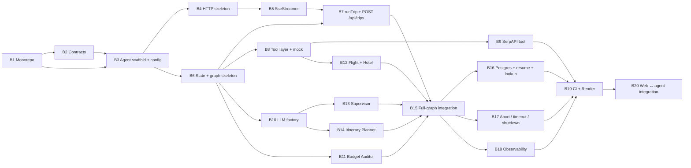

# ai-travel-agent — Implementation Plan

> Step-by-step plan for building the backend described in [`CLAUDE.md`](./CLAUDE.md)
> (agent spec) and [`../../ARCHITECTURE.md`](../../ARCHITECTURE.md) (system design).
> Each ticket is one branch / one PR, small enough to review on its own.

---

## Overview

| Milestone | Tickets | Outcome |
| --- | --- | --- |
| **M1 · Foundation** | B1 – B4 | Monorepo, shared contracts, Express app with config, errors, CORS, rate limits and `/health` |
| **M2 · Streaming skeleton** | B5 – B7 | `POST /api/trips` streams real SSE packets from a graph of stub nodes — the web app can switch from its mock agent |
| **M3 · Agent brain** | B8 – B15 | Tools, LLM factory and all five real nodes; full graph runs end to end in tests with no network |
| **M4 · Persistence & resilience** | B16 – B18 | PostgreSQL checkpoints, resume, trip lookup, abort/timeout/shutdown, structured logs |
| **M5 · Ship** | B19 – B20 | CI, Render deploy with Postgres, web app wired to the real agent |

### Dependency graph

**Parallel work:** after B7 is merged, B8, B10 and B11 can start at the same time in separate
Conductor workspaces. After B8 and B10, B9 / B12 / B13 / B14 touch separate files and can also run
in parallel.

**Why a stub graph first (B6–B7):** the riskiest parts of the backend are the streaming plumbing
(SSE headers, heartbeats, packet validation, progress mapping) and the graph wiring (routers,
re-plan loop, checkpointer). Building them with stub nodes that return canned data proves the whole
pipe end to end on day 3, gives the frontend a real server to talk to, and lets each real node later
replace its stub without touching anything else.

**Shared with the web plan:** B1 and B2 are the same work as web T1 and T2
([`../web/PLAN.md`](../web/PLAN.md)). They landed on `main` through the web branch (PR #1), so the
backend builds on that setup. Shared files follow the ownership rules in ARCHITECTURE.md §12.6.

### Definition of done (every ticket)

- `pnpm --filter ai-travel-agent typecheck lint test` passes (and `build` from B3 on).
- Cross-service types come only from `@ai-travel/contracts`; `process.env` is read only in `src/config.ts`.
- No test calls Anthropic, SerpAPI, Tavily or a real database (fake `LlmFactory`, `TOOLS_MODE=mock`, `MemorySaver`).
- Relative imports use the `.js` extension (ESM + `NodeNext`).
- New behaviour has tests as listed in the ticket.
- If the implementation has to deviate from `CLAUDE.md`, the spec is updated in the same PR.

Size: **S** ≈ half a day · **M** ≈ 1 day · **L** ≈ 2 days.

### Status

| Ticket | Status |
| --- | --- |
| B1 – B2 | ✅ Done as web T1 / T2 (PR #1); the Zod 4 ↔ LangChain check from B2 was done here |
| B3 – B4 | ✅ Done |
| B5 – B20 | ⬜ Not started |

---

## M1 · Foundation

### B1 — Monorepo foundation · S

**Goal:** one `pnpm install` and `pnpm dev` at the repo root (ARCHITECTURE.md §12). *Same as web T1.*

**Depends on:** —

**Tasks**
- Root `package.json` (`private`, `packageManager: pnpm@<exact>`, scripts `dev/build/test/typecheck/lint` → `turbo run …`, `turbo` dev dependency).
- `pnpm-workspace.yaml` with `apps/*`, `packages/*` and the `catalog` (`typescript`, `zod`, `vitest`).
- `turbo.json` and `tsconfig.base.json` exactly as in ARCHITECTURE.md §12.2.
- `.gitignore` (`node_modules`, `dist`, `.next`, `.turbo`, `.env*` except `.env.example`), `.nvmrc` (Node LTS, ≥ 20 for `AbortSignal.any`).
- Conductor setup script `pnpm install`, run script `pnpm dev`.

**Acceptance**
- Fresh clone → `pnpm install` succeeds; `pnpm build` runs. Lockfile committed.

---

### B2 — Shared contracts package (`@ai-travel/contracts`) · M

**Goal:** the single source of cross-service types (ARCHITECTURE.md §5). *Same as web T2.*

**Depends on:** B1

**Tasks**
- `packages/contracts/package.json`: name `@ai-travel/contracts`, `"type": "module"`, `exports` → `dist/index.js` + `.d.ts`, scripts `build: tsc`, `dev: tsc --watch`, `test`, `typecheck`.
- `src/trip.ts`, `src/sse-events.ts`, `src/index.ts` exactly as in §5.1 / §5.2.
- **Zod 4 check:** confirm the pinned `zod` version works with `@langchain/core` / `@langchain/anthropic` `withStructuredOutput` (a 10-line spike is enough). If not, pin the catalog to a compatible version now — both apps depend on this choice.
- Tests: blueprint example packets parse; malformed packets rejected (wrong `type`, missing fields, percent > 100, bad coordinates, non-UUID `threadId`); `TripRequestSchema` bounds.

**Acceptance**
- `pnpm --filter @ai-travel/contracts build test` passes; `dist/` contains JS + `.d.ts`.

---

### B3 — Agent scaffold + validated config · M

**Goal:** an empty `ai-travel-agent` that builds, starts on the right port and refuses bad env (CLAUDE.md §1–§4).

**Depends on:** B1, B2

**Tasks**
- `apps/agent/package.json`: name `ai-travel-agent`, `"type": "module"`, dependencies and scripts from CLAUDE.md §3, `@ai-travel/contracts: workspace:*`.
- `tsconfig.json` extending the base with `module`/`moduleResolution: NodeNext`, `outDir: dist`.
- ESLint flat config (`typescript-eslint`), Vitest config (`environment: node`, `NODE_ENV=test`).
- `src/config.ts`: Zod schema for every variable in CLAUDE.md §4 — `PORT` derived from `CONDUCTOR_PORT + 1` / 4000, `WEB_ORIGIN` comma list with the localhost default (required in `production`), `TOOLS_MODE`, `RUN_TIMEOUT_MS`, rate-limit values, optional keys. Print issues and `process.exit(1)` on failure. Export a pure `parseConfig(env)` for tests.
- `.env.example` with every variable and a one-line comment each.
- Placeholder `src/server.ts` that logs the port and listens.
- Tests: `test/config.test.ts` — defaults, `CONDUCTOR_PORT` derivation, `PORT` wins, `WEB_ORIGIN` list parsing, production without `WEB_ORIGIN` fails, missing `ANTHROPIC_API_KEY` fails.

**Acceptance**
- `pnpm dev` from the root starts the agent on `$CONDUCTOR_PORT + 1` (or 4000) next to the web app.
- `pnpm --filter ai-travel-agent build typecheck lint test` passes; `node dist/server.js` starts.

---

### B4 — HTTP skeleton: middlewares, errors, `/health` · M

**Goal:** the Express app with everything except the trip routes (CLAUDE.md §5.1, §5.3, §5.4).

**Depends on:** B3

**Tasks**
- Split `server.ts` into `createApp(deps)` (pure, testable with supertest) and a `main()` that boots and listens.
- Middleware order from §5.1: `trust proxy`, `helmet`, `cors` (allow-list + `exposedHeaders: ['X-Thread-Id']`), `express.json({ limit: '10kb' })`, limiters, routes, 404, `errorHandler`. No `compression()`.
- `utils/errors.ts`: `AppError`, `ErrorCode`, helpers (`notFound()`, `validation(zodError)`).
- `middlewares/errorHandler.ts`: standard JSON shape; `ZodError` → 400; unknown → 500 generic; if `res.headersSent`, only log and end.
- `middlewares/rateLimiter.ts`: `generalLimiter` (100/min) and `runLimiter` (config values), `draft-7` headers, `429 RATE_LIMITED` body.
- `GET /health` (no rate limit).
- Tests: `test/server.test.ts` — `/health`, unknown route 404 shape, CORS allowed vs. rejected origin, `X-Thread-Id` in `Access-Control-Expose-Headers`, body > 10 kb rejected, 429 after the limit (with a low test limit).

**Acceptance**
- `curl /health` → `{"status":"ok"}`; all error responses use the standard shape.

---

## M2 · Streaming skeleton

### B5 — `SseStreamer` · S

**Goal:** the only way packets reach the wire (CLAUDE.md §6, ARCHITECTURE.md §6.1).

**Depends on:** B4

**Tasks**
- `utils/sseStreamer.ts`: `open(threadId)` (headers incl. `X-Accel-Buffering: no` and `X-Thread-Id`, `flushHeaders()`, 15 s `: ping` heartbeat), `send(event)` (`SseEventSchema.parse` → `id: n\ndata: <json>\n\n`), `close()`, `isClosed`.
- Progress monotonicity enforced in `send`; `send` after close is a no-op; listens to `res.on('close')` to mark closed.
- Heartbeat interval injectable (or use fake timers) for tests.
- Tests: `test/sseStreamer.test.ts` — headers, wire format, sequence ids, invalid packet throws, lower progress raised, heartbeat written, no write after close.

**Acceptance**
- Output of a test stream parses back with `SseEventSchema` packet by packet.

---

### B6 — State, graph wiring and stub nodes · M

**Goal:** the real `StateGraph` with real routers and loop, running on placeholder nodes (CLAUDE.md §8.1–§8.3).

**Depends on:** B3

**Tasks**
- `agent/state.ts`: `TravelAgentStateAnnotation` (replace / append reducers), `MAX_BUDGET_RETRIES`, `initialState(request)`, `nextStep(state)`, `log(state, agent, message, level?)`.
- `agent/graph.ts`: `buildGraph(deps)` with the five nodes, edges and the three pure routers exactly as in §8.2; `retryPolicy` on supervisor and planner; export `CompiledTravelGraph` type.
- `createCheckpointer(config)` returning `MemorySaver` for now (Postgres in B16).
- Stub node factories in `agent/nodes/*.node.ts` that return canned, contract-valid data and logs — each later ticket replaces one stub.
- Tests: `test/graph.routes.test.ts` — every router for every relevant status / itinerary combination; `test/state.test.ts` — reducers (logs/warnings append, others replace), `nextStep` across re-plans; a compile test proving no node name collides with a state key.

**Acceptance**
- `graph.invoke(initialState(req), { configurable: { thread_id } })` with stubs reaches `END` with `status: 'completed'`.

---

### B7 — `runTrip` stream controller + `POST /api/trips` · M

**Goal:** a real SSE stream from the API, end to end (CLAUDE.md §5.2, §7; ARCHITECTURE.md §6.3).

**Depends on:** B5, B6

**Tasks**
- `agent/runTrip.ts`: open stream, `PROGRESS 5/parsing`, `graph.stream(..., { streamMode: 'updates', recursionLimit: 20, signal })`, node logs → `LOG` packets, node + status → `PROGRESS` per the §6.3 table, final `getState` → exactly one `RESULT`, close.
- `buildResultPayload(threadId, values)` as a separate pure function (reused by B16's `GET /api/trips/:id`).
- Error path: `System` error `LOG` + `RESULT failed` built from the latest checkpoint; safe error messages only (no stack, no keys). Client-abort path: just close.
- `POST /api/trips`: validate with `TripRequestSchema` → 400; `threadId = crypto.randomUUID()`; `runLimiter`; client-disconnect `AbortController` wired to `res.on('close')`.
- Tests: `test/runTrip.test.ts` (stub graph) — every packet parses, exactly one `RESULT` and it is last, progress monotonic and ends at 100, a node that throws ends in `RESULT failed`; supertest: 400 on bad body, `X-Thread-Id` header present.

**Acceptance**
- `curl -N -X POST localhost:4000/api/trips -H 'content-type: application/json' -d '{"prompt":"5 days in Paris"}'` prints a valid stream.
- The web app's `useAgentStream` (web T7) works against this server, not only against its mock.

---

## M3 · Agent brain

### B8 — Tool layer + mock travel engine · M

**Goal:** a `TravelSearchTool` the nodes can call, working fully offline (CLAUDE.md §10).

**Depends on:** B6

**Tasks**
- `tools/types.ts`: `FlightQuery`, `HotelQuery`, `TravelSearchTool`, `ToolUnavailableError`.
- `tools/mockTravel.tool.ts`: deterministic prices from a hash of the query, 3–5 flights / 3–5 hotels, `source: 'mock'`, `cheaper` mode ≥ 15% below `maxPrice`, ~300 ms delay (0 in tests), respects `signal`.
- `tools/index.ts`: `withFallback(primary, mock, onFallback)`, `createTravelTool(config)` for `mock | live | auto` (SerpAPI slot throws "not implemented" until B9).
- Tests: `test/tools.test.ts` — determinism, schema validity of every result, cheaper-mode bound, fallback calls `onFallback` and returns mock data, `TOOLS_MODE` selection.

**Acceptance**
- All mock output parses with `FlightSchema` / `HotelSchema`.

---

### B9 — SerpAPI tool (live flights & hotels) · L

**Goal:** real prices from Google Flights / Google Hotels with safe degradation (CLAUDE.md §10).

**Depends on:** B8

**Tasks**
- `tools/serpApi.tool.ts`: `engine=google_flights` (round trip, `currency=USD`) and `engine=google_hotels` via `fetch`.
- City → airport code: city name first, small lookup map for common cities as fallback (incl. Tashkent `TAS`).
- `AbortSignal.any([run signal, AbortSignal.timeout(10_000)])`; retry 2× on network / 429 / 5xx with 500 ms → 1500 ms backoff + jitter; no retry on other 4xx.
- Map items through `FlightSchema` / `HotelSchema` with `source: 'serpapi'`; drop items that fail; zero valid items → `ToolUnavailableError`.
- Record real responses once (keys stripped) as fixtures in `test/fixtures/serpapi/`.
- Tests: mapping from fixtures, retry/backoff (fake timers + mocked `fetch`), no retry on 400, timeout → `ToolUnavailableError`, `auto` mode falls back to mock.
- Manual check: one live call with a real key, documented in the PR.

**Acceptance**
- With `SERPAPI_API_KEY` set and `TOOLS_MODE=auto`, a run returns `source: 'serpapi'` options; with a bad key it falls back to mock with a warning.

---

### B10 — LLM factory + fake factory · S

**Goal:** one place that builds structured-output models with fallback (CLAUDE.md §9).

**Depends on:** B6

**Tasks**
- `agent/llm.ts`: `LlmFactory.structured(schema, name, opts?)` → primary `ChatAnthropic` (`maxRetries: 2`, `timeout: 30_000`; no `temperature`) `.withStructuredOutput(schema, { name })` `.withFallbacks([fallback…])`.
- Report which model answered (so nodes can add the "used claude-sonnet-5-5" `warn` log) — e.g. return `{ data, model }` or expose an `onFallback` callback.
- `test/helpers/fakeLlm.ts`: fake factory returning canned objects per schema name, with an option to throw (for fallback/failure tests).
- Tests: fallback is used when the primary throws (with fake chat models), strict-schema helper rejects `optional()` fields.

**Acceptance**
- No node constructs `ChatAnthropic` directly; everything goes through `LlmFactory`.

---

### B11 — Budget Auditor node · S

**Goal:** the deterministic cost check and re-plan decision (CLAUDE.md §8.4, ARCHITECTURE.md §4.3).

**Depends on:** B6

**Tasks**
- `agent/nodes/budget.node.ts`: export `computeTotalCost(state)` (2-decimal rounding) and `budgetNode`.
- The three conditions with the exact state updates and log texts from the spec; `MAX_BUDGET_RETRIES` from `state.ts`.
- Replace the B6 stub.
- Tests: `test/budget.node.test.ts` — formula, exact-budget boundary, condition 1, condition 2 (retry++ / `searchMode: 'cheaper'` / `overBudgetBy`), condition 3 (warning text, stops), no I/O.

**Acceptance**
- 100% branch coverage of `budget.node.ts`.

---

### B12 — Flight Agent + Hotel Agent nodes · M

**Goal:** search, sort and select flights and hotels, honouring cheaper mode (CLAUDE.md §8.4).

**Depends on:** B8

**Tasks**
- `flight.node.ts`: build `FlightQuery` (`returnDate = startDate + durationDays`), `maxPrice` in cheaper mode, sort ascending, keep previous selection if nothing cheaper, fallback warning + `warnings` entry.
- `hotel.node.ts`: `checkIn/checkOut`, rating ≥ 3.5 preference, cheapest-first, same "never more expensive" rule, `status` `planning` vs `auditing`.
- Shared date helper (`addDays(isoDate, n)`) with tests.
- Replace the B6 stubs.
- Tests: `test/nodes/flight.node.test.ts`, `test/nodes/hotel.node.test.ts` — sorting, rating rule, cheaper mode never increases price, "keeping $X option" log, fallback warning, `step` numbering.

**Acceptance**
- Over three rounds against the mock tool, selected flight and hotel prices never go up.

---

### B13 — Supervisor node · M

**Goal:** turn free text into a structured trip, safely (CLAUDE.md §8.4, ARCHITECTURE.md §9).

**Depends on:** B10

**Tasks**
- Structured schema (all fields `nullable`), system prompt: extract only, never invent budget/duration.
- Merge: request overrides win; default `startDate` = today + 30 days (clock injectable for tests); reject past dates.
- Missing `destination`, `budget` or `durationDays` → `status: 'failed'`, user-friendly `error` ("Please include …"), `warn` log — graph ends normally.
- Success log e.g. `Planning 5 days in Paris from Tashkent, budget $1,000.`
- Replace the B6 stub.
- Tests: `test/nodes/supervisor.node.test.ts` (fake LLM) — overrides win, each missing field, default date, fallback-model `warn` log.
- Manual eval: 10 sample prompts (EN + a few with typos / mixed currency) against the real model, results pasted in the PR.

**Acceptance**
- A prompt without a budget ends the run with `RESULT failed` and a helpful message, not a crash.

---

### B14 — Itinerary Planner node · L

**Goal:** a day-by-day plan with real coordinates and a daily spend estimate (CLAUDE.md §8.4).

**Depends on:** B10

**Tasks**
- Structured schema `{ dailyExpensesEstimate, days: ItineraryDay[] }` (strict-compatible version of the contract schema).
- Prompt: real well-known places, accurate coordinates, 2–5 places per day, realistic USD per-day spend for one traveller.
- Post-validation: exactly `durationDays` days numbered 1..N (fail → treat as model failure → fallback), drop places > ~100 km from the day's median point (haversine helper).
- Optional Tavily context when `TAVILY_API_KEY` is set (top attractions passed into the prompt; skipped silently on error).
- Replace the B6 stub.
- Tests: `test/nodes/planner.node.test.ts` — day count, renumbering/rejection, coordinate guard drops outliers and keeps empty days, Tavily on/off with a fake client.
- Manual eval: 3 destinations (Paris, Tokyo, Samarkand) against the real model; spot-check coordinates on a map.

**Acceptance**
- Planner output always passes `ItineraryDaySchema` and the guard.

---

### B15 — Full-graph integration tests · M

**Goal:** prove the real graph behaves as the architecture says, with no network (CLAUDE.md §13).

**Depends on:** B7, B11, B12, B13, B14

**Tasks**
- `test/runTrip.test.ts` with the real nodes, fake LLM, mock tools, `MemorySaver`:
  - happy path within budget — node order, packet sequence, progress 5 → 100, `RESULT completed`;
  - over budget — two re-plans that skip `itineraryPlanner`, then completed with `Budget exceeded by $X`;
  - becomes affordable on retry 1 — stops after one re-plan;
  - supervisor input failure — `RESULT failed` with the user message;
  - every packet parses with `SseEventSchema`; exactly one `RESULT`; `step` strictly increasing.
- Remove all remaining stub code.

**Acceptance**
- The suite runs in < 10 s and is the regression net for every later ticket.

---

## M4 · Persistence & resilience

### B16 — PostgreSQL checkpointer, resume and trip lookup · L

**Goal:** runs survive failures and reloads (CLAUDE.md §5.2, §11; ARCHITECTURE.md §4.5).

**Depends on:** B15

**Tasks**
- `createCheckpointer(config)`: `PostgresSaver.fromConnString(DATABASE_URL)` + `await setup()` on boot; `MemorySaver` otherwise (boot warning in `production`).
- `POST /api/trips/:threadId/resume`: UUID check, 404 if no checkpoint, finished run → send its `RESULT` and close, else `runTrip({ resume: true })`.
- `GET /api/trips/:threadId`: latest checkpoint → `buildResultPayload` JSON, 404 if unknown.
- Local Postgres for development: `docker-compose.yml` (or documented `docker run`) + `.env.example` entry.
- Tests: `test/resume.test.ts` — inject a failure in `itineraryPlanner`, assert `RESULT failed`, resume → completes without re-running supervisor/flight/hotel (spy on nodes); resume of a finished run; 404s; GET lookup shape.
- Optional: one Postgres-backed test behind an env flag (`TEST_DATABASE_URL`), skipped by default.

**Acceptance**
- With Postgres, restarting the server mid-run and calling resume finishes the trip.

---

### B17 — Abort, timeout and graceful shutdown · M

**Goal:** no wasted LLM/tool spend and no hung streams (ARCHITECTURE.md §8, CLAUDE.md §5.5, §7).

**Depends on:** B15

**Tasks**
- Client disconnect aborts the graph and in-flight `fetch`/LLM calls (signal threaded into tools and `ChatAnthropic` calls).
- `RUN_TIMEOUT_MS` via `AbortSignal.timeout` → `RESULT failed` "Trip planning took too long, resume to continue".
- Active-run registry; `SIGTERM`/`SIGINT` → stop accepting, abort runs with "Server restarting, resume to continue", close Postgres pool, exit ≤ 10 s.
- Tests: abort mid-run stops further node execution (spy), timeout path with a slow fake node, shutdown sends failed `RESULT` to open streams.

**Acceptance**
- Closing the browser tab mid-run produces no further Anthropic/SerpAPI requests (verified in logs).

---

### B18 — Observability · S

**Goal:** every run is traceable by `threadId` (CLAUDE.md §12, ARCHITECTURE.md §10).

**Depends on:** B15

**Tasks**
- `utils/logger.ts`: tiny structured JSON logger (or `pino`) — `{ level, msg, threadId, node, durationMs, … }`. *Spec update: add the file to CLAUDE.md §2.*
- Request log line per HTTP request; run summary line (`outcome`, `retryCount`, `llmFallbackUsed`, `toolFallbackUsed`, `totalMs`); per-node duration.
- Redaction: never log keys or full prompts in production (length only).
- LangSmith tracing enabled through config (`LANGSMITH_TRACING`, `LANGSMITH_API_KEY`) and documented.
- Tests: summary line fields for completed / failed / aborted runs; redaction.

**Acceptance**
- One grep on a `threadId` shows the full story of a run.

---

## M5 · Ship

### B19 — CI and Render deployment · M

**Goal:** green CI and a production agent with Postgres (ARCHITECTURE.md §13).

**Depends on:** B9, B16, B17, B18

**Tasks**
- GitHub Actions (shared with web T17 if it exists): pnpm cache, `pnpm install --frozen-lockfile`, `pnpm turbo run lint typecheck test build`.
- Render web service: root = repo root, build/start commands and build filters from §13, health check `/health`, Corepack pnpm version.
- Render Postgres instance; `DATABASE_URL` linked.
- Env vars: `ANTHROPIC_API_KEY`, `SERPAPI_API_KEY`, `WEB_ORIGIN` (production + preview domains), `NODE_ENV=production`, optional Tavily / LangSmith.
- Smoke test after deploy: `/health`, one real trip, one resume.
- `apps/agent/README.md`: run locally, env vars, deploy notes.

**Acceptance**
- Merging to `main` deploys the agent; a real trip from `curl` completes in production.

---

### B20 — Web ↔ agent integration · S

**Goal:** the deployed frontend talks to the real backend.

**Depends on:** B19 (and web T16/T17)

**Tasks**
- Point Vercel `NEXT_PUBLIC_AGENT_URL` at the Render URL; confirm CORS for production and preview domains.
- Run the web Playwright suite against the real agent with `TOOLS_MODE=mock` and the fake LLM (or a test-only `LLM_MODE=fake` flag — *spec update if added*).
- Retire the web mock agent from previews.

**Acceptance**
- Production: submit a trip in the browser → logs stream → result cards, timeline and map render.

---

## Open questions

1. **Model choice** — the spec defaults to `claude-opus-5-5` / `claude-sonnet-5-5`. Confirm these are still the models you want (and still available) before B10, or change the `ANTHROPIC_MODEL` defaults.
2. **Zod 4 vs LangChain** — the B2 spike was run against the OpenAI package; re-run it against `@langchain/anthropic`. It must confirm that `withStructuredOutput` works with Zod 4 **without a forced `tool_choice`** (a 400 on Opus 5.5 / Sonnet 5.5), that `withFallbacks` works, and that malformed output is rejected with a `ZodError`.
3. **Hotel nights** — keep `durationDays` nights (blueprint) or switch to `durationDays - 1` (ARCHITECTURE.md §15)? Affects B11/B12 and the web cards.
4. **SerpAPI plan** — the free tier has a low monthly quota; is mock-only acceptable for previews/staging, with live search only in production?
5. **Render tier** — the free tier sleeps and cold-starts (slow first stream) and its Postgres expires; use a paid instance for production?
6. ~~**Docs on `main`**~~ — resolved: the specs landed on `main` with PR #1.
