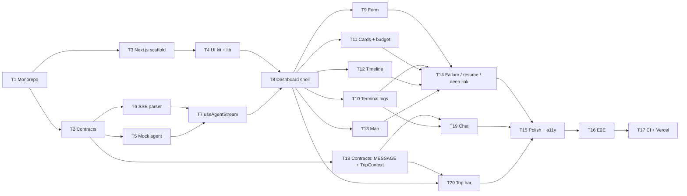

# ai-travel-web — Frontend Technical Specification

> All paths below are relative to `apps/web/`.
> System-wide design (graph, SSE protocol, contracts, deploy) is in [`../../ARCHITECTURE.md`](../../ARCHITECTURE.md);
> this file specifies how the web app implements it.

---

## 1. Responsibilities

- Collect the trip request and send it to `ai-travel-agent`.
- Consume the SSE stream and render it live: a friendly agent chat (with confirmed decisions), technical
  terminal logs, progress bar, then result cards, day-by-day timeline and an interactive map.
- Show the destination's weather and USD exchange rate in a top bar (`GET /api/trip-context`).
- Validate every incoming packet with the shared Zod schemas; never trust the wire.
- Hold **no secrets** and contain **no business logic** (cost math, retries, search all live in the agent).

Package name `ai-travel-web`. Next.js 16 (App Router, Turbopack), React 19, TypeScript strict.

Next.js 16 notes that matter here:

- Turbopack is the default bundler for `next dev` and `next build` — no `--turbopack` flag needed.
- `next lint` no longer exists: lint with the ESLint CLI (`eslint .`) and a flat config using `eslint-config-next`.
- Request APIs are async only: `searchParams`, `params`, `cookies()`, `headers()` must be awaited.
- `middleware.ts` is now `proxy.ts` (this app doesn't use either).
- Requires Node.js ≥ 20.9 (the repo uses the current LTS from `.nvmrc`).
- **Cache Components** (`cacheComponents: true`, the create-next-app default) is on: routes are static
  by default, and anything that reads request data (`searchParams`, uncached `fetch`) must sit inside a
  `<Suspense>` boundary or the build fails. `partialPrefetching` is on as well.
- Tailwind v4 is wired through the `@tailwindcss/turbopack` loader in `next.config.ts` (no PostCSS config).
- `LayoutProps<'/'>` / `PageProps<'/'>` are global route types generated by `next typegen`.

---

## 2. Folder structure

```text
apps/web/
├── src/
│   ├── app/
│   │   ├── layout.tsx              # <html>, fonts, globals.css, Toaster
│   │   ├── page.tsx                # Server Component: reads ?trip=, renders <TripDashboard>
│   │   └── globals.css             # Tailwind + shadcn theme tokens
│   ├── components/
│   │   ├── TripDashboard.tsx       # + 'use client' — owns useAgentStream, lays out the screen
│   │   ├── TripInputForm.tsx       # request form
│   │   ├── TopBar.tsx              # + destination weather + USD exchange rate chips
│   │   ├── AgentChat.tsx           # + friendly agent messages, "Confirmed" decisions
│   │   ├── AgentTerminalLogs.tsx   # streamed live console (technical log)
│   │   ├── MapboxViewer.tsx        # interactive route map (client-only)
│   │   ├── FlightHotelCards.tsx    # flight & hotel options + budget summary
│   │   ├── ItineraryTimeline.tsx   # day-by-day timeline
│   │   └── ui/                     # shadcn/ui generated components (do not hand-edit)
│   ├── hooks/
│   │   ├── useAgentStream.ts       # SSE hook, typed by @ai-travel/contracts
│   │   ├── useTripContext.ts       # + weather / exchange-rate lookup for the top bar
│   │   └── useStickToBottom.ts     # + shared auto-scroll behaviour of chat and terminal
│   └── lib/
│       ├── utils.ts                # cn() (re-exported from the `cn` package) + formatUsd/formatTime/formatDate
│       ├── env.ts                  # + Zod-validated public env → { agentUrl, mapboxToken }
│       ├── labels.ts               # + agent colours, log-level styles, status labels, decision labels, weather icons
│       └── sse.ts                  # + framework-free SSE parser
├── test/                           # Vitest + RTL (setup.ts); test/e2e/ for Playwright
├── components.json                 # shadcn config (style base-nova)
├── eslint.config.mjs               # ESLint flat config (eslint-config-next)
├── vitest.config.ts                # jsdom, `@` alias
├── .env.example
├── next.config.ts
├── package.json                    # name: ai-travel-web
└── tsconfig.json                   # extends ../../tsconfig.base.json, moduleResolution Bundler
```

Files marked `+` are not in the blueprint tree; see ARCHITECTURE.md §15 for why they exist.

---

## 3. Dependencies

| Package | Purpose |
| --- | --- |
| `@ai-travel/contracts` (`workspace:*`) | `SseEventSchema`, `TripRequestSchema`, all domain types |
| `next` 16, `react` 19, `react-dom` 19 | App Router, RSC |
| `tailwindcss` v4, `@tailwindcss/turbopack` | Styling |
| shadcn/ui: `shadcn` (theme CSS), `@base-ui/react` (primitives), `class-variance-authority`, `cn` (class merging, replaces clsx + tailwind-merge), `lucide-react`, `tw-animate-css` | Component kit |
| `framer-motion` | Log-line, card and timeline animations |
| `react-hook-form`, `@hookform/resolvers` | Form state + Zod resolver |
| `mapbox-gl`, `react-map-gl` | Map |
| `sonner`, `next-themes` | Toasts (shadcn's `Toaster` reads the theme via `next-themes`; we pin `theme="light"`) |
| `zod` (`catalog:`) | Validation |
| dev: `eslint`, `eslint-config-next` | Lint (flat config, `eslint.config.mjs`) |
| dev: `vitest`, `jsdom`, `@testing-library/react`, `@testing-library/dom`, `@testing-library/jest-dom`, `@playwright/test` | Tests |

Dependencies are added by the ticket that first needs them (e.g. `framer-motion` in T10, `react-hook-form` in T9,
`mapbox-gl` in T13), not up front.

shadcn components installed: `button`, `card`, `input`, `textarea`, `field`, `label`, `progress`, `badge`,
`scroll-area`, `skeleton`, `alert`, `separator`, `tooltip`, `sonner`. (`field` replaces the old `form`
component, which is an empty placeholder in the `base-nova` style.) Base UI primitives use a `render` prop
instead of Radix's `asChild`.

Scripts:

```json
{
  "dev": "next dev --port ${CONDUCTOR_PORT:-3000}",
  "build": "next build",
  "start": "next start --port ${PORT:-3000}",
  "test": "vitest run",
  "test:watch": "vitest",
  "typecheck": "next typegen && tsc --noEmit",
  "lint": "eslint ."
}
```

---

## 4. Configuration

### 4.1 Environment

| Variable | Required | Notes |
| --- | --- | --- |
| `NEXT_PUBLIC_AGENT_URL` | no | Base URL of the agent, e.g. `https://ai-travel-agent.onrender.com`. Unset in a deployed build → UI-only mode |
| `NEXT_PUBLIC_MAPBOX_TOKEN` | no | Public token, URL-restricted in the Mapbox dashboard. Missing → map placeholder |

`next.config.ts` derives a local default **only for `next dev`**, so parallel Conductor workspaces work
without `.env` edits, while deployed builds never point at `localhost`:

```typescript
import type { NextConfig } from 'next';
import { PHASE_DEVELOPMENT_SERVER } from 'next/constants';

export default function nextConfig(phase: string): NextConfig {
  const agentPort = process.env.CONDUCTOR_PORT ? Number(process.env.CONDUCTOR_PORT) + 1 : 4000;
  const devDefault = phase === PHASE_DEVELOPMENT_SERVER ? `http://localhost:${agentPort}` : undefined;
  const agentUrl = process.env.NEXT_PUBLIC_AGENT_URL ?? devDefault;
  return { env: agentUrl ? { NEXT_PUBLIC_AGENT_URL: agentUrl } : {} };
}
```

`lib/env.ts` validates the public values once with Zod (optional `z.string().url()` for the agent URL,
optional token) and exports a typed `env` object with `agentUrl: string | null` and
`mapboxToken: string | null`. Components import `env`, never `process.env`.
Because `NEXT_PUBLIC_*` values are inlined at build time, they are listed under `build.env` in `turbo.json`.

**UI-only mode** (`env.agentUrl === null`) — used for Vercel previews and production until the agent
is deployed:

- `TripDashboard` shows an info `Alert`: "Preview — the planning agent isn't connected yet."
- `TripInputForm` is fully usable for input and validation, but submit is disabled (with a tooltip).
- `page.tsx` skips the deep-link fetch; `useAgentStream.start/resume` are guarded no-ops.
- Everything else (layout, empty states, styling) renders normally.

### 4.2 TypeScript

Extends `tsconfig.base.json`; `module: "esnext"`, `moduleResolution: "bundler"`, `jsx: "react-jsx"`
(Next 16 default), path alias `@/*` → `src/*`. `exactOptionalPropertyTypes` is turned **off** here because
the generated `components/ui/*` files don't compile with it. `@ai-travel/contracts` is consumed from its built `dist/`, so no
`transpilePackages` entry is needed.

---

## 5. Data layer

### 5.1 SSE parser — `lib/sse.ts`

```typescript
export async function* readSseData(body: ReadableStream<Uint8Array>, signal?: AbortSignal): AsyncGenerator<string>;
```

- Decode with `TextDecoderStream`, keep a string buffer, split events on blank lines (`\n\n`, also accept `\r\n\r\n`).
- Per event: ignore lines starting with `:` (heartbeats); join all `data:` lines with `\n` and yield the result;
  ignore `id:`/`event:`/`retry:` fields.
- Must handle events split across chunks at any byte position (multibyte UTF-8 included) — covered by tests.
- Pure module, no React, no Zod — easy to unit test.

### 5.2 Hook — `hooks/useAgentStream.ts`

```typescript
type StreamStatus = 'idle' | 'connecting' | 'streaming' | 'completed' | 'failed' | 'aborted';

interface AgentStreamState {
  status: StreamStatus;
  threadId: string | null;
  logs: LogPayload[];              // technical lines → AgentTerminalLogs
  messages: MessagePayload[];      // friendly chat messages → AgentChat
  progress: ProgressPayload | null;
  result: ResultPayload | null;
  error: string | null;            // transport or validation error shown to the user
}

function useAgentStream(initial?: { threadId?: string; result?: ResultPayload | null }): AgentStreamState & {
  start(request: TripRequest): void;
  resume(): void;                  // POST /api/trips/:threadId/resume — only when threadId is set and status = 'failed'
  cancel(): void;                  // abort the fetch; status → 'aborted'
  reset(): void;                   // back to 'idle', clears data
};
```

Behaviour:

1. `start` aborts any in-flight run, dispatches `connecting`, and calls
   `fetch(`${env.agentUrl}/api/trips`, { method: 'POST', headers: { 'Content-Type': 'application/json', Accept: 'text/event-stream' }, body, signal })`.
2. Non-2xx response → read the JSON `{ error: { code, message } }`; status `failed`, message mapped for
   the user (`RATE_LIMITED` → "Too many requests, try again in a few minutes").
3. On 200 read `X-Thread-Id`, dispatch `streaming`, write `?trip=<threadId>` to the URL with
   `history.replaceState` (survives reload, no navigation).
4. For each data string from `readSseData`: `JSON.parse` → `SseEventSchema.safeParse`. Invalid packets are
   dropped with `console.warn` (dev) — they never crash the UI.
   - `LOG` → append to `logs`.
   - `MESSAGE` → append to `messages` (`decision` is kept as is; the UI never infers it).
   - `PROGRESS` → replace `progress`, keeping `progressPercent = max(previous, next)`.
   - `RESULT` → set `result`; status = `result.status` (`completed` / `failed`), `error = result.error`.
5. Stream ends without a `RESULT` → status `failed`, error "Connection lost", `resume()` available.
6. `AbortError` from `cancel()` or unmount → status `aborted`, no error toast.
7. State lives in a `useReducer`; the reducer is exported and unit-tested on its own.
8. The run starts only from a user action (`start`/`resume`), never from an effect, so React Strict Mode's
   double effects cannot start two runs. The `AbortController` is kept in a ref and aborted on unmount.

### 5.3 Reload / deep link

`page.tsx` is a Server Component. In Next.js 16 `searchParams` is a Promise and must be awaited:

```typescript
export default async function Page({ searchParams }: { searchParams: Promise<{ trip?: string }> }) {
  const { trip } = await searchParams;
  const initialResult = trip ? await fetchTripResult(trip) : null;   // GET /api/trips/:id, cache: 'no-store'; null on any error
  return <TripDashboard initialThreadId={trip ?? null} initialResult={initialResult} />;
}
```

A completed trip reopens with its results; an unfinished one shows a "Resume" button. The chat and
terminal are live-only, so a reopened trip starts with them empty (the confirmed decisions are still visible
in the result itself); the top bar is fetched from the reopened trip's `destination`.

With Cache Components on, `page.tsx` renders the static shell (header, layout) immediately and puts the
part that awaits `searchParams` and `fetchTripResult` inside `<Suspense fallback={<DashboardSkeleton />}>`.

### 5.4 Trip context — `hooks/useTripContext.ts`

```typescript
type TripContextStatus = 'idle' | 'loading' | 'ready' | 'error';
function useTripContext(destination: string | null): { status: TripContextStatus; data: TripContext | null };
```

- `destination` is `result?.destination` — empty/`null` → `idle`. The call is made once the destination is
  known (after the `RESULT`, or when a stored trip reopens), never during streaming.
- `fetch(`${env.agentUrl}/api/trip-context?destination=${encodeURIComponent(destination)}`, { signal })`, then
  `TripContextSchema.safeParse`. An invalid body counts as an error.
- A module-level `Map` caches results per normalised destination for the page's lifetime; a destination
  change aborts the previous request.
- **Failures are silent**: no toast, no error state in the UI, no effect on the run. `error` just means the bar
  shows nothing. Guarded no-op when `env.agentUrl === null` (UI-only mode).
- Runs in an effect keyed by `destination` (it is a read-only GET, so Strict Mode double-invocation is harmless;
  the abort-on-cleanup keeps it to one in-flight call).

---

## 6. Screen layout — `components/TripDashboard.tsx`

`'use client'`. Owns `useAgentStream` and the shared UI state `activeDay: number | null`.

```text
┌──────────────────────────── Header: "AI Travel Planner" ───────────────────────────┐
│ TopBar:  📍 Paris, France   ·   ⛅ 18 °C Partly cloudy   ·   1 USD = 0.92 EUR       │
│ ┌── left column (lg: 5/12) ──────────┐  ┌── right column (lg: 7/12) ──────────────┐ │
│ │ TripInputForm                      │  │ Budget summary (total vs budget, alerts) │ │
│ │ Progress bar + status label        │  │ FlightHotelCards                         │ │
│ │ AgentChat                          │  │ ItineraryTimeline   │   MapboxViewer      │ │
│ │ AgentTerminalLogs (collapsible)    │  │                                          │ │
│ └────────────────────────────────────┘  └──────────────────────────────────────────┘ │
└──────────────────────────────────────────────────────────────────────────────────────┘
```

- Below `lg` the columns stack: form → progress → chat → logs → results.
- The header wordmark stays in the static shell (`page.tsx`); `TopBar` is rendered by `TripDashboard` directly
  under it, because it needs client state (`result?.destination`).
- The chat is the primary feed; the terminal is a collapsed "Technical log" section below it.
- Before a result: the right column shows a skeleton while `streaming`, an empty-state illustration when `idle`.
- **Progress bar:** shadcn `Progress` bound to `progress.progressPercent`; label from `currentStatus`
  (`parsing` → "Understanding your request", `searching` → "Searching flights & hotels",
  `planning` → "Building your itinerary", `auditing` → "Checking the budget", `completed` → "Done").
- **Budget summary:** `totalCost` vs `budget` with a bar, cost breakdown (flight, hotel ×
  `result.durationDays`, daily expenses × days — display only, the agent's `totalCost` is authoritative), one `Alert` per `warnings` entry
  (amber), and a destructive `Alert` with `error` + `threadId` + Resume button when `status = 'failed'`.
- Cancel button visible while `connecting`/`streaming`.

---

## 7. Components

All components are typed with contracts types only. Props listed are the full public API.

### `TripInputForm.tsx`

```typescript
{ onSubmit: (request: TripRequest) => void; disabled: boolean }
```

- `react-hook-form` + `zodResolver(TripRequestSchema)` — the same schema the agent uses — rendered with
  shadcn `Field` components through `Controller`.
- Fields: `prompt` (textarea, required, counter up to 1,000), and an "Details" group with optional
  `origin`, `budget` (USD, number), `durationDays` (1–30), `startDate` (date ≥ today).
- Empty optional inputs are removed from the payload (not sent as `""`/`NaN`).
- 3 example prompt chips that fill the textarea, e.g. "5 days in Paris from Tashkent, $1,000 budget".
- `disabled` while a run is active; Enter + ⌘/Ctrl submits.

### `TopBar.tsx`

```typescript
{ status: TripContextStatus; data: TripContext | null }
```

- Up to three chips, each rendered only if its data is present: **place** (`data.location`), **weather**
  (lucide icon from `lib/labels.ts` by `weather.icon`, temperature via `Intl.NumberFormat` `unit: 'celsius'`,
  `weather.condition`), **rate** (`1 USD = 12,650 UZS`, `Intl.NumberFormat` with `maximumSignificantDigits: 4`
  for the quote; tooltip with `asOf`).
- `loading` → three `Skeleton` chips; `idle`, `error`, or no chip with data → renders nothing (no empty bar).
- `data.source === 'mock'` is a test fixture marker only; do not show it in the UI.
- Each chip has an `aria-label` that reads as a sentence ("Weather in Paris: 18 degrees, partly cloudy"); the
  icon is decorative (`aria-hidden`) — information is never colour or icon alone.
- Display only: no conversion maths in the browser (the agent returns the rate).

### `AgentChat.tsx`

```typescript
{ messages: MessagePayload[]; status: StreamStatus }
```

- A conversation list in a `ScrollArea` (~320 px): per message the agent's display name (from `lib/labels.ts`),
  `HH:mm` time and `text`. Messages are read-only; there is no input box.
- `decision !== null` → a **confirmed decision**: "Confirmed" `Badge` with a check icon and the topic label
  (`decisionLabels[decision]`, e.g. "Flight"), plus an accent border. Ordinary messages have none of these.
  Never infer a decision from the text.
- Typing indicator (three animated dots) while `status = 'streaming'`; static when `prefers-reduced-motion`.
- New messages animate in with Framer Motion (≤150 ms); auto-scroll and "Jump to latest" come from
  `useStickToBottom` (shared with the terminal).
- Empty state when `idle`: a short hint ("Describe your trip and the agents will walk you through their plan.").
- Accessibility: `role="log"`, `aria-live="polite"`, `aria-label="Conversation"`.

### `AgentTerminalLogs.tsx`

```typescript
{ logs: LogPayload[]; status: StreamStatus }
```

- Wrapped in a collapsible "Technical log" section (collapsed by default in production builds).

- Dark terminal look (`bg-zinc-950`, monospace), inside `ScrollArea`, fixed height (~320 px).
- Line format: `HH:mm:ss  [step]  Agent  message`; agent name with a fixed colour per `AgentName`;
  `warn` lines amber, `error` lines red.
- New lines animate in with Framer Motion (`opacity`/`y`, ≤150 ms); respect `prefers-reduced-motion`.
- Auto-scroll to bottom unless the user has scrolled up; "Jump to latest" button appears in that case.
- Blinking cursor line while `streaming`.
- Accessibility: `role="log"`, `aria-live="polite"`, `aria-label="Technical log"`.

### `FlightHotelCards.tsx`

```typescript
{ flights: Flight[]; hotels: Hotel[]; durationDays: number }
```

- Two sections, cards in a responsive grid. Index `0` of each list is the agent's selection:
  highlighted border + "Selected" badge.
- Flight card: airline, price (`Intl.NumberFormat` USD), departure in the user's locale.
- Hotel card: name, star rating (0–5, half stars), price per night, and total = `pricePerNight × durationDays`.
- `source === 'mock'` → muted "Estimated" badge with a tooltip "Live prices were unavailable".
- Staggered entrance animation on first render of a result.

### `ItineraryTimeline.tsx`

```typescript
{ itinerary: ItineraryDay[]; activeDay: number | null; onSelectDay: (day: number | null) => void }
```

- Vertical timeline, one node per day: "Day N — title", list of places.
- Clicking a day sets `activeDay` (click again to clear); the active day is highlighted and the map follows.
- Keyboard accessible (buttons, visible focus ring).

### `MapboxViewer.tsx`

```typescript
{ itinerary: ItineraryDay[]; activeDay: number | null }
```

- Client-only: imported in `TripDashboard` with `next/dynamic(() => import(...), { ssr: false })`
  and a `Skeleton` while loading. Import `mapbox-gl/dist/mapbox-gl.css` inside this component.
- `react-map-gl` (`react-map-gl/mapbox`) with `env.mapboxToken`.
- Numbered markers per place, coloured per day; a line layer (GeoJSON `LineString`) connecting the places
  of each day in order.
- `fitBounds` to all places on result, to the active day's places when `activeDay` changes (padding 48, animated).
- Marker popup: place name + "Day N".
- No token or no places → placeholder card listing the places instead of a broken map.

---

## 8. Styling & UX rules

- **Visual identity:** no custom brand assets. Use the shadcn defaults (`base-nova` style, `neutral` base
  colour, light theme only — no `ThemeProvider`), Geist Sans / Geist Mono via `next/font` (mono for the terminal), and a text
  wordmark "AI Travel Planner" with the lucide `Plane` icon in the header.
- Tailwind utility classes only; merge conditional classes with `cn()` from `lib/utils.ts`.
- Use shadcn theme tokens (`bg-background`, `text-muted-foreground`, …), not raw colours — except the terminal.
- Money always through one `formatUsd()` helper; dates/times through `Intl.DateTimeFormat`.
- Every async state has a visible representation: idle, loading (skeleton), streaming, completed, failed, aborted.
- Animations are short (≤300 ms) and disabled under `prefers-reduced-motion`.
- Target WCAG 2.1 AA: labelled inputs, focus states, contrast, no information by colour alone.

---

## 9. Rendering rules

- `layout.tsx` and `page.tsx` are Server Components. Interactivity starts at `TripDashboard` (`'use client'`)
  and everything it renders.
- Do not call the agent from a Next.js Route Handler or Server Action for streaming — Vercel function
  limits would cut long runs. The browser talks to the agent directly (CORS is configured there).
- The only server-side call is the non-streaming `GET /api/trips/:id` in `page.tsx`, inside `<Suspense>`
  (Cache Components). `GET /api/trip-context` is called from the browser by `useTripContext` (short JSON, no
  duration-limit risk).
- No global state library; state lives in `useAgentStream`, `useTripContext` and `TripDashboard`.

---

## 10. Testing

| File | What it proves |
| --- | --- |
| `test/sse.test.ts` | Parser: events split at every byte offset, `\r\n`, multi-line `data:`, heartbeat comments ignored, UTF-8 split across chunks |
| `test/useAgentStream.reducer.test.ts` | LOG and MESSAGE append, monotonic PROGRESS, RESULT completed/failed, stream end without RESULT → failed |
| `test/useAgentStream.test.tsx` | Mocked `fetch` with a `ReadableStream` fixture; invalid packet dropped; 429 mapped to message; cancel → aborted |
| `test/TripInputForm.test.tsx` | Schema validation messages; optional empty fields omitted from payload |
| `test/components.test.tsx` | Selected badges, hotel total, mock badge, timeline selection callback, logs `role="log"` |
| `test/AgentChat.test.tsx` | "Confirmed" badge and topic label only for `decision !== null`, typing indicator only while streaming, empty state, `role="log"` |
| `test/useTripContext.test.tsx` | Mocked `fetch`: loading → ready, invalid body → error, 404 → error, destination change aborts the previous call, cache hit, no call in UI-only mode |
| `test/TopBar.test.tsx` | A `null` chip is hidden, both `null` renders nothing, skeleton while loading, sentence-style `aria-label`s |
| `test/e2e/trip.spec.ts` | Playwright: agent in `TOOLS_MODE=mock` → submit → chat and logs appear → progress reaches 100 → cards, timeline, map/placeholder render, top bar shows weather and rate |

Fixtures for packets are built with the contracts schemas so they cannot drift from the protocol.

---

## 11. Rules for working in this package

- Import every cross-service type and schema from `@ai-travel/contracts`. Never declare a local
  `Flight`, `Hotel`, packet type, or a hand-written copy of `TripRequest`.
- Never read `process.env` outside `lib/env.ts` and `next.config.ts`.
- Never put secrets in this app. Only `NEXT_PUBLIC_*` values, and only public ones.
- Don't add business logic (cost calculation, retries, choosing options) — render what the agent sends. That
  includes decisions (`MessagePayload.decision`) and the exchange rate: display them, never derive them.
- Add shadcn components with the CLI (`pnpm dlx shadcn@latest add <name>`); don't hand-edit `components/ui/`.
- Run `pnpm --filter ai-travel-web test typecheck lint` before committing.

---

## 12. Implementation plan

> Step-by-step plan for building this app from the spec in §1–§11 and
> [`../../ARCHITECTURE.md`](../../ARCHITECTURE.md). Each ticket is one branch / one PR, small enough to
> review on its own.

---

### Overview

| Milestone | Tickets | Outcome | Status |
| --- | --- | --- | --- |
| **M1 · Foundation** | T1 – T4 | Monorepo, shared contracts, empty Next.js app with UI kit running on `pnpm dev` | ✅ Done (2026-10-27) |
| **M2 · Data layer** | T5 – T7 | Mock agent, SSE parser and `useAgentStream` hook, fully tested without any UI | ⏳ Next |
| **M3 · UI** | T8 – T13 | Dashboard and all five components, driven by the mock agent | — |
| **M4 · Resilience & ship** | T14 – T17 | Failure/resume/deep links, polish, end-to-end tests, CI and Vercel deploy | — |
| **M5 · Chat & top bar** | T18 – T20 | `MESSAGE` packets in the hook, `AgentChat` with "Confirmed" decisions, top bar with weather and exchange rate | — |

#### Dependency graph



**Parallel work:** once T8 is merged, T9–T13 touch separate files and can run in separate
Conductor workspaces at the same time. After T18, T19 and T20 are independent of each other.

**Why a mock agent (T5):** the backend does not exist yet. A small scripted SSE server that speaks
the exact contract lets the frontend be built and tested now — **locally and in CI only**. Deployed
builds don't use it: until the agent is deployed, Vercel runs in UI-only mode (no `NEXT_PUBLIC_AGENT_URL`).
When the real agent lands, only the URL changes. The e2e suite then also runs against the real agent in `TOOLS_MODE=mock`.

#### Definition of done (every ticket)

- `pnpm --filter ai-travel-web typecheck lint test` passes (and `build` from T3 on).
- Cross-service types come only from `@ai-travel/contracts`; `process.env` is read only in `lib/env.ts` / `next.config.ts`.
- New behaviour has tests as listed in the ticket.
- If the implementation has to deviate from the spec in §1–§11, update the spec in the same PR.

Size: **S** ≈ half a day · **M** ≈ 1 day · **L** ≈ 2 days.

---

### M1 · Foundation

#### T1 — Monorepo foundation · S · ✅ Done

> Implemented with pnpm 10.34.9 (via Corepack), Turborepo 2.11, Node 24. Conductor config is
> `.conductor/settings.toml` (setup: `corepack enable pnpm && pnpm install`).

**Goal:** one `pnpm install` and `pnpm dev` at the repo root (ARCHITECTURE.md §12).

**Depends on:** —

**Tasks**
- Root `package.json` (`private`, `packageManager: pnpm@<exact>`, scripts `dev/build/test/typecheck/lint` → `turbo run …`, `turbo` dev dependency).
- `pnpm-workspace.yaml` with `apps/*`, `packages/*` and the `catalog` (`typescript`, `zod`, `vitest`).
- `turbo.json` exactly as in ARCHITECTURE.md §12.2 (incl. `build.env` and `dev.passThroughEnv`).
- `tsconfig.base.json` from §12.2.
- `.gitignore` (`node_modules`, `dist`, `.next`, `.turbo`, `.env*` except `.env.example`, `test-results`, `playwright-report`), `.npmrc` if needed.
- Conductor `.conductor/settings.toml`: setup `corepack enable pnpm && pnpm install`, run action `pnpm dev`.
- Written by hand from ARCHITECTURE.md §12 (no `create-turbo`: it adds example apps we'd only delete).
- `.nvmrc`: current Node LTS (Next.js 16 needs ≥ 20.9); `engines.node` in the root `package.json` to match.

**Acceptance**
- Fresh clone → `pnpm install` succeeds; `pnpm build` runs (no packages yet = no-op).
- Lockfile committed.

---

#### T2 — Shared contracts package (`@ai-travel/contracts`) · M · ✅ Done

> Zod 4 API (`z.iso.*`, `z.uuid()`); 24 schema tests. Added `DataSourceSchema`, per-packet event schemas
> and `SseEventInput` type.

**Goal:** the single source of types for both apps (ARCHITECTURE.md §5).

**Depends on:** T1

**Tasks**
- `packages/contracts/package.json`: name `@ai-travel/contracts`, `"type": "module"`, `exports` → `dist/index.js` + `dist/index.d.ts`, scripts `build: tsc`, `dev: tsc --watch`, `test`, `typecheck`.
- `src/trip.ts`, `src/sse-events.ts`, `src/index.ts` exactly as specified in §5.1 / §5.2 (incl. the added RESULT fields `origin`, `destination`, `durationDays`, `startDate`).
- `tsconfig.json` extending the base, `module`/`moduleResolution: NodeNext`.
- Tests: blueprint example packets parse; malformed packets (wrong `type`, missing fields, percent > 100, bad coordinates, non-UUID `threadId`) are rejected; `TripRequestSchema` bounds.

**Acceptance**
- `pnpm --filter @ai-travel/contracts build test` passes; `dist/` contains JS + `.d.ts`.
- Remove the `.gitkeep` in `packages/contracts/src`.

---

#### T3 — Next.js 16 app scaffold · M · ✅ Done

> Generated with `create-next-app@16.4.3` (`--no-react-compiler --no-agents-md`), kept its defaults:
> Cache Components + Partial Prefetching on, Tailwind via `@tailwindcss/turbopack`, `jsx: react-jsx`.

**Goal:** an empty `ai-travel-web` that starts on the right port and imports the contracts.

**Depends on:** T1 (T2 for the import check)

**How:** generate with the official `create-next-app`, then adapt it to the monorepo. It can't run
inside `apps/web/` (the folder already holds `CLAUDE.md`, `.gitkeep`s), so generate into a
temporary folder and copy in without overwriting:

```bash
# from the repo root
pnpm create next-app@16 .tmp-web --ts --tailwind --eslint --app --src-dir \
  --import-alias "@/*" --use-pnpm --skip-install --disable-git --yes
rsync -a --ignore-existing --exclude node_modules .tmp-web/ apps/web/
rm -rf .tmp-web
```

**Tasks — after generating**
- Delete what the monorepo owns or we don't want: nested `pnpm-lock.yaml` / `pnpm-workspace.yaml`
  (move any `onlyBuiltDependencies` entries to the root `pnpm-workspace.yaml`), generated `README.md`,
  any generated `AGENTS.md`, demo SVGs in `public/`, and the demo content of `page.tsx`.
- `package.json`: name `ai-travel-web`, add `@ai-travel/contracts: workspace:*`, `zod: catalog:`,
  remaining deps from §3, scripts from §3 (`dev` on `${CONDUCTOR_PORT:-3000}`, `lint: eslint .`, `typecheck`, `test`).
- `tsconfig.json` extends `../../tsconfig.base.json` with the options in §4.2.
- `next.config.ts` as in §4.1 (phase-based `NEXT_PUBLIC_AGENT_URL` default for `next dev` only).
- Keep the generated Tailwind v4 setup (`@tailwindcss/turbopack` loader, `globals.css`) and ESLint flat config.
- `layout.tsx`: Geist Sans/Mono, metadata, `<html lang="en">`. Placeholder `page.tsx` renders a value
  typed from `@ai-travel/contracts` (proves the workspace link).
- Vitest + jsdom + React Testing Library (`vitest.config.ts`, `test/setup.ts`) with one smoke test.
- `.env.example` with `NEXT_PUBLIC_AGENT_URL`, `NEXT_PUBLIC_MAPBOX_TOKEN` (both commented, both optional).
- `pnpm install` once from the repo root; remove the `.gitkeep` files in folders that now have content.

**Acceptance**
- `pnpm dev` from the root serves the page on `$CONDUCTOR_PORT` (or 3000) with Turbopack.
- `pnpm --filter ai-travel-web build typecheck lint test` passes.

---

#### T4 — UI kit, design tokens and `lib/` helpers · S · ✅ Done

> shadcn 4 default preset is `base-nova` (Base UI primitives); `field` used instead of the empty `form`.
> Web turns off `exactOptionalPropertyTypes` (generated shadcn code). 14 web tests.

**Goal:** everything components will need, before any component exists.

**Depends on:** T3

**Decision:** no custom branding — shadcn defaults (`base-nova`, `neutral`, light theme), Geist fonts,
text wordmark "AI Travel Planner" + lucide `Plane` icon (§8).

**Commands**

```bash
cd apps/web
pnpm dlx shadcn@latest init -d --no-monorepo -y   # default preset base-nova, base colour neutral
pnpm dlx shadcn@latest add card input textarea field label progress badge \
  scroll-area skeleton alert separator tooltip sonner -y
```

**Tasks**
- `<Toaster />` (sonner) and `TooltipProvider` in `layout.tsx`; header with the wordmark.
- `lib/utils.ts`: `cn()` (generated by shadcn), plus `formatUsd(n)`, `formatTime(iso)` (`HH:mm:ss`), `formatDate(iso)`.
- `lib/env.ts`: Zod-validated `env` → `agentUrl: string | null`, `mapboxToken: string | null` (§4.1).
- Agent colour map (`AgentName` → Tailwind classes) and status label map (`TripStatus` → text) in one place (`lib/labels.ts`).
- Tests for formatters and `env` parsing (set / unset / invalid URL).

**Acceptance**
- shadcn components render in the placeholder page; formatter and env tests pass.

---

### M2 · Data layer

#### T5 — Mock agent + packet fixtures · M

**Goal:** develop and test the whole UI without the backend.

**Depends on:** T2

**Tasks**
- `test/fixtures/packets.ts`: builders (`logPacket()`, `progressPacket()`, `resultPacket()`) that run every fixture through `SseEventSchema.parse`, so fixtures cannot drift from the contract.
- Scenarios as packet scripts with delays:
  - `happy` — full run Paris from Tashkent, within budget;
  - `overBudget` — two re-plan rounds, completed with a warning;
  - `mockData` — results with `source: 'mock'`;
  - `failed` — stream ends with `RESULT { status: 'failed' }`;
  - `dropped` — stream closes without a `RESULT`;
  - `invalidPacket` — one malformed packet in the middle;
  - `validationError` / `rateLimited` — JSON `400` / `429` before the stream.
- `test/mock-agent/server.ts`: small Node HTTP server implementing `POST /api/trips`, `POST /api/trips/:id/resume`, `GET /api/trips/:id`, CORS + `Access-Control-Expose-Headers: X-Thread-Id`, `: ping` heartbeats. Scenario picked by a keyword in the prompt (e.g. `#fail`) or `MOCK_SCENARIO` env.
- Script `pnpm --filter ai-travel-web mock-agent` on the agent port (`CONDUCTOR_PORT + 1` / 4000).

**Acceptance**
- `curl -N -X POST …/api/trips` prints a valid SSE stream for every scenario.
- Dev-only: not imported by any file under `src/`.

---

#### T6 — SSE parser (`lib/sse.ts`) · S

**Goal:** framework-free `readSseData()` (§5.1).

**Depends on:** T2

**Tasks**
- `TextDecoderStream` + buffer, split on blank lines (`\n\n` and `\r\n\r\n`), join `data:` lines, skip `:` comments and `id/event/retry` fields, stop on `signal` abort, release the reader in `finally`.
- `test/sse.test.ts`: fixture stream split at **every** byte offset; `\r\n`; multi-line `data:`; heartbeats ignored; multibyte UTF-8 (e.g. "Tashkent → Paris") split mid-character; trailing event without final blank line.

**Acceptance**
- All parser tests pass; no React/Zod imports in the module.

---

#### T7 — `useAgentStream` hook · L

**Goal:** the single client-side source of run state (§5.2).

**Depends on:** T5, T6

**Tasks**
- Exported pure reducer + action types: `START`, `CONNECTED(threadId)`, `PACKET(event)`, `STREAM_ENDED`, `HTTP_ERROR(code, message)`, `ABORTED`, `RESET`.
- Monotonic progress (`max(previous, next)`), `RESULT` sets final status, end-without-RESULT → `failed` "Connection lost".
- Hook: `start`, `resume`, `cancel`, `reset`; `AbortController` in a ref, aborted on new run and on unmount; runs only from user actions (Strict-Mode safe).
- Reads `X-Thread-Id`; writes `?trip=<id>` with `history.replaceState`.
- `JSON.parse` + `SseEventSchema.safeParse` per packet; invalid → dropped with `console.warn` in dev.
- Error mapping table (`VALIDATION_ERROR`, `RATE_LIMITED`, `NOT_FOUND`, `INTERNAL`, network error) → user-facing messages.
- Accepts `initial` (`threadId`, `result`) for the deep-link case.
- Tests: `test/useAgentStream.reducer.test.ts` and `test/useAgentStream.test.tsx` (mocked `fetch` returning `ReadableStream`s built from T5 fixtures, every scenario).

**Acceptance**
- Every T5 scenario ends in the expected `status`, `logs`, `progress`, `result`, `error`.
- A temporary debug page (removed in T8) can run a real trip against the mock agent.

---

### M3 · UI

#### T8 — Dashboard shell, page and progress · M

**Goal:** the screen skeleton wired to the hook (§6, §9).

**Depends on:** T4, T7

**Tasks**
- `page.tsx` (Server Component) renders `<TripDashboard initialThreadId={null} initialResult={null} />` (deep link comes in T14).
- `TripDashboard.tsx` (`'use client'`): owns `useAgentStream` + `activeDay`; two-column layout at `lg`, stacked below; header.
- Progress bar + status label (from T4 label map), Cancel button while `connecting`/`streaming`.
- Right column states: empty state when `idle`, skeletons while `streaming`, slots for result components.
- UI-only mode (`env.agentUrl === null`): info banner "Preview — the planning agent isn't connected yet", submit disabled, `start`/`resume` no-ops.
- Slots for form / logs / cards / timeline / map with temporary placeholders so T9–T13 can be built in parallel.

**Acceptance**
- With a stub submit button, a run against the mock agent moves the progress bar to 100 and swaps skeletons for placeholders.
- `next build && next start` without `NEXT_PUBLIC_AGENT_URL` shows the UI-only banner and never calls `localhost`.
- Layout correct at 375 px, 768 px, 1280 px.

---

#### T9 — `TripInputForm` · M

**Depends on:** T8 · Spec: §7

**Tasks**
- `react-hook-form` + `zodResolver(TripRequestSchema)`; `prompt` textarea with 1,000-char counter; collapsible "Details": `origin`, `budget`, `durationDays`, `startDate` (≥ today).
- Strip empty optional fields (no `""` / `NaN` in the payload); number inputs coerced correctly.
- 3 example-prompt chips; ⌘/Ctrl + Enter submits; disabled while a run is active.
- Tests: validation messages, payload shape, disabled state, keyboard submit.

**Acceptance:** submitting starts a real run against the mock agent.

---

#### T10 — `AgentTerminalLogs` · M

**Depends on:** T8 · Spec: §7

**Tasks**
- Dark terminal panel in `ScrollArea` (~320 px), line format `HH:mm:ss  [step]  Agent  message`, agent colours, `warn`/`error` colours **plus** an icon/prefix (not colour alone).
- Framer Motion line entrance (≤150 ms), disabled under `prefers-reduced-motion`.
- Stick-to-bottom auto-scroll; "Jump to latest" button when the user scrolled up; blinking cursor while `streaming`.
- `role="log"`, `aria-live="polite"`.
- Tests: rendering of levels, auto-scroll behaviour, role/aria.

**Acceptance:** logs stream smoothly through the `overBudget` scenario (re-plan steps visible).

---

#### T11 — `FlightHotelCards` + budget summary · M

**Depends on:** T8 · Spec: §6, §7

**Tasks**
- Flight and hotel card grids; index `0` highlighted with "Selected" badge.
- Hotel total = `pricePerNight × durationDays`; half-star rating; "Estimated" badge + tooltip for `source: 'mock'`.
- Budget summary in `TripDashboard`: `totalCost` vs `budget` bar, display-only breakdown, amber `Alert` per warning.
- Staggered entrance animation.
- Tests: selected badges, hotel total, mock badge, over-budget warning rendering.

**Acceptance:** `happy`, `overBudget` and `mockData` scenarios render correctly.

---

#### T12 — `ItineraryTimeline` · S

**Depends on:** T8 · Spec: §7

**Tasks**
- Vertical timeline "Day N — title" with places; day items are buttons; click toggles `activeDay`; active styling + focus ring.
- Tests: selection callback, toggle off, keyboard activation.

**Acceptance:** selecting a day updates `activeDay` in the dashboard (visible to the map in T13).

---

#### T13 — `MapboxViewer` · L

**Depends on:** T8 · Spec: §7

**Tasks**
- `next/dynamic` with `ssr: false` + `Skeleton` fallback; `mapbox-gl` CSS imported in the component.
- `react-map-gl/mapbox` map; numbered markers coloured per day; per-day `LineString` route layer.
- `fitBounds` to all places on result and to the active day on change (padding 48, animated); popup with place name + "Day N".
- Placeholder card listing places when there is no token or no places.
- Mapbox token: create a URL-restricted public token (localhost + Vercel domains).
- Tests: placeholder path (no token); GeoJSON/bounds helper functions as pure unit tests (WebGL is not tested in jsdom).

**Acceptance:** map follows timeline selection; no hydration warnings; page works without a token.

---

### M4 · Resilience & ship

#### T14 — Failure, resume and deep links · M

**Depends on:** T9–T13 · Spec: §5.3, §6

**Tasks**
- `page.tsx`: skip the fetch in UI-only mode; otherwise read `searchParams` (Promise in Next.js 16 — must be awaited), `fetchTripResult(threadId)` → `GET /api/trips/:id` with `cache: 'no-store'`, `null` on any error; pass `initialThreadId` / `initialResult`.
- Completed deep link → results render immediately; unfinished → "Resume" button.
- Failed state: destructive `Alert` with `error`, `threadId` (copy button) and Resume; `dropped` scenario → "Connection lost" + Resume.
- Pre-stream HTTP errors (`400`, `429`) → inline form error / toast; `aborted` shows no error.
- `app/error.tsx` and `app/not-found.tsx` boundaries.
- Tests: each failure scenario's UI; resume flow against the mock agent.

**Acceptance:** reloading during and after a run never loses a completed result; every failure has a visible next step.

---

#### T15 — Polish, accessibility and performance · M

**Depends on:** T14

**Tasks**
- Consistent animation timings (≤300 ms) and `prefers-reduced-motion` across all components.
- Accessibility pass: labels, focus order, focus return after submit/result, contrast, axe check (`vitest-axe` or Playwright axe) with zero serious issues.
- Responsive pass at 375 / 768 / 1280 / 1536 px; long names and 30-day itineraries don't break layout.
- Metadata (title, description, Open Graph), favicon.
- Bundle check: map code only in its own chunk; Lighthouse ≥ 90 for performance and accessibility on the idle page.

**Acceptance:** checklist above signed off with screenshots in the PR.

---

#### T16 — End-to-end tests (Playwright) · M

**Depends on:** T15

**Tasks**
- `playwright.config.ts` with `webServer` starting the mock agent (T5) and `next start`, with `NEXT_PUBLIC_AGENT_URL` set explicitly to the mock agent.
- One spec for UI-only mode (build without `NEXT_PUBLIC_AGENT_URL`): banner visible, submit disabled.
- `test/e2e/trip.spec.ts`: submit → logs appear → progress hits 100 → cards, timeline and map/placeholder render.
- Additional specs: over-budget warning, failed + resume, rate-limit message, deep-link reload.
- Once the real agent exists: a second project that runs the same spec against it with `TOOLS_MODE=mock`.

**Acceptance:** `pnpm --filter ai-travel-web test:e2e` passes locally and headless in CI.

---

#### T17 — CI and Vercel deployment · S

**Depends on:** T16

**Tasks**
- GitHub Actions: pnpm cache, `pnpm install --frozen-lockfile`, `pnpm turbo run lint typecheck test build`, Playwright job.
- Vercel project `ai-travel-web`: root `apps/web`, build `turbo run build`, Ignored Build Step `npx turbo-ignore`.
- Env vars: `NEXT_PUBLIC_MAPBOX_TOKEN` for Preview + Production. **Do not set `NEXT_PUBLIC_AGENT_URL`** until
  the agent is deployed — previews and production run in UI-only mode.
- Preview deployments per PR; add the preview domain pattern to the Mapbox token.
- Later (when the backend ships): set `NEXT_PUBLIC_AGENT_URL`, add the Vercel domains to the agent's `WEB_ORIGIN`, redeploy.

**Acceptance:** merging to `main` deploys production; PRs get previews showing the UI with the "agent not connected" banner; CI is green.

---

### M5 · Chat & top bar

> Two features the original blueprint did not cover: a friendly chat with confirmed decisions, and a top bar
> with the destination's weather and exchange rate. Design: ARCHITECTURE.md §4.6, §5.2–§5.3, §7.1. The agent
> side is in [`../agent/CLAUDE.md`](../agent/CLAUDE.md) §15, tickets B21–B23. Both new components ship after the mock agent is extended,
> so they can be built before the backend work lands.

#### T18 — Contracts: chat messages and trip context · S

**Goal:** the shared schemas for both features. *Same as agent B21 — one PR, not two.*

**Depends on:** T2

**Tasks**
- The contracts work exactly as listed in agent B21 (`DecisionTopicSchema`, `MessagePayloadSchema` / `MessageEventSchema` in the `SseEventSchema` union, `src/trip-context.ts`).
- Web side of the same PR (ARCHITECTURE.md §12.6): `useAgentStream` state gains `messages: MessagePayload[]`; the reducer appends on `MESSAGE` so the app keeps type-checking.
- `test/fixtures/packets.ts`: `messagePacket()` and `tripContextFixture()` builders that run through the contracts schemas.

**Acceptance**
- `pnpm typecheck` passes for both apps; the reducer test covers `MESSAGE` append.

---

#### T19 — `AgentChat` + `MESSAGE` handling · M

**Goal:** a conversation view where agents talk in plain language and confirmed decisions stand out (§7, ARCHITECTURE.md §4.6).

**Depends on:** T10, T18

**Tasks**
- Extend the mock agent (T5): `MESSAGE` packets in every scenario (`happy` confirms `trip, itinerary, flight, hotel, budget`; `overBudget` confirms flight/hotel/budget only at the end; `failed` has an ordinary "could you tell me…" message and no decision).
- `lib/labels.ts`: `decisionLabels: Record<DecisionTopic, string>` and display names per `AgentName`.
- `hooks/useStickToBottom.ts`: extract the auto-scroll / "Jump to latest" logic from `AgentTerminalLogs` and use it in both components.
- `components/AgentChat.tsx` as specified in §7: agent name + time + text; `decision !== null` → "Confirmed" badge with the topic label, check icon and accent border (not colour alone); typing indicator while `streaming`; `role="log"` with `aria-label="Conversation"`.
- `TripDashboard`: chat above the terminal in the left column; the terminal becomes a collapsed "Technical log" section (open by default in dev).
- Tests: ordinary vs decision rendering, badge text per topic, indicator only while streaming, auto-scroll shared hook, reducer.

**Acceptance:** the `happy` scenario shows five "Confirmed" messages in order; `overBudget` shows none for flight/hotel until the last round.

---

#### T20 — Top bar: weather and exchange rate · M

**Goal:** show the destination's current weather and USD rate next to the header (§5.4, §7; ARCHITECTURE.md §7.1).

**Depends on:** T8, T18

**Tasks**
- Extend the mock agent (T5): `GET /api/trip-context` with fixtures; keywords for `#noweather`, `#norate`, `#unknowncity` (404) scenarios.
- `hooks/useTripContext.ts`: `fetch` + `TripContextSchema.safeParse`, `AbortController` per destination, module-level cache per destination, silent on errors; guarded no-op when `env.agentUrl === null`.
- `lib/labels.ts`: weather `icon` → lucide icon map; formatters for temperature (`Intl.NumberFormat` unit `celsius`) and rate (`1 USD = 12,650 UZS`).
- `components/TopBar.tsx` as specified in §7; rendered by `TripDashboard` under the header with `result?.destination`.
- Tests: hook (loading → ready, error → hidden, 404, destination change aborts the previous call), component (a `null` chip is hidden, both `null` renders nothing, skeleton while loading, `aria-label`s).

**Acceptance:** in the `happy` scenario the bar shows place, temperature and rate after the `RESULT`; with `#noweather` only the rate chip remains; the run is never affected by a failing lookup.

---

### Decisions

| # | Question | Decision |
| --- | --- | --- |
| 1 | Next.js 15 or 16? | **Next.js 16** (current stable line; 15 only receives backports). Turbopack by default, ESLint CLI instead of `next lint`, async-only request APIs. Specs updated. |
| 2 | Vercel previews before the backend exists | **UI only.** No hosted mock agent; deployed builds run without `NEXT_PUBLIC_AGENT_URL` and show an "agent not connected" banner. The mock agent stays local/CI-only. |
| 3 | Branding | **None.** shadcn defaults (`base-nova`, `neutral`, light), Geist fonts, text wordmark + lucide `Plane` icon. |
| 4 | Chat vs terminal | **Separate `MESSAGE` packet.** `LOG` stays technical for the terminal; the chat shows friendly text and a "Confirmed" badge for decisions. The terminal becomes a collapsible "Technical log". |
| 5 | When the top bar loads | **After the `RESULT`** (or when a stored trip reopens), straight from the browser to the agent. The destination is only known then; no extra stream packet. |
| 6 | Lookup failure | **Hide the chip.** No mock weather or rate — fake values in the header would look real. |
