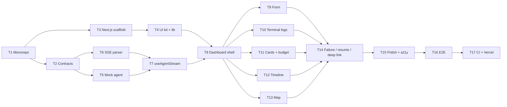

# ai-travel-web — Implementation Plan

> Step-by-step plan for building the frontend described in [`CLAUDE.md`](./CLAUDE.md)
> (web spec) and [`../../ARCHITECTURE.md`](../../ARCHITECTURE.md) (system design).
> Each ticket is one branch / one PR, small enough to review on its own.

---

## Overview

| Milestone | Tickets | Outcome | Status |
| --- | --- | --- | --- |
| **M1 · Foundation** | T1 – T4 | Monorepo, shared contracts, empty Next.js app with UI kit running on `pnpm dev` | ✅ Done (2026-10-27) |
| **M2 · Data layer** | T5 – T7 | Mock agent, SSE parser and `useAgentStream` hook, fully tested without any UI | ⏳ Next |
| **M3 · UI** | T8 – T13 | Dashboard and all five components, driven by the mock agent | — |
| **M4 · Resilience & ship** | T14 – T17 | Failure/resume/deep links, polish, end-to-end tests, CI and Vercel deploy | — |

### Dependency graph



**Parallel work:** once T8 is merged, T9–T13 touch separate files and can run in separate
Conductor workspaces at the same time.

**Why a mock agent (T5):** the backend does not exist yet. A small scripted SSE server that speaks
the exact contract lets the frontend be built and tested now — **locally and in CI only**. Deployed
builds don't use it: until the agent is deployed, Vercel runs in UI-only mode (no `NEXT_PUBLIC_AGENT_URL`).
When the real agent lands, only the URL changes. The e2e suite then also runs against the real agent in `TOOLS_MODE=mock`.

### Definition of done (every ticket)

- `pnpm --filter ai-travel-web typecheck lint test` passes (and `build` from T3 on).
- Cross-service types come only from `@ai-travel/contracts`; `process.env` is read only in `lib/env.ts` / `next.config.ts`.
- New behaviour has tests as listed in the ticket.
- If the implementation has to deviate from `CLAUDE.md`, the spec is updated in the same PR.

Size: **S** ≈ half a day · **M** ≈ 1 day · **L** ≈ 2 days.

---

## M1 · Foundation

### T1 — Monorepo foundation · S · ✅ Done

> Implemented with pnpm 10.34.9 (via Corepack), Turborepo 2.11, Node 24. Conductor config is
> `.conductor/settings.toml` (setup: `corepack enable pnpm && pnpm install`).

**Goal:** one `pnpm install` and `pnpm dev` at the repo root (ARCHITECTURE.md §12).

**Depends on:** —

**Tasks**
- Root `package.json` (`private`, `packageManager: pnpm@<exact>`, scripts `dev/build/test/typecheck/lint` → `turbo run …`, `turbo` dev dependency).
- `pnpm-workspace.yaml` with `apps/*`, `packages/*` and the `catalog` (`typescript`, `zod`, `vitest`).
- `turbo.json` exactly as in ARCHITECTURE.md §12.2 (incl. `build.env` and `dev.passThroughEnv`).
- `tsconfig.base.json` from §12.2.
- `.gitignore` (`node_modules`, `dist`, `.next`, `.turbo`, `.env*` except `.env.example`, `test-results`, `playwright-report`), `.npmrc` if needed.
- Conductor `.conductor/settings.toml`: setup `corepack enable pnpm && pnpm install`, run action `pnpm dev`.
- Written by hand from ARCHITECTURE.md §12 (no `create-turbo`: it adds example apps we'd only delete).
- `.nvmrc`: current Node LTS (Next.js 16 needs ≥ 20.9); `engines.node` in the root `package.json` to match.

**Acceptance**
- Fresh clone → `pnpm install` succeeds; `pnpm build` runs (no packages yet = no-op).
- Lockfile committed.

---

### T2 — Shared contracts package (`@ai-travel/contracts`) · M · ✅ Done

> Zod 4 API (`z.iso.*`, `z.uuid()`); 24 schema tests. Added `DataSourceSchema`, per-packet event schemas
> and `SseEventInput` type.

**Goal:** the single source of types for both apps (ARCHITECTURE.md §5).

**Depends on:** T1

**Tasks**
- `packages/contracts/package.json`: name `@ai-travel/contracts`, `"type": "module"`, `exports` → `dist/index.js` + `dist/index.d.ts`, scripts `build: tsc`, `dev: tsc --watch`, `test`, `typecheck`.
- `src/trip.ts`, `src/sse-events.ts`, `src/index.ts` exactly as specified in §5.1 / §5.2 (incl. the added RESULT fields `origin`, `destination`, `durationDays`, `startDate`).
- `tsconfig.json` extending the base, `module`/`moduleResolution: NodeNext`.
- Tests: blueprint example packets parse; malformed packets (wrong `type`, missing fields, percent > 100, bad coordinates, non-UUID `threadId`) are rejected; `TripRequestSchema` bounds.

**Acceptance**
- `pnpm --filter @ai-travel/contracts build test` passes; `dist/` contains JS + `.d.ts`.
- Remove the `.gitkeep` in `packages/contracts/src`.

---

### T3 — Next.js 16 app scaffold · M · ✅ Done

> Generated with `create-next-app@16.4.3` (`--no-react-compiler --no-agents-md`), kept its defaults:
> Cache Components + Partial Prefetching on, Tailwind via `@tailwindcss/turbopack`, `jsx: react-jsx`.

**Goal:** an empty `ai-travel-web` that starts on the right port and imports the contracts.

**Depends on:** T1 (T2 for the import check)

**How:** generate with the official `create-next-app`, then adapt it to the monorepo. It can't run
inside `apps/web/` (the folder already holds `CLAUDE.md`, `PLAN.md`, `.gitkeep`s), so generate into a
temporary folder and copy in without overwriting:

```bash
# from the repo root
pnpm create next-app@16 .tmp-web --ts --tailwind --eslint --app --src-dir \
  --import-alias "@/*" --use-pnpm --skip-install --disable-git --yes
rsync -a --ignore-existing --exclude node_modules .tmp-web/ apps/web/
rm -rf .tmp-web
```

**Tasks — after generating**
- Delete what the monorepo owns or we don't want: nested `pnpm-lock.yaml` / `pnpm-workspace.yaml`
  (move any `onlyBuiltDependencies` entries to the root `pnpm-workspace.yaml`), generated `README.md`,
  any generated `AGENTS.md`, demo SVGs in `public/`, and the demo content of `page.tsx`.
- `package.json`: name `ai-travel-web`, add `@ai-travel/contracts: workspace:*`, `zod: catalog:`,
  remaining deps from CLAUDE.md §3, scripts from §3 (`dev` on `${CONDUCTOR_PORT:-3000}`, `lint: eslint .`, `typecheck`, `test`).
- `tsconfig.json` extends `../../tsconfig.base.json` with the options in §4.2.
- `next.config.ts` as in §4.1 (phase-based `NEXT_PUBLIC_AGENT_URL` default for `next dev` only).
- Keep the generated Tailwind v4 setup (`@tailwindcss/turbopack` loader, `globals.css`) and ESLint flat config.
- `layout.tsx`: Geist Sans/Mono, metadata, `<html lang="en">`. Placeholder `page.tsx` renders a value
  typed from `@ai-travel/contracts` (proves the workspace link).
- Vitest + jsdom + React Testing Library (`vitest.config.ts`, `test/setup.ts`) with one smoke test.
- `.env.example` with `NEXT_PUBLIC_AGENT_URL`, `NEXT_PUBLIC_MAPBOX_TOKEN` (both commented, both optional).
- `pnpm install` once from the repo root; remove the `.gitkeep` files in folders that now have content.

**Acceptance**
- `pnpm dev` from the root serves the page on `$CONDUCTOR_PORT` (or 3000) with Turbopack.
- `pnpm --filter ai-travel-web build typecheck lint test` passes.

---

### T4 — UI kit, design tokens and `lib/` helpers · S · ✅ Done

> shadcn 4 default preset is `base-nova` (Base UI primitives); `field` used instead of the empty `form`.
> Web turns off `exactOptionalPropertyTypes` (generated shadcn code). 14 web tests.

**Goal:** everything components will need, before any component exists.

**Depends on:** T3

**Decision:** no custom branding — shadcn defaults (`base-nova`, `neutral`, light theme), Geist fonts,
text wordmark "AI Travel Planner" + lucide `Plane` icon (CLAUDE.md §8).

**Commands**

```bash
cd apps/web
pnpm dlx shadcn@latest init -d --no-monorepo -y   # default preset base-nova, base colour neutral
pnpm dlx shadcn@latest add card input textarea field label progress badge \
  scroll-area skeleton alert separator tooltip sonner -y
```

**Tasks**
- `<Toaster />` (sonner) and `TooltipProvider` in `layout.tsx`; header with the wordmark.
- `lib/utils.ts`: `cn()` (generated by shadcn), plus `formatUsd(n)`, `formatTime(iso)` (`HH:mm:ss`), `formatDate(iso)`.
- `lib/env.ts`: Zod-validated `env` → `agentUrl: string | null`, `mapboxToken: string | null` (§4.1).
- Agent colour map (`AgentName` → Tailwind classes) and status label map (`TripStatus` → text) in one place (`lib/labels.ts`).
- Tests for formatters and `env` parsing (set / unset / invalid URL).

**Acceptance**
- shadcn components render in the placeholder page; formatter and env tests pass.

---

## M2 · Data layer

### T5 — Mock agent + packet fixtures · M

**Goal:** develop and test the whole UI without the backend.

**Depends on:** T2

**Tasks**
- `test/fixtures/packets.ts`: builders (`logPacket()`, `progressPacket()`, `resultPacket()`) that run every fixture through `SseEventSchema.parse`, so fixtures cannot drift from the contract.
- Scenarios as packet scripts with delays:
  - `happy` — full run Paris from Tashkent, within budget;
  - `overBudget` — two re-plan rounds, completed with a warning;
  - `mockData` — results with `source: 'mock'`;
  - `failed` — stream ends with `RESULT { status: 'failed' }`;
  - `dropped` — stream closes without a `RESULT`;
  - `invalidPacket` — one malformed packet in the middle;
  - `validationError` / `rateLimited` — JSON `400` / `429` before the stream.
- `test/mock-agent/server.ts`: small Node HTTP server implementing `POST /api/trips`, `POST /api/trips/:id/resume`, `GET /api/trips/:id`, CORS + `Access-Control-Expose-Headers: X-Thread-Id`, `: ping` heartbeats. Scenario picked by a keyword in the prompt (e.g. `#fail`) or `MOCK_SCENARIO` env.
- Script `pnpm --filter ai-travel-web mock-agent` on the agent port (`CONDUCTOR_PORT + 1` / 4000).

**Acceptance**
- `curl -N -X POST …/api/trips` prints a valid SSE stream for every scenario.
- Dev-only: not imported by any file under `src/`.

---

### T6 — SSE parser (`lib/sse.ts`) · S

**Goal:** framework-free `readSseData()` (CLAUDE.md §5.1).

**Depends on:** T2

**Tasks**
- `TextDecoderStream` + buffer, split on blank lines (`\n\n` and `\r\n\r\n`), join `data:` lines, skip `:` comments and `id/event/retry` fields, stop on `signal` abort, release the reader in `finally`.
- `test/sse.test.ts`: fixture stream split at **every** byte offset; `\r\n`; multi-line `data:`; heartbeats ignored; multibyte UTF-8 (e.g. "Tashkent → Paris") split mid-character; trailing event without final blank line.

**Acceptance**
- All parser tests pass; no React/Zod imports in the module.

---

### T7 — `useAgentStream` hook · L

**Goal:** the single client-side source of run state (CLAUDE.md §5.2).

**Depends on:** T5, T6

**Tasks**
- Exported pure reducer + action types: `START`, `CONNECTED(threadId)`, `PACKET(event)`, `STREAM_ENDED`, `HTTP_ERROR(code, message)`, `ABORTED`, `RESET`.
- Monotonic progress (`max(previous, next)`), `RESULT` sets final status, end-without-RESULT → `failed` "Connection lost".
- Hook: `start`, `resume`, `cancel`, `reset`; `AbortController` in a ref, aborted on new run and on unmount; runs only from user actions (Strict-Mode safe).
- Reads `X-Thread-Id`; writes `?trip=<id>` with `history.replaceState`.
- `JSON.parse` + `SseEventSchema.safeParse` per packet; invalid → dropped with `console.warn` in dev.
- Error mapping table (`VALIDATION_ERROR`, `RATE_LIMITED`, `NOT_FOUND`, `INTERNAL`, network error) → user-facing messages.
- Accepts `initial` (`threadId`, `result`) for the deep-link case.
- Tests: `test/useAgentStream.reducer.test.ts` and `test/useAgentStream.test.tsx` (mocked `fetch` returning `ReadableStream`s built from T5 fixtures, every scenario).

**Acceptance**
- Every T5 scenario ends in the expected `status`, `logs`, `progress`, `result`, `error`.
- A temporary debug page (removed in T8) can run a real trip against the mock agent.

---

## M3 · UI

### T8 — Dashboard shell, page and progress · M

**Goal:** the screen skeleton wired to the hook (CLAUDE.md §6, §9).

**Depends on:** T4, T7

**Tasks**
- `page.tsx` (Server Component) renders `<TripDashboard initialThreadId={null} initialResult={null} />` (deep link comes in T14).
- `TripDashboard.tsx` (`'use client'`): owns `useAgentStream` + `activeDay`; two-column layout at `lg`, stacked below; header.
- Progress bar + status label (from T4 label map), Cancel button while `connecting`/`streaming`.
- Right column states: empty state when `idle`, skeletons while `streaming`, slots for result components.
- UI-only mode (`env.agentUrl === null`): info banner "Preview — the planning agent isn't connected yet", submit disabled, `start`/`resume` no-ops.
- Slots for form / logs / cards / timeline / map with temporary placeholders so T9–T13 can be built in parallel.

**Acceptance**
- With a stub submit button, a run against the mock agent moves the progress bar to 100 and swaps skeletons for placeholders.
- `next build && next start` without `NEXT_PUBLIC_AGENT_URL` shows the UI-only banner and never calls `localhost`.
- Layout correct at 375 px, 768 px, 1280 px.

---

### T9 — `TripInputForm` · M

**Depends on:** T8 · Spec: CLAUDE.md §7

**Tasks**
- `react-hook-form` + `zodResolver(TripRequestSchema)`; `prompt` textarea with 1,000-char counter; collapsible "Details": `origin`, `budget`, `durationDays`, `startDate` (≥ today).
- Strip empty optional fields (no `""` / `NaN` in the payload); number inputs coerced correctly.
- 3 example-prompt chips; ⌘/Ctrl + Enter submits; disabled while a run is active.
- Tests: validation messages, payload shape, disabled state, keyboard submit.

**Acceptance:** submitting starts a real run against the mock agent.

---

### T10 — `AgentTerminalLogs` · M

**Depends on:** T8 · Spec: CLAUDE.md §7

**Tasks**
- Dark terminal panel in `ScrollArea` (~320 px), line format `HH:mm:ss  [step]  Agent  message`, agent colours, `warn`/`error` colours **plus** an icon/prefix (not colour alone).
- Framer Motion line entrance (≤150 ms), disabled under `prefers-reduced-motion`.
- Stick-to-bottom auto-scroll; "Jump to latest" button when the user scrolled up; blinking cursor while `streaming`.
- `role="log"`, `aria-live="polite"`.
- Tests: rendering of levels, auto-scroll behaviour, role/aria.

**Acceptance:** logs stream smoothly through the `overBudget` scenario (re-plan steps visible).

---

### T11 — `FlightHotelCards` + budget summary · M

**Depends on:** T8 · Spec: CLAUDE.md §6, §7

**Tasks**
- Flight and hotel card grids; index `0` highlighted with "Selected" badge.
- Hotel total = `pricePerNight × durationDays`; half-star rating; "Estimated" badge + tooltip for `source: 'mock'`.
- Budget summary in `TripDashboard`: `totalCost` vs `budget` bar, display-only breakdown, amber `Alert` per warning.
- Staggered entrance animation.
- Tests: selected badges, hotel total, mock badge, over-budget warning rendering.

**Acceptance:** `happy`, `overBudget` and `mockData` scenarios render correctly.

---

### T12 — `ItineraryTimeline` · S

**Depends on:** T8 · Spec: CLAUDE.md §7

**Tasks**
- Vertical timeline "Day N — title" with places; day items are buttons; click toggles `activeDay`; active styling + focus ring.
- Tests: selection callback, toggle off, keyboard activation.

**Acceptance:** selecting a day updates `activeDay` in the dashboard (visible to the map in T13).

---

### T13 — `MapboxViewer` · L

**Depends on:** T8 · Spec: CLAUDE.md §7

**Tasks**
- `next/dynamic` with `ssr: false` + `Skeleton` fallback; `mapbox-gl` CSS imported in the component.
- `react-map-gl/mapbox` map; numbered markers coloured per day; per-day `LineString` route layer.
- `fitBounds` to all places on result and to the active day on change (padding 48, animated); popup with place name + "Day N".
- Placeholder card listing places when there is no token or no places.
- Mapbox token: create a URL-restricted public token (localhost + Vercel domains).
- Tests: placeholder path (no token); GeoJSON/bounds helper functions as pure unit tests (WebGL is not tested in jsdom).

**Acceptance:** map follows timeline selection; no hydration warnings; page works without a token.

---

## M4 · Resilience & ship

### T14 — Failure, resume and deep links · M

**Depends on:** T9–T13 · Spec: CLAUDE.md §5.3, §6

**Tasks**
- `page.tsx`: skip the fetch in UI-only mode; otherwise read `searchParams` (Promise in Next.js 16 — must be awaited), `fetchTripResult(threadId)` → `GET /api/trips/:id` with `cache: 'no-store'`, `null` on any error; pass `initialThreadId` / `initialResult`.
- Completed deep link → results render immediately; unfinished → "Resume" button.
- Failed state: destructive `Alert` with `error`, `threadId` (copy button) and Resume; `dropped` scenario → "Connection lost" + Resume.
- Pre-stream HTTP errors (`400`, `429`) → inline form error / toast; `aborted` shows no error.
- `app/error.tsx` and `app/not-found.tsx` boundaries.
- Tests: each failure scenario's UI; resume flow against the mock agent.

**Acceptance:** reloading during and after a run never loses a completed result; every failure has a visible next step.

---

### T15 — Polish, accessibility and performance · M

**Depends on:** T14

**Tasks**
- Consistent animation timings (≤300 ms) and `prefers-reduced-motion` across all components.
- Accessibility pass: labels, focus order, focus return after submit/result, contrast, axe check (`vitest-axe` or Playwright axe) with zero serious issues.
- Responsive pass at 375 / 768 / 1280 / 1536 px; long names and 30-day itineraries don't break layout.
- Metadata (title, description, Open Graph), favicon.
- Bundle check: map code only in its own chunk; Lighthouse ≥ 90 for performance and accessibility on the idle page.

**Acceptance:** checklist above signed off with screenshots in the PR.

---

### T16 — End-to-end tests (Playwright) · M

**Depends on:** T15

**Tasks**
- `playwright.config.ts` with `webServer` starting the mock agent (T5) and `next start`, with `NEXT_PUBLIC_AGENT_URL` set explicitly to the mock agent.
- One spec for UI-only mode (build without `NEXT_PUBLIC_AGENT_URL`): banner visible, submit disabled.
- `test/e2e/trip.spec.ts`: submit → logs appear → progress hits 100 → cards, timeline and map/placeholder render.
- Additional specs: over-budget warning, failed + resume, rate-limit message, deep-link reload.
- Once the real agent exists: a second project that runs the same spec against it with `TOOLS_MODE=mock`.

**Acceptance:** `pnpm --filter ai-travel-web test:e2e` passes locally and headless in CI.

---

### T17 — CI and Vercel deployment · S

**Depends on:** T16

**Tasks**
- GitHub Actions: pnpm cache, `pnpm install --frozen-lockfile`, `pnpm turbo run lint typecheck test build`, Playwright job.
- Vercel project `ai-travel-web`: root `apps/web`, build `turbo run build`, Ignored Build Step `npx turbo-ignore`.
- Env vars: `NEXT_PUBLIC_MAPBOX_TOKEN` for Preview + Production. **Do not set `NEXT_PUBLIC_AGENT_URL`** until
  the agent is deployed — previews and production run in UI-only mode.
- Preview deployments per PR; add the preview domain pattern to the Mapbox token.
- Later (when the backend ships): set `NEXT_PUBLIC_AGENT_URL`, add the Vercel domains to the agent's `WEB_ORIGIN`, redeploy.

**Acceptance:** merging to `main` deploys production; PRs get previews showing the UI with the "agent not connected" banner; CI is green.

---

## Decisions

| # | Question | Decision |
| --- | --- | --- |
| 1 | Next.js 15 or 16? | **Next.js 16** (current stable line; 15 only receives backports). Turbopack by default, ESLint CLI instead of `next lint`, async-only request APIs. Specs updated. |
| 2 | Vercel previews before the backend exists | **UI only.** No hosted mock agent; deployed builds run without `NEXT_PUBLIC_AGENT_URL` and show an "agent not connected" banner. The mock agent stays local/CI-only. |
| 3 | Branding | **None.** shadcn defaults (`base-nova`, `neutral`, light), Geist fonts, text wordmark + lucide `Plane` icon. |
