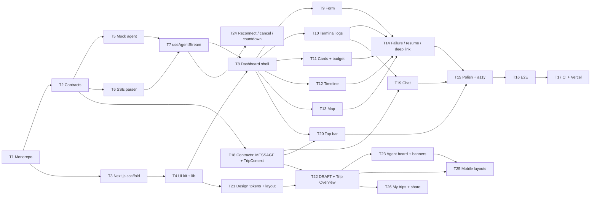

# ai-travel-web — Frontend Technical Specification

> All paths below are relative to `apps/web/`.
> System-wide design (graph, SSE protocol, contracts, deploy) is in [`../../ARCHITECTURE.md`](../../ARCHITECTURE.md);
> this file specifies how the web app implements it.
> The visual and interaction design is in the design project (`.context/design/*.dc.html`, "Web dashboard v2"
> is the launch page). Where this spec and the design disagree, the design wins.

---

## 1. Responsibilities

- Collect the trip request and send it to `ai-travel-agent`.
- Consume the SSE stream and render it live: a friendly agent chat (with confirmed decisions), an agent board,
  technical terminal logs, a progress bar with phases, and a **Trip Overview** that fills in as agents decide
  (budget breakdown, selected flight with transfers, hotel, day-by-day plan, interactive map).
- Show the destination bar as soon as the destination is known: place and dates, weather, currency rate, local time
  (`GET /api/trip-context`).
- Survive a dropped connection (reconnect and catch up), a rate limit (countdown), and an over-budget result
  (raise the budget, shorten the trip, or keep the best options).
- Validate every incoming packet with the shared Zod schemas; never trust the wire.
- Hold **no secrets** and contain **no business logic** (cost math, retries, search, suggestions all live in the agent).

Package name `ai-travel-web`. Next.js 16 (App Router, Turbopack), React 19, TypeScript strict.

Next.js 16 notes that matter here:

- Turbopack is the default bundler for `next dev` and `next build` — no `--turbopack` flag needed.
- `next lint` no longer exists: lint with the ESLint CLI (`eslint .`) and a flat config using `eslint-config-next`.
- Request APIs are async only: `searchParams`, `params`, `cookies()`, `headers()` must be awaited.
- `middleware.ts` is now `proxy.ts` (this app doesn't use either).
- Requires Node.js ≥ 20.9 (the repo uses the current LTS from `.nvmrc`).
- **Cache Components** (`cacheComponents: true`, the create-next-app default) is on: routes are static
  by default, and anything that reads request data (`searchParams`, uncached `fetch`) must sit inside a
  `<Suspense>` boundary or the build fails. `partialPrefetching` is on as well.
- Tailwind v4 is wired through the `@tailwindcss/turbopack` loader in `next.config.ts` (no PostCSS config).
- `LayoutProps<'/'>` / `PageProps<'/'>` are global route types generated by `next typegen`.

---

## 2. Folder structure

```text
apps/web/
├── src/
│   ├── app/
│   │   ├── layout.tsx              # <html>, fonts, globals.css, Toaster
│   │   ├── page.tsx                # Server Component: reads ?trip=, renders <TripDashboard>
│   │   ├── trips/page.tsx          # + "My trips" list (client component, reads localStorage)
│   │   └── globals.css             # Tailwind + shadcn theme tokens
│   ├── components/
│   │   ├── TripDashboard.tsx       # + 'use client' — owns useAgentStream, lays out the screen
│   │   ├── TripInputForm.tsx       # request form (locks to a brief summary while a run is active)
│   │   ├── TopBar.tsx              # + destination bar: place · weather · currency · local time
│   │   ├── AgentChat.tsx           # + friendly agent messages, "Confirmed" decisions, callouts
│   │   ├── AgentBoard.tsx          # + one row per agent: latest line, status, pass
│   │   ├── AgentTerminalLogs.tsx   # streamed live console (technical log)
│   │   ├── RunBanners.tsx          # + fallback model, estimates, over budget, paused, reconnecting
│   │   ├── RunDetails.tsx          # + thread, checkpointer, last checkpoint, model, re-plans
│   │   ├── TripOverview.tsx        # + live right column: budget, flight, hotel, map, days
│   │   ├── BudgetMeter.tsx         # + total vs budget, segments, passes table
│   │   ├── MapboxViewer.tsx        # interactive route map (client-only)
│   │   ├── FlightHotelCards.tsx    # flight (with transfers) & hotel cards
│   │   ├── ItineraryTimeline.tsx   # day tabs + the selected day's stops
│   │   ├── TripActions.tsx         # + Stop run · Re-plan · Share trip
│   │   └── ui/                     # shadcn/ui generated components (do not hand-edit)
│   ├── hooks/
│   │   ├── useAgentStream.ts       # SSE hook, typed by @ai-travel/contracts
│   │   ├── useTripContext.ts       # + weather / rate / time-zone lookup for the destination bar
│   │   ├── useTripHistory.ts       # + "My trips": thread ids kept in localStorage
│   │   ├── useCountdown.ts         # + seconds left until a timestamp (rate-limit button)
│   │   └── useStickToBottom.ts     # + shared auto-scroll behaviour of chat and terminal
│   └── lib/
│       ├── utils.ts                # cn() (re-exported from the `cn` package) + formatUsd/formatTime/formatDate
│       ├── env.ts                  # + Zod-validated public env → { agentUrl, mapboxToken }
│       ├── labels.ts               # + agent names/colours, day colours, log styles, status & phase labels, decision labels, weather icons, rating words
│       ├── links.ts                # + "Maps" and fare/room link helpers
│       ├── time.ts                 # + local time and time-zone difference via Intl
│       └── sse.ts                  # + framework-free SSE parser
├── test/                           # Vitest + RTL (setup.ts); test/e2e/ for Playwright
├── components.json                 # shadcn config (style base-nova)
├── eslint.config.mjs               # ESLint flat config (eslint-config-next)
├── vitest.config.ts                # jsdom, `@` alias
├── .env.example
├── next.config.ts
├── package.json                    # name: ai-travel-web
└── tsconfig.json                   # extends ../../tsconfig.base.json, moduleResolution Bundler
```

Files marked `+` are not in the blueprint tree; see ARCHITECTURE.md §15 for why they exist.

---

## 3. Dependencies

| Package | Purpose |
| --- | --- |
| `@ai-travel/contracts` (`workspace:*`) | `SseEventSchema`, `TripRequestSchema`, all domain types |
| `next` 16, `react` 19, `react-dom` 19 | App Router, RSC |
| `tailwindcss` v4, `@tailwindcss/turbopack` | Styling |
| shadcn/ui: `shadcn` (theme CSS), `@base-ui/react` (primitives), `class-variance-authority`, `cn` (class merging, replaces clsx + tailwind-merge), `lucide-react`, `tw-animate-css` | Component kit |
| `framer-motion` | Log-line, card and timeline animations |
| `react-hook-form`, `@hookform/resolvers` | Form state + Zod resolver |
| `mapbox-gl`, `react-map-gl` | Map |
| `sonner`, `next-themes` | Toasts (shadcn's `Toaster` reads the theme via `next-themes`; we pin `theme="light"`) |
| `zod` (`catalog:`) | Validation |
| dev: `eslint`, `eslint-config-next` | Lint (flat config, `eslint.config.mjs`) |
| dev: `vitest`, `jsdom`, `@testing-library/react`, `@testing-library/dom`, `@testing-library/jest-dom`, `@playwright/test` | Tests |

Dependencies are added by the ticket that first needs them (e.g. `framer-motion` in T10, `react-hook-form` in T9,
`mapbox-gl` in T13), not up front.

shadcn components installed: `button`, `card`, `input`, `textarea`, `field`, `label`, `progress`, `badge`,
`scroll-area`, `skeleton`, `alert`, `separator`, `tooltip`, `sonner`. (`field` replaces the old `form`
component, which is an empty placeholder in the `base-nova` style.) Base UI primitives use a `render` prop
instead of Radix's `asChild`.

Scripts:

```json
{
  "dev": "next dev --port ${CONDUCTOR_PORT:-3000}",
  "build": "next build",
  "start": "next start --port ${PORT:-3000}",
  "test": "vitest run",
  "test:watch": "vitest",
  "typecheck": "next typegen && tsc --noEmit",
  "lint": "eslint ."
}
```

---

## 4. Configuration

### 4.1 Environment

| Variable | Required | Notes |
| --- | --- | --- |
| `NEXT_PUBLIC_AGENT_URL` | no | Base URL of the agent, e.g. `https://ai-travel-agent.onrender.com`. Unset in a deployed build → UI-only mode |
| `NEXT_PUBLIC_MAPBOX_TOKEN` | no | Public token, URL-restricted in the Mapbox dashboard. Missing → map placeholder |

`next.config.ts` derives a local default **only for `next dev`**, so parallel Conductor workspaces work
without `.env` edits, while deployed builds never point at `localhost`:

```typescript
import type { NextConfig } from 'next';
import { PHASE_DEVELOPMENT_SERVER } from 'next/constants';

export default function nextConfig(phase: string): NextConfig {
  const agentPort = process.env.CONDUCTOR_PORT ? Number(process.env.CONDUCTOR_PORT) + 1 : 4000;
  const devDefault = phase === PHASE_DEVELOPMENT_SERVER ? `http://localhost:${agentPort}` : undefined;
  const agentUrl = process.env.NEXT_PUBLIC_AGENT_URL ?? devDefault;
  return { env: agentUrl ? { NEXT_PUBLIC_AGENT_URL: agentUrl } : {} };
}
```

`lib/env.ts` validates the public values once with Zod (optional `z.string().url()` for the agent URL,
optional token) and exports a typed `env` object with `agentUrl: string | null` and
`mapboxToken: string | null`. Components import `env`, never `process.env`.
Because `NEXT_PUBLIC_*` values are inlined at build time, they are listed under `build.env` in `turbo.json`.

**UI-only mode** (`env.agentUrl === null`) — used for Vercel previews and production until the agent
is deployed:

- `TripDashboard` shows an info `Alert`: "Preview — the planning agent isn't connected yet."
- `TripInputForm` is fully usable for input and validation, but submit is disabled (with a tooltip).
- `page.tsx` skips the deep-link fetch; `useAgentStream.start/resume` are guarded no-ops.
- Everything else (layout, empty states, styling) renders normally.

### 4.2 TypeScript

Extends `tsconfig.base.json`; `module: "esnext"`, `moduleResolution: "bundler"`, `jsx: "react-jsx"`
(Next 16 default), path alias `@/*` → `src/*`. `exactOptionalPropertyTypes` is turned **off** here because
the generated `components/ui/*` files don't compile with it. `@ai-travel/contracts` is consumed from its built `dist/`, so no
`transpilePackages` entry is needed.

---

## 5. Data layer

### 5.1 SSE parser — `lib/sse.ts`

```typescript
export async function* readSseEvents(body: ReadableStream<Uint8Array>, signal?: AbortSignal): AsyncGenerator<{ id: string | null; data: string }>;
```

- Decode with `TextDecoderStream`, keep a string buffer, split events on blank lines (`\n\n`, also accept `\r\n\r\n`).
- Per event: ignore lines starting with `:` (heartbeats); join all `data:` lines with `\n`; yield `{ id, data }` where `id` is the
  event's `id:` value (or `null`); ignore `event:`/`retry:` fields. The hook keeps the last `id` for `Last-Event-ID`.
- Must handle events split across chunks at any byte position (multibyte UTF-8 included) — covered by tests.
- Pure module, no React, no Zod — easy to unit test.

### 5.2 Hook — `hooks/useAgentStream.ts`

```typescript
type StreamStatus = 'idle' | 'connecting' | 'streaming' | 'reconnecting' | 'completed' | 'failed' | 'aborted';

interface AgentStreamState {
  status: StreamStatus;
  threadId: string | null;
  logs: LogPayload[];              // technical lines → AgentTerminalLogs, AgentBoard
  messages: MessagePayload[];      // friendly chat messages → AgentChat
  decisions: Partial<Record<DecisionTopic, MessagePayload>>;  // newest confirmation per topic
  draft: DraftPayload;             // the trip so far → TripOverview, TopBar (merged: later fields replace earlier ones)
  progress: ProgressPayload | null;
  result: ResultPayload | null;
  error: string | null;            // transport or validation error shown to the user
  retryAt: number | null;          // epoch ms when the rate limit lifts (429), else null
  reconnect: { attempt: number; max: number; nextAt: number | null } | null;
  lastRequest: TripRequest | null; // for Re-plan, Start over and the over-budget actions
}

function useAgentStream(initial?: { threadId?: string; result?: ResultPayload | null }): AgentStreamState & {
  start(request: TripRequest): void;
  resume(): void;                  // POST /api/trips/:threadId/resume — only when threadId is set and status = 'failed'
  reconnectNow(): void;            // skip the backoff wait
  cancel(): void;                  // POST …/cancel (best effort), abort the fetch; status → 'aborted'
  reset(): void;                   // back to 'idle', clears data
};
```

Behaviour:

1. `start` aborts any in-flight run, dispatches `connecting`, remembers `lastRequest`, and calls
   `fetch(`${env.agentUrl}/api/trips`, { method: 'POST', headers: { 'Content-Type': 'application/json', Accept: 'text/event-stream' }, body, signal })`.
2. Non-2xx response → read the JSON `{ error: { code, message, retryAfterSeconds? } }`; status `failed`, message mapped for
   the user. `RATE_LIMITED` sets `retryAt = Date.now() + retryAfterSeconds × 1000`; the form shows the countdown (§7), the message is
   "You've reached the request limit for now."
3. On 200 read `X-Thread-Id`, dispatch `streaming`, write `?trip=<threadId>` to the URL with
   `history.replaceState` (survives reload, no navigation).
4. For each `{ id, data }` from `readSseEvents`: remember `id` as `lastEventId`; `JSON.parse` → `SseEventSchema.safeParse`. Invalid packets are
   dropped with `console.warn` (dev) — they never crash the UI.
   - `LOG` → append to `logs`.
   - `MESSAGE` → append to `messages` (`decision` and `callout` are kept as is; the UI never infers them) and, when `decision !== null`, set `decisions[decision]`.
   - `DRAFT` → shallow-merge into `draft` (a field in a later packet replaces the earlier value).
   - `PROGRESS` → replace `progress`, keeping `progressPercent = max(previous, next)`.
   - `RESULT` → set `result`; status = `result.status` (`completed` / `failed`), `error = result.error`.
5. **Reconnect.** The stream ends without a `RESULT`, or the read fails with a network error (not an abort) → status `reconnecting`,
   `reconnect = { attempt, max: 5, nextAt }`. Wait 1 s, 2 s, 4 s, 8 s, 15 s (or until `reconnectNow()`), then
   `GET /api/trips/:threadId/stream` with `Last-Event-ID: <lastEventId>`; the agent replays what was missed, so the logs, chat and draft catch up
   without duplicates (packets with an id ≤ `lastEventId` are ignored). Success → `streaming`. `404` or five failed attempts → `failed`,
   error "Connection lost", `resume()` available.
6. `AbortError` from `cancel()` or unmount → status `aborted`, no error toast.
7. State lives in a `useReducer`; the reducer is exported and unit-tested on its own.
8. The run starts only from a user action (`start`/`resume`), never from an effect, so React Strict Mode's
   double effects cannot start two runs. The `AbortController` is kept in a ref and aborted on unmount; reconnect timers are cleared too.

### 5.3 Reload / deep link

`page.tsx` is a Server Component. In Next.js 16 `searchParams` is a Promise and must be awaited:

```typescript
export default async function Page({ searchParams }: { searchParams: Promise<{ trip?: string }> }) {
  const { trip } = await searchParams;
  const initialResult = trip ? await fetchTripResult(trip) : null;   // GET /api/trips/:id, cache: 'no-store'; null on any error
  return <TripDashboard initialThreadId={trip ?? null} initialResult={initialResult} />;
}
```

A completed trip reopens with its results; an unfinished one shows a "Resume" button. The chat and
terminal are live-only (beyond the agent's 10-minute replay buffer), so a reopened trip starts with them empty
(the confirmed decisions are still visible in the result itself); the destination bar is fetched from the reopened
trip's `destination`. "Share trip" copies this `?trip=<threadId>` link.

With Cache Components on, `page.tsx` renders the static shell (header, layout) immediately and puts the
part that awaits `searchParams` and `fetchTripResult` inside `<Suspense fallback={<DashboardSkeleton />}>`.

### 5.4 Trip context — `hooks/useTripContext.ts`

```typescript
type TripContextStatus = 'idle' | 'loading' | 'ready' | 'error';
function useTripContext(destination: string | null, origin?: string | null): { status: TripContextStatus; data: TripContext | null };
```

- `destination` is `draft.destination ?? result?.destination` — empty/`null` → `idle`. The call is made as soon as the destination is
  known: from the first `DRAFT` (right after the Supervisor) during a run, or from the `RESULT` when a stored trip reopens.
- `fetch(`${env.agentUrl}/api/trip-context?destination=${encodeURIComponent(destination)}&origin=…`, { signal })`, then
  `TripContextSchema.safeParse`. An invalid body counts as an error.
- A module-level `Map` caches results per normalised destination + origin for the page's lifetime; a destination
  change aborts the previous request.
- **Failures are silent**: no toast, no error state in the UI, no effect on the run. `error` just means the bar
  shows nothing. Guarded no-op when `env.agentUrl === null` (UI-only mode).
- Runs in an effect keyed by `destination` (it is a read-only GET, so Strict Mode double-invocation is harmless;
  the abort-on-cleanup keeps it to one in-flight call).

---

## 6. Screen layout — `components/TripDashboard.tsx`

`'use client'`. Owns `useAgentStream`, `useTripContext` and the shared UI state `activeDay: number | null`.

```text
┌ Header: ✈ AI Travel Planner · Plan a trip · My trips ········ [Stop run | Re-plan · Share trip] ┐
│ TopBar:  📍 Paris, France · Thu 12 – Tue 17 Nov · 5 nights │ ⛅ 12°C Partly cloudy │ € EUR │ 🕓 16:30 │
│ ┌── left column (lg: 5/12) ──────────┐  ┌── right column (lg: 7/12) — Trip Overview ───────────┐ │
│ │ Brief summary (form when idle)     │  │ Heading + total vs budget (BudgetMeter)               │ │
│ │ Progress: % · ETA · phase chips    │  │ Breakdown: Flights · Hotel · Transfers · Daily spend  │ │
│ │ RunBanners                         │  │ Selected flight (+ transfers)  ·  Selected hotel      │ │
│ │ AgentBoard                         │  │ Map                                                   │ │
│ │ AgentChat (primary feed)           │  │ Day by day: day tabs + the selected day's stops       │ │
│ │ Technical log (collapsible)        │  └──────────────────────────────────────────────────────┘ │
│ └────────────────────────────────────┘                                                           │
└──────────────────────────────────────────────────────────────────────────────────────────────────┘
```

- Below `lg` the columns stack. **Live run (mobile):** brief title, progress, agent list, the latest two log lines
  with "Show all logs", "Stop run". **Trip ready (mobile):** headline with total and day tabs, the selected day's stops,
  flight and hotel summary rows, "Open map" (a sheet), "Share trip".
- The header wordmark stays in the static shell (`page.tsx`); `TopBar`, the nav actions and everything else are rendered by
  `TripDashboard`, because they need client state. The header has no avatar or account menu in v1 (no auth).
- While a run is active the form collapses to a one-line brief ("Planning 5 days in Paris…", the Supervisor's parsed
  destination, origin, days and budget from the first `DRAFT`); it expands again when idle, failed or finished.
- **Trip Overview** reads `result ?? draft`. It is empty-state ("fills in as agents decide") until the first `DRAFT`; sections appear as their
  data arrives, each with a "Confirmed" tag once `decisions[topic]` exists (`flight`, `hotel`, `transfers`, `itinerary`) and a pending note
  ("Final check pending") until `budget` is confirmed. Day cards show "drafting" for the day in `progress.detail` and "waiting" for the rest.
- **Progress:** shadcn `Progress` bound to `progress.progressPercent`; the label comes from `currentStatus` (`parsing` → "Understanding your
  request", `searching` → "Searching flights & hotels", `planning` → "Building your itinerary", `auditing` → "Checking the budget",
  `completed` → "Done") plus `progress.detail` ("Day 4 of 5"). Six **phase chips** — Brief, Flights, Hotel, Transfers, Itinerary, Budget check —
  are done when their decision exists (budget check: when the result is in) and current while they are the first without one. "About 20 s left"
  is estimated from the elapsed time and the percent and is hidden below 15 % and after completion.
- **Budget:** `BudgetMeter` shows `totalCost` vs `budget` ("$100 under", "Within $15", "Over by $84"); the bar rescales past 100 % and a tick marks the
  budget. The breakdown (flight, hotel × `durationDays`, transfers, daily × days) is display only — the agent's `totalCost` is authoritative.
  One `Alert` per `warnings` entry (amber); a destructive `Alert` with `error` + `threadId` + Resume / Start over when `status = 'failed'`.
  When `result.suggestions` is set, three actions: "Raise to $1,100" and "Try 4 days" (each calls `start({ ...lastRequest, budget | durationDays })`;
  "Try N days" is hidden when `tryDays >= durationDays`) and "Keep these" (dismisses the suggestion).
- "Stop run" (`cancel`) is visible while `connecting`/`streaming`/`reconnecting`; "Re-plan" (`start(lastRequest)`) and "Share trip" appear on a finished trip.

---

## 7. Components

All components are typed with contracts types only. Props listed are the full public API.

### `TripInputForm.tsx`

```typescript
{ onSubmit: (request: TripRequest) => void; disabled: boolean; retryAt: number | null; brief: DraftPayload | null }
```

- `react-hook-form` + `zodResolver(TripRequestSchema)` — the same schema the agent uses — rendered with
  shadcn `Field` components through `Controller`.
- Fields: `prompt` ("Describe your trip", textarea, required, counter up to 1,000), and an optional details group: `origin` ("From"),
  destination hint is part of the prompt, `durationDays` ("Days", 1–30), `budget` ("Budget, USD"), `startDate` (date ≥ today).
- Empty optional inputs are removed from the payload (not sent as `""`/`NaN`).
- 3 example prompt chips that fill the textarea ("Weekend in Istanbul, $600", "7 days in Tokyo, $2,500", "5 days in Paris from Tashkent, $1,000 budget").
- Inline errors after submit say what to do ("Pick a place the agents can search — "somewhere warm" isn't one yet.", "Add a budget so the Budget Auditor can check
  the total."), shown under the field with `aria-describedby`.
- `disabled` while a run is active; when `brief` is set the form collapses to the one-line summary. Enter + ⌘/Ctrl submits.
- **Rate limit:** while `retryAt` is in the future the submit button is disabled and reads "Plan trip in 0:42" (`useCountdown`); it comes back when the timer ends.

### `TopBar.tsx`

```typescript
{ status: TripContextStatus; data: TripContext | null; startDate: string | null; durationDays: number | null }
```

- Up to four chips, each rendered only if its data is present: **place** (`data.location`, with "Thu 12 – Tue 17 Nov · 5 nights" built from
  `startDate` / `durationDays` with `Intl.DateTimeFormat`), **weather** (lucide icon from `lib/labels.ts` by `weather.icon`, `Intl.NumberFormat`
  `unit: 'celsius'`, `weather.condition`, a second line "Today 9–14°C · rain Saturday" from `todayLowC` / `todayHighC` / `outlook`), **currency**
  ("EUR (€)" from `data.currency`, second line `1 USD = 0.92 EUR` with `Intl.NumberFormat` `maximumSignificantDigits: 4`, tooltip with `asOf`),
  **local time** (`lib/time.ts`: `Intl.DateTimeFormat` with `data.timeZone`, e.g. "16:30 · Paris (GMT+1)", second line "4 hrs behind Tashkent · 20:30 there" when
  `originTimeZone` is set; refreshed once a minute).
- `loading` → four `Skeleton` chips; `idle`, `error`, or no chip with data → renders nothing (no empty bar).
- `data.source === 'mock'` is a test fixture marker only; do not show it in the UI.
- Each chip has an `aria-label` that reads as a sentence ("Weather in Paris: 12 degrees, partly cloudy"); the icon is decorative (`aria-hidden`) —
  information is never colour or icon alone.
- Display only: no conversion maths in the browser (the agent returns the rate); time-zone formatting is presentation, done with `Intl`.

### `AgentChat.tsx`

```typescript
{ messages: MessagePayload[]; status: StreamStatus; decisionCount: number }
```

- The primary feed: a conversation list in a `ScrollArea`, per message the agent's display name and colour (from `lib/labels.ts`), `HH:mm` time and
  `text`. `@Name` tokens in the text are highlighted. Messages are read-only; there is no input box. A header shows "Agent Chat · N decisions confirmed".
- `decision !== null` → a **confirmed decision**: "Confirmed" `Badge` with a check icon, the topic label (`decisionLabels[decision]`, e.g. "Flight") and the
  message's detail line, plus an accent border. Never infer a decision from the text.
- `callout !== null` → a tag under the text: amber for `warn` ("Over budget by $125 · re-plan 1 of 2"), neutral for `info` ("Weather prep · Day 3 moved indoors").
- A banner line "Itinerary Planner is drafting Day 4" from `progress.detail` while streaming; typing indicator (three animated dots) otherwise;
  static when `prefers-reduced-motion`.
- New messages animate in with Framer Motion (≤150 ms); auto-scroll and "Jump to latest" come from `useStickToBottom` (shared with the terminal).
- Empty state when `idle`: "Describe your trip and the agents will walk you through their plan."
- Accessibility: `role="log"`, `aria-live="polite"`, `aria-label="Conversation"`.
- On a finished trip a compact variant lists the confirmed decisions ("Brief · Flight · Hotel · Transfers · Itinerary · Budget", each with its agent and
  one-line summary) with "Open full chat" and "Technical log" tabs.

### `AgentBoard.tsx`

```typescript
{ logs: LogPayload[]; progress: ProgressPayload | null; status: StreamStatus }
```

- One row per agent (Supervisor, Flight Agent, Hotel Agent, Itinerary Planner, Budget Auditor): step number, **Latest** (that agent's newest log line),
  **Status** chip, update time. Header "LangGraph · 5 nodes · pass 2".
- Status is derived, not sent: `done` when the agent has logged in the current pass; `running` for the first agent without a log in this pass
  (Planner: "Building day 3 of 5" from `progress.detail`); `waiting` for the rest; `failed` for the agent of the last `error` log when `status = 'failed'`.
  A new pass starts when `progress.pass` increases; agents that re-ran show a "pass 2" tag and their new latest line ("$420 via Istanbul · was $500 direct").
- Status chips share one shape per state: Waiting, Running (amber "live"), Done, Failed — the word and an icon carry the meaning, not colour alone.
- On mobile it is a compact list (number, name, latest line).

### `AgentTerminalLogs.tsx`

```typescript
{ logs: LogPayload[]; status: StreamStatus }
```

- Wrapped in a collapsible "Technical log" section (collapsed by default in production builds). Header: "N LOG packets", an "Auto-scroll on" toggle and a "Copy" button.
- Dark terminal look (ink ground `#0B1726`, Geist Mono 13/20), inside `ScrollArea`, fixed height (~320 px).
- Line format: `HH:mm:ss  #step  Agent  message`; agent tag in the agent's fixed colour (`Supervisor`, `FlightAgent`, `HotelAgent`, `Planner`, `BudgetAuditor`);
  `warn` lines amber with a `WARN` prefix, `error` lines red with `ERROR`; `kind: 'checkpoint'` lines are a dim row without a step ("checkpoint · state saved after step 5 · PostgresSaver");
  the newest line is highlighted.
- New lines animate in with Framer Motion (`opacity`/`y`, ≤150 ms); respect `prefers-reduced-motion`.
- Auto-scroll to bottom unless the user has scrolled up; "Jump to latest" button appears in that case.
- Blinking cursor line while `streaming`.
- Accessibility: `role="log"`, `aria-live="polite"`, `aria-label="Technical log"`.

### `RunBanners.tsx`

```typescript
{ status: StreamStatus; logs: LogPayload[]; result: ResultPayload | null; reconnect: AgentStreamState['reconnect']; lastProgress: ProgressPayload | null; onResume: () => void; onStartOver: () => void; onReconnect: () => void }
```

Stacked `Alert`s, each with a title, one sentence and an action where there is one (all are display only):

| Banner | Shown when | Content / action |
| --- | --- | --- |
| Running on fallback model | a log with `kind: 'llm-fallback'` | "The primary model is unavailable; the fallback took over." No action |
| Live search down — estimates | a log with `kind: 'search-fallback'`, or a flight/hotel with `source: 'mock'` | "Live prices are unavailable, so these are estimates. Check before you book." |
| Over budget after 2 re-plans | `result.suggestions !== null` | "Best options found, $84 over." Actions are the three over-budget buttons from §6 |
| Run stopped at step N | `status = 'failed'` with a `threadId` | "Steps 1–N−1 are saved." **Resume from step N** / **Start over**; the last run stays visible but dimmed |
| Reconnecting | `status = 'reconnecting'` | "Reconnecting · attempt 2", "Last update · 65% planning", "The run keeps going on the server." **Reconnect now** |
| Trip ready | `status = 'completed'`, no warnings | "Trip ready · $100 under — re-planned once to fit your budget." (`replans`) |

### `RunDetails.tsx`

```typescript
{ threadId: string | null; progress: ProgressPayload | null; replans: number }
```

- A small collapsible card: thread id, checkpointer (`progress.run.checkpointer`), last checkpoint ("step 5"), model (`progress.run.model`), re-plans "1 of 2". Hidden in UI-only mode.

### `TripOverview.tsx`

```typescript
{ trip: DraftPayload | ResultPayload; decisions: AgentStreamState['decisions']; progress: ProgressPayload | null; result: ResultPayload | null;
  activeDay: number | null; onSelectDay: (day: number | null) => void }
```

- Composes `BudgetMeter`, `FlightHotelCards`, the map and the day tabs. Heading while running: "Trip Overview — fills in as agents decide"; when finished:
  "5 days in Paris", "Tashkent → Paris · planned by 5 agents · re-planned once to fit your budget".
- Renders only the sections whose data exists; an empty section is absent, not a blank card.

### `BudgetMeter.tsx`

```typescript
{ totalCost: number; budget: number; parts: { flight: number; hotel: number; transfers: number; daily: number }; passes: BudgetPass[]; final: boolean }
```

- Total vs budget with a stacked bar in one hue, stepped lightness (flights, hotel, transfers, daily, left), a tick at the budget; "$975 of $1,000", "Approved · $25 to spare" / "Final check pending" / "Over by $84".
- The bar rescales past 100 %.
- When `passes.length > 1`, a "What changed on re-plan" table (Item · Pass 1 · Pass 2 …) using `flightLabel`, `hotelLabel`, transfers, daily, total.
- `parts` come from the draft/result fields (`flights[0].price`, `hotels[0].pricePerNight × durationDays`, `Σ transfers.priceUsd`, `dailyExpensesEstimate × durationDays`); display only.

### `FlightHotelCards.tsx`

```typescript
{ flights: Flight[]; hotels: Hotel[]; transfers: Transfer[]; durationDays: number; confirmed: { flight: boolean; hotel: boolean; transfers: boolean } }
```

- Index `0` of each list is the agent's selection: highlighted border, "Selected" badge, plus "Confirmed" once its decision exists. Other options appear as
  a "Dropped option" row (airline, stops, price struck through) when the list has more than one entry after a re-plan.
- **Flight card:** airline, "round trip", price (`formatUsd`), stops ("1 stop · IST" / "Direct"), a route strip per leg — `TAS 06:40 ─ IST 1 h 50 m layover ─ CDG 13:55 · T1`
  with airport names and `+1 day` when the arrival date differs — and the return leg when present. Below it the transfers of the trip as rows
  ("Taxi · CDG Terminal 1 → hotel · fixed fare €56 (~$61) · about 45 min", "RER B · Gare du Nord → CDG Terminal 1 · About $14"). Links: "View fare" (`bookingUrl`), "Maps".
- **Hotel card:** photo (`photoUrl`, a neutral placeholder block when `null`), name, `area`, rating as a score out of 10 with a word from `lib/labels.ts`
  (`ratingWords`: ≥ 9 "Superb", ≥ 8 "Very good", ≥ 7 "Good", else "Fair"), check-in / check-out, `transit`, `$66 × 5 nights = $330`. Links: "View rooms", "Maps".
- `source === 'mock'` → muted "Estimate" badge with a tooltip "Live prices were unavailable".
- Staggered entrance animation on first render of a result. Dates and times use `Intl.DateTimeFormat` in the leg's own offset.

### `ItineraryTimeline.tsx`

```typescript
{ itinerary: ItineraryDay[]; pendingDays: { drafting: number | null; total: number }; activeDay: number | null; onSelectDay: (day: number | null) => void }
```

- **Day tabs:** one tab per `itinerary[].day`, "Day 1 · Thu" with date, `weather` (icon, high °C, condition) and the stop count; days not yet planned show "drafting" / "waiting".
  The tab colour is the day's colour (`lib/labels.ts`) and the same number labels its pins on the map.
- Below the tabs: the selected day's heading ("Day 2 · Museums along the Seine"), weather line, and the stops as a numbered list — name, `note` ("Morning"),
  coordinates in Geist Mono; the arrival / departure transfer of that day shown as the first / last row with its cost, and "Daily spend ~$30".
- Clicking a tab sets `activeDay` (click again to clear); the map follows. Keyboard accessible (tabs with arrow-key navigation, visible focus ring).

### `MapboxViewer.tsx`

```typescript
{ itinerary: ItineraryDay[]; hotel: Hotel | null; activeDay: number | null }
```

- Client-only: imported in `TripDashboard` with `next/dynamic(() => import(...), { ssr: false })`
  and a `Skeleton` while loading. Import `mapbox-gl/dist/mapbox-gl.css` inside this component.
- `react-map-gl` (`react-map-gl/mapbox`) with `env.mapboxToken`.
- Numbered markers in visiting order, coloured per day: the selected day's stops are full size, other days small and faded until their tab opens. A **hotel marker**
  (`hotel.location`) marks the start and end of every day. A line layer (GeoJSON `LineString`) joins the hotel and the stops of the selected day in order (straight legs).
- Caption "Showing Day 2 · Fri 13 Nov — pick a day below to change the route"; a legend for selected stop, other days, hotel and route.
- `fitBounds` to all places on result, to the active day's places when `activeDay` changes (padding 48, animated).
- Marker popup: place name + "Day N".
- No token or no places → placeholder card listing the places instead of a broken map.

### `TripActions.tsx`

```typescript
{ status: StreamStatus; threadId: string | null; canReplan: boolean; onStop: () => void; onReplan: () => void }
```

- "Stop run" (destructive) while `connecting`/`streaming`/`reconnecting`; "Re-plan" (secondary) and "Share trip" (copies the `?trip=` link, toast "Link copied") on a finished trip.

### `/trips` — "My trips"

- `hooks/useTripHistory.ts` stores `{ threadId, title, createdAt }` in `localStorage` (max 20) when a `RESULT` arrives. `app/trips/page.tsx` (client) lists them, newest first,
  each linking to `/?trip=<threadId>`; a trip the agent no longer knows (`404`) shows "No longer available" and a remove button. No accounts, no server storage in v1.

---

## 8. Styling & UX rules

- **Visual identity — "Departure board"** (design: Foundations board). Cool paper ground, navy ink, one blue for actions and amber only for what is live
  right now. Geist Sans for the interface, Geist Mono for anything the agents produce (prices, codes, logs), via `next/font`. Light theme only —
  no `ThemeProvider`. The wordmark is the text "AI Travel Planner" with the lucide `Plane` icon.
- **Tokens** live in `globals.css` and override the shadcn `base-nova` variables, so components keep using the shadcn names:

| Token | Value | Use |
| --- | --- | --- |
| `--background` | `#F2F3F5` | Page ground |
| `--card` | `#FFFFFF` | Cards, inputs |
| `--border` | `#DDE1E6` | Borders, dividers |
| `--foreground` | `#0B1726` | Text; also the terminal ground |
| ink 2 / `--muted-foreground` | `#3D4A5C` / `#5F6B7A` | Secondary text / labels (4.9:1 on ground) |
| `--primary`, `--ring` | `#2952CC` | Buttons, links, route line |
| `--live`, `--live-foreground` | `#F2A60D`, `#8A5300` | Running, pending, warn |
| `--success` | `#0F7B5F` | Completed, under budget |
| `--destructive` | `#C2361F` | Failed, over budget |
| budget segments | `#1F3FA3` flights · `#4F78E0` hotel · transfers between · `#A9BDF0` daily · `#EEF0F3` left | `BudgetMeter` |
| day colours 1–5 | `#0F7B5F` `#2952CC` `#C46A00` `#7A4CD9` `#C2361F` | Day tabs and map pins |

  Agent colours for terminal tags and the chat live in `lib/labels.ts` next to the display names.
- **Type scale:** Display 36/40 · 600; Heading 20/28 · 600; Body 15/22; Small 13/18; Label Mono 11/16 caps; Figure Mono 36/40 · 600 (`$900 · TAS`); Log Mono 13/20.
- **Shape and spacing:** 4-pt scale (4 8 12 16 20 24 32 48); radius 8 for controls, 12 for cards, 14 on mobile, pill for chips. Controls are 40 px on desktop and 44–48 px on touch.
- **Run status** chips: the four working states (`parsing`, `searching`, `planning`, `auditing`) share one amber chip and the word carries the difference; finished states switch to an icon.
- Pins always carry their order number, so a day never depends on hue alone.- Tailwind utility classes only; merge conditional classes with `cn()` from `lib/utils.ts`.
- Use the theme tokens above (`bg-background`, `text-muted-foreground`, `text-primary`, …), not raw colours. The terminal uses the ink token too.
- Money always through one `formatUsd()` helper; dates/times through `Intl.DateTimeFormat`.
- Every async state has a visible representation: idle, loading (skeleton), streaming, completed, failed, aborted.
- Animations are short (≤300 ms) and disabled under `prefers-reduced-motion`.
- Target WCAG 2.1 AA: labelled inputs, focus states, contrast, no information by colour alone.

---

## 9. Rendering rules

- `layout.tsx` and `page.tsx` are Server Components. Interactivity starts at `TripDashboard` (`'use client'`)
  and everything it renders.
- Do not call the agent from a Next.js Route Handler or Server Action for streaming — Vercel function
  limits would cut long runs. The browser talks to the agent directly (CORS is configured there).
- The only server-side call is the non-streaming `GET /api/trips/:id` in `page.tsx`, inside `<Suspense>`
  (Cache Components). `GET /api/trip-context` is called from the browser by `useTripContext` (short JSON, no
  duration-limit risk), and so are the reconnect (`GET …/stream`) and cancel (`POST …/cancel`) calls.
- No global state library; state lives in `useAgentStream`, `useTripContext` and `TripDashboard`. The only persisted client state is the "My trips" list in `localStorage`.

---

## 10. Testing

| File | What it proves |
| --- | --- |
| `test/sse.test.ts` | Parser: events split at every byte offset, `\r\n`, multi-line `data:`, heartbeat comments ignored, `id:` returned, UTF-8 split across chunks |
| `test/useAgentStream.reducer.test.ts` | LOG and MESSAGE append, decisions keep the newest per topic, DRAFT merges, monotonic PROGRESS, RESULT completed/failed, stream end without RESULT → reconnecting |
| `test/useAgentStream.test.tsx` | Mocked `fetch` with a `ReadableStream` fixture; invalid packet dropped; 429 sets `retryAt`; cancel calls the cancel route and → aborted; reconnect sends `Last-Event-ID` and ignores replayed ids; 404 or five failures → failed with Resume |
| `test/TripInputForm.test.tsx` | Schema validation messages; optional empty fields omitted from payload |
| `test/components.test.tsx` | Selected / Confirmed badges, flight legs and layover, transfer rows, hotel total and rating word, mock "Estimate" badge, day tabs selection and "drafting" / "waiting", logs `role="log"` and checkpoint rows, hotel marker in the placeholder |
| `test/BudgetMeter.test.tsx` | Under / within / over wording, rescale past 100 %, passes table only after a re-plan |
| `test/AgentBoard.test.tsx` | Status derivation per pass (waiting → running → done), "pass 2" tag, failed agent |
| `test/RunBanners.test.tsx` | Each banner appears for its trigger only; over-budget buttons call `start` with the raised budget / fewer days; Resume and Reconnect now call their handlers |
| `test/TripInputForm.countdown.test.tsx` | Button disabled and labelled "Plan trip in 0:42" until `retryAt`, then enabled (fake timers) |
| `test/AgentChat.test.tsx` | "Confirmed" badge and topic label only for `decision !== null`, callout tones, `@Name` highlighting, typing indicator only while streaming, empty state, `role="log"` |
| `test/useTripContext.test.tsx` | Mocked `fetch`: loading → ready, invalid body → error, 404 → error, destination change aborts the previous call, cache hit, no call in UI-only mode, starts from the draft destination |
| `test/TopBar.test.tsx` | A `null` chip is hidden, all `null` renders nothing, skeleton while loading, today range and outlook, currency line, local time and difference to the origin, sentence-style `aria-label`s |
| `test/useTripHistory.test.tsx` | Saves on `RESULT`, caps at 20, removes an entry |
| `test/e2e/trip.spec.ts` | Playwright: agent in `TOOLS_MODE=mock` → submit → destination bar appears during the run → chat, board and logs fill → Trip Overview fills in → progress reaches 100 → cards, day tabs, map/placeholder render; a dropped stream reconnects; share copies the link |

Fixtures for packets are built with the contracts schemas so they cannot drift from the protocol.

---

## 11. Rules for working in this package

- Import every cross-service type and schema from `@ai-travel/contracts`. Never declare a local
  `Flight`, `Hotel`, packet type, or a hand-written copy of `TripRequest`.
- Never read `process.env` outside `lib/env.ts` and `next.config.ts`.
- Never put secrets in this app. Only `NEXT_PUBLIC_*` values, and only public ones.
- Don't add business logic (cost calculation, retries, choosing options) — render what the agent sends. That
  includes decisions (`MessagePayload.decision`), callouts, the exchange rate, the over-budget `suggestions` and the
  budget `passes`: display them, never derive them. Agent status on the board and the phase chips are presentation derived
  from packets, not new facts.
- Add shadcn components with the CLI (`pnpm dlx shadcn@latest add <name>`); don't hand-edit `components/ui/`.
- Run `pnpm --filter ai-travel-web test typecheck lint` before committing.

---

## 12. Implementation plan

> Step-by-step plan for building this app from the spec in §1–§11 and
> [`../../ARCHITECTURE.md`](../../ARCHITECTURE.md). Each ticket is one branch / one PR, small enough to
> review on its own.

---

### Overview

| Milestone | Tickets | Outcome | Status |
| --- | --- | --- | --- |
| **M1 · Foundation** | T1 – T4 | Monorepo, shared contracts, empty Next.js app with UI kit running on `pnpm dev` | ✅ Done (2026-10-27) |
| **M2 · Data layer** | T5 – T7 | Mock agent, SSE parser and `useAgentStream` hook, fully tested without any UI | ⏳ Next |
| **M3 · UI** | T8 – T13 | Dashboard and all its components, driven by the mock agent | — |
| **M4 · Resilience & ship** | T14 – T17 | Failure/resume/deep links, polish, end-to-end tests, CI and Vercel deploy | — |
| **M5 · Chat & top bar** | T18 – T20 | `MESSAGE` packets in the hook, `AgentChat` with "Confirmed" decisions, destination bar with weather, rate and local time | — |
| **M6 · Design v2** | T21 – T26 | The design's look and live Trip Overview: tokens and layout, `DRAFT` handling, agent board and banners, reconnect / cancel / countdown, mobile layouts, My trips | — |

#### Dependency graph



**Design v2 (M6):** the design (`.context/design`) added a live Trip Overview, an agent board, transfers, per-day weather, run banners and a reconnecting
stream after the first versions of T8–T20 were written. Those tickets keep their scope; T21–T26 apply the design on top of them. Build T21 early
(right after T8) so later components are styled once. Where a ticket below disagrees with §6–§8, §6–§8 win.

**Parallel work:** once T8 is merged, T9–T13 touch separate files and can run in separate
Conductor workspaces at the same time. After T18, T19 and T20 are independent of each other.

**Why a mock agent (T5):** the backend does not exist yet. A small scripted SSE server that speaks
the exact contract lets the frontend be built and tested now — **locally and in CI only**. Deployed
builds don't use it: until the agent is deployed, Vercel runs in UI-only mode (no `NEXT_PUBLIC_AGENT_URL`).
When the real agent lands, only the URL changes. The e2e suite then also runs against the real agent in `TOOLS_MODE=mock`.

#### Definition of done (every ticket)

- `pnpm --filter ai-travel-web typecheck lint test` passes (and `build` from T3 on).
- Cross-service types come only from `@ai-travel/contracts`; `process.env` is read only in `lib/env.ts` / `next.config.ts`.
- New behaviour has tests as listed in the ticket.
- If the implementation has to deviate from the spec in §1–§11, update the spec in the same PR.

Size: **S** ≈ half a day · **M** ≈ 1 day · **L** ≈ 2 days.

---

### M1 · Foundation

#### T1 — Monorepo foundation · S · ✅ Done

> Implemented with pnpm 10.34.9 (via Corepack), Turborepo 2.11, Node 24. Conductor config is
> `.conductor/settings.toml` (setup: `corepack enable pnpm && pnpm install`).

**Goal:** one `pnpm install` and `pnpm dev` at the repo root (ARCHITECTURE.md §12).

**Depends on:** —

**Tasks**
- Root `package.json` (`private`, `packageManager: pnpm@<exact>`, scripts `dev/build/test/typecheck/lint` → `turbo run …`, `turbo` dev dependency).
- `pnpm-workspace.yaml` with `apps/*`, `packages/*` and the `catalog` (`typescript`, `zod`, `vitest`).
- `turbo.json` exactly as in ARCHITECTURE.md §12.2 (incl. `build.env` and `dev.passThroughEnv`).
- `tsconfig.base.json` from §12.2.
- `.gitignore` (`node_modules`, `dist`, `.next`, `.turbo`, `.env*` except `.env.example`, `test-results`, `playwright-report`), `.npmrc` if needed.
- Conductor `.conductor/settings.toml`: setup `corepack enable pnpm && pnpm install`, run action `pnpm dev`.
- Written by hand from ARCHITECTURE.md §12 (no `create-turbo`: it adds example apps we'd only delete).
- `.nvmrc`: current Node LTS (Next.js 16 needs ≥ 20.9); `engines.node` in the root `package.json` to match.

**Acceptance**
- Fresh clone → `pnpm install` succeeds; `pnpm build` runs (no packages yet = no-op).
- Lockfile committed.

---

#### T2 — Shared contracts package (`@ai-travel/contracts`) · M · ✅ Done

> Zod 4 API (`z.iso.*`, `z.uuid()`); 24 schema tests. Added `DataSourceSchema`, per-packet event schemas
> and `SseEventInput` type.

**Goal:** the single source of types for both apps (ARCHITECTURE.md §5).

**Depends on:** T1

**Tasks**
- `packages/contracts/package.json`: name `@ai-travel/contracts`, `"type": "module"`, `exports` → `dist/index.js` + `dist/index.d.ts`, scripts `build: tsc`, `dev: tsc --watch`, `test`, `typecheck`.
- `src/trip.ts`, `src/sse-events.ts`, `src/index.ts` exactly as specified in §5.1 / §5.2 (incl. the added RESULT fields `origin`, `destination`, `durationDays`, `startDate`).
- `tsconfig.json` extending the base, `module`/`moduleResolution: NodeNext`.
- Tests: blueprint example packets parse; malformed packets (wrong `type`, missing fields, percent > 100, bad coordinates, non-UUID `threadId`) are rejected; `TripRequestSchema` bounds.

**Acceptance**
- `pnpm --filter @ai-travel/contracts build test` passes; `dist/` contains JS + `.d.ts`.
- Remove the `.gitkeep` in `packages/contracts/src`.

---

#### T3 — Next.js 16 app scaffold · M · ✅ Done

> Generated with `create-next-app@16.4.3` (`--no-react-compiler --no-agents-md`), kept its defaults:
> Cache Components + Partial Prefetching on, Tailwind via `@tailwindcss/turbopack`, `jsx: react-jsx`.

**Goal:** an empty `ai-travel-web` that starts on the right port and imports the contracts.

**Depends on:** T1 (T2 for the import check)

**How:** generate with the official `create-next-app`, then adapt it to the monorepo. It can't run
inside `apps/web/` (the folder already holds `SPEC.md`, `.gitkeep`s), so generate into a
temporary folder and copy in without overwriting:

```bash
# from the repo root
pnpm create next-app@16 .tmp-web --ts --tailwind --eslint --app --src-dir \
  --import-alias "@/*" --use-pnpm --skip-install --disable-git --yes
rsync -a --ignore-existing --exclude node_modules .tmp-web/ apps/web/
rm -rf .tmp-web
```

**Tasks — after generating**
- Delete what the monorepo owns or we don't want: nested `pnpm-lock.yaml` / `pnpm-workspace.yaml`
  (move any `onlyBuiltDependencies` entries to the root `pnpm-workspace.yaml`), generated `README.md`,
  any generated `AGENTS.md`, demo SVGs in `public/`, and the demo content of `page.tsx`.
- `package.json`: name `ai-travel-web`, add `@ai-travel/contracts: workspace:*`, `zod: catalog:`,
  remaining deps from §3, scripts from §3 (`dev` on `${CONDUCTOR_PORT:-3000}`, `lint: eslint .`, `typecheck`, `test`).
- `tsconfig.json` extends `../../tsconfig.base.json` with the options in §4.2.
- `next.config.ts` as in §4.1 (phase-based `NEXT_PUBLIC_AGENT_URL` default for `next dev` only).
- Keep the generated Tailwind v4 setup (`@tailwindcss/turbopack` loader, `globals.css`) and ESLint flat config.
- `layout.tsx`: Geist Sans/Mono, metadata, `<html lang="en">`. Placeholder `page.tsx` renders a value
  typed from `@ai-travel/contracts` (proves the workspace link).
- Vitest + jsdom + React Testing Library (`vitest.config.ts`, `test/setup.ts`) with one smoke test.
- `.env.example` with `NEXT_PUBLIC_AGENT_URL`, `NEXT_PUBLIC_MAPBOX_TOKEN` (both commented, both optional).
- `pnpm install` once from the repo root; remove the `.gitkeep` files in folders that now have content.

**Acceptance**
- `pnpm dev` from the root serves the page on `$CONDUCTOR_PORT` (or 3000) with Turbopack.
- `pnpm --filter ai-travel-web build typecheck lint test` passes.

---

#### T4 — UI kit, design tokens and `lib/` helpers · S · ✅ Done

> shadcn 4 default preset is `base-nova` (Base UI primitives); `field` used instead of the empty `form`.
> Web turns off `exactOptionalPropertyTypes` (generated shadcn code). 14 web tests.

**Goal:** everything components will need, before any component exists.

**Depends on:** T3

**Decision:** no custom branding — shadcn defaults (`base-nova`, `neutral`, light theme), Geist fonts,
text wordmark "AI Travel Planner" + lucide `Plane` icon (§8).

**Commands**

```bash
cd apps/web
pnpm dlx shadcn@latest init -d --no-monorepo -y   # default preset base-nova, base colour neutral
pnpm dlx shadcn@latest add card input textarea field label progress badge \
  scroll-area skeleton alert separator tooltip sonner -y
```

**Tasks**
- `<Toaster />` (sonner) and `TooltipProvider` in `layout.tsx`; header with the wordmark.
- `lib/utils.ts`: `cn()` (generated by shadcn), plus `formatUsd(n)`, `formatTime(iso)` (`HH:mm:ss`), `formatDate(iso)`.
- `lib/env.ts`: Zod-validated `env` → `agentUrl: string | null`, `mapboxToken: string | null` (§4.1).
- Agent colour map (`AgentName` → Tailwind classes) and status label map (`TripStatus` → text) in one place (`lib/labels.ts`).
- Tests for formatters and `env` parsing (set / unset / invalid URL).

**Acceptance**
- shadcn components render in the placeholder page; formatter and env tests pass.

---

### M2 · Data layer

#### T5 — Mock agent + packet fixtures · M

**Goal:** develop and test the whole UI without the backend.

**Depends on:** T2

**Tasks**
- `test/fixtures/packets.ts`: builders (`logPacket()`, `progressPacket()`, `resultPacket()`) that run every fixture through `SseEventSchema.parse`, so fixtures cannot drift from the contract.
- Scenarios as packet scripts with delays:
  - `happy` — full run Paris from Tashkent, within budget;
  - `overBudget` — two re-plan rounds, completed with a warning;
  - `mockData` — results with `source: 'mock'`;
  - `failed` — stream ends with `RESULT { status: 'failed' }`;
  - `dropped` — stream closes without a `RESULT`;
  - `invalidPacket` — one malformed packet in the middle;
  - `validationError` / `rateLimited` — JSON `400` / `429` before the stream.
- `test/mock-agent/server.ts`: small Node HTTP server implementing `POST /api/trips`, `POST /api/trips/:id/resume`, `GET /api/trips/:id`, CORS + `Access-Control-Expose-Headers: X-Thread-Id`, `: ping` heartbeats. Scenario picked by a keyword in the prompt (e.g. `#fail`) or `MOCK_SCENARIO` env.
- Script `pnpm --filter ai-travel-web mock-agent` on the agent port (`CONDUCTOR_PORT + 1` / 4000).

**Acceptance**
- `curl -N -X POST …/api/trips` prints a valid SSE stream for every scenario.
- Dev-only: not imported by any file under `src/`.

---

#### T6 — SSE parser (`lib/sse.ts`) · S

**Goal:** framework-free `readSseData()` (§5.1).

**Depends on:** T2

**Tasks**
- `TextDecoderStream` + buffer, split on blank lines (`\n\n` and `\r\n\r\n`), join `data:` lines, skip `:` comments and `id/event/retry` fields, stop on `signal` abort, release the reader in `finally`.
- `test/sse.test.ts`: fixture stream split at **every** byte offset; `\r\n`; multi-line `data:`; heartbeats ignored; multibyte UTF-8 (e.g. "Tashkent → Paris") split mid-character; trailing event without final blank line.

**Acceptance**
- All parser tests pass; no React/Zod imports in the module.

---

#### T7 — `useAgentStream` hook · L

**Goal:** the single client-side source of run state (§5.2).

**Depends on:** T5, T6

**Tasks**
- Exported pure reducer + action types: `START`, `CONNECTED(threadId)`, `PACKET(event)`, `STREAM_ENDED`, `HTTP_ERROR(code, message)`, `ABORTED`, `RESET`.
- Monotonic progress (`max(previous, next)`), `RESULT` sets final status, end-without-RESULT → `failed` "Connection lost".
- Hook: `start`, `resume`, `cancel`, `reset`; `AbortController` in a ref, aborted on new run and on unmount; runs only from user actions (Strict-Mode safe).
- Reads `X-Thread-Id`; writes `?trip=<id>` with `history.replaceState`.
- `JSON.parse` + `SseEventSchema.safeParse` per packet; invalid → dropped with `console.warn` in dev.
- Error mapping table (`VALIDATION_ERROR`, `RATE_LIMITED`, `NOT_FOUND`, `INTERNAL`, network error) → user-facing messages.
- Accepts `initial` (`threadId`, `result`) for the deep-link case.
- Tests: `test/useAgentStream.reducer.test.ts` and `test/useAgentStream.test.tsx` (mocked `fetch` returning `ReadableStream`s built from T5 fixtures, every scenario).

**Acceptance**
- Every T5 scenario ends in the expected `status`, `logs`, `progress`, `result`, `error`.
- A temporary debug page (removed in T8) can run a real trip against the mock agent.

---

### M3 · UI

#### T8 — Dashboard shell, page and progress · M

**Goal:** the screen skeleton wired to the hook (§6, §9).

**Depends on:** T4, T7

**Tasks**
- `page.tsx` (Server Component) renders `<TripDashboard initialThreadId={null} initialResult={null} />` (deep link comes in T14).
- `TripDashboard.tsx` (`'use client'`): owns `useAgentStream` + `activeDay`; two-column layout at `lg`, stacked below; header.
- Progress bar + status label (from T4 label map), Cancel button while `connecting`/`streaming`.
- Right column states: empty state when `idle`, skeletons while `streaming`, slots for result components.
- UI-only mode (`env.agentUrl === null`): info banner "Preview — the planning agent isn't connected yet", submit disabled, `start`/`resume` no-ops.
- Slots for form / logs / cards / timeline / map with temporary placeholders so T9–T13 can be built in parallel.

**Acceptance**
- With a stub submit button, a run against the mock agent moves the progress bar to 100 and swaps skeletons for placeholders.
- `next build && next start` without `NEXT_PUBLIC_AGENT_URL` shows the UI-only banner and never calls `localhost`.
- Layout correct at 375 px, 768 px, 1280 px.

---

#### T9 — `TripInputForm` · M

**Depends on:** T8 · Spec: §7

**Tasks**
- `react-hook-form` + `zodResolver(TripRequestSchema)`; `prompt` textarea with 1,000-char counter; collapsible "Details": `origin`, `budget`, `durationDays`, `startDate` (≥ today).
- Strip empty optional fields (no `""` / `NaN` in the payload); number inputs coerced correctly.
- 3 example-prompt chips; ⌘/Ctrl + Enter submits; disabled while a run is active.
- Tests: validation messages, payload shape, disabled state, keyboard submit.

**Acceptance:** submitting starts a real run against the mock agent.

---

#### T10 — `AgentTerminalLogs` · M

**Depends on:** T8 · Spec: §7

**Tasks**
- Dark terminal panel in `ScrollArea` (~320 px), line format `HH:mm:ss  [step]  Agent  message`, agent colours, `warn`/`error` colours **plus** an icon/prefix (not colour alone).
- Framer Motion line entrance (≤150 ms), disabled under `prefers-reduced-motion`.
- Stick-to-bottom auto-scroll; "Jump to latest" button when the user scrolled up; blinking cursor while `streaming`.
- `role="log"`, `aria-live="polite"`.
- Tests: rendering of levels, auto-scroll behaviour, role/aria.

**Acceptance:** logs stream smoothly through the `overBudget` scenario (re-plan steps visible).

---

#### T11 — `FlightHotelCards` + budget summary · M

> Design update: flight legs and layovers, transfer rows, hotel photo / area / check-in / 0–10 rating, and `BudgetMeter` with the passes table are specified in §7; build them here. Budget breakdown includes transfers.

**Depends on:** T8 · Spec: §6, §7

**Tasks**
- Flight and hotel card grids; index `0` highlighted with "Selected" badge.
- Hotel total = `pricePerNight × durationDays`; half-star rating; "Estimated" badge + tooltip for `source: 'mock'`.
- Budget summary in `TripDashboard`: `totalCost` vs `budget` bar, display-only breakdown, amber `Alert` per warning.
- Staggered entrance animation.
- Tests: selected badges, hotel total, mock badge, over-budget warning rendering.

**Acceptance:** `happy`, `overBudget` and `mockData` scenarios render correctly.

---

#### T12 — `ItineraryTimeline` · S

> Design update: day tabs with date and weather, "drafting" / "waiting" days and per-day transfers (§7) replace the plain vertical timeline.

**Depends on:** T8 · Spec: §7

**Tasks**
- Vertical timeline "Day N — title" with places; day items are buttons; click toggles `activeDay`; active styling + focus ring.
- Tests: selection callback, toggle off, keyboard activation.

**Acceptance:** selecting a day updates `activeDay` in the dashboard (visible to the map in T13).

---

#### T13 — `MapboxViewer` · L

> Design update: add the hotel marker, faded markers for other days and the legend (§7).

**Depends on:** T8 · Spec: §7

**Tasks**
- `next/dynamic` with `ssr: false` + `Skeleton` fallback; `mapbox-gl` CSS imported in the component.
- `react-map-gl/mapbox` map; numbered markers coloured per day; per-day `LineString` route layer.
- `fitBounds` to all places on result and to the active day on change (padding 48, animated); popup with place name + "Day N".
- Placeholder card listing places when there is no token or no places.
- Mapbox token: create a URL-restricted public token (localhost + Vercel domains).
- Tests: placeholder path (no token); GeoJSON/bounds helper functions as pure unit tests (WebGL is not tested in jsdom).

**Acceptance:** map follows timeline selection; no hydration warnings; page works without a token.

---

### M4 · Resilience & ship

#### T14 — Failure, resume and deep links · M

**Depends on:** T9–T13 · Spec: §5.3, §6

**Tasks**
- `page.tsx`: skip the fetch in UI-only mode; otherwise read `searchParams` (Promise in Next.js 16 — must be awaited), `fetchTripResult(threadId)` → `GET /api/trips/:id` with `cache: 'no-store'`, `null` on any error; pass `initialThreadId` / `initialResult`.
- Completed deep link → results render immediately; unfinished → "Resume" button.
- Failed state: destructive `Alert` with `error`, `threadId` (copy button) and Resume; `dropped` scenario → "Connection lost" + Resume.
- Pre-stream HTTP errors (`400`, `429`) → inline form error / toast; `aborted` shows no error.
- `app/error.tsx` and `app/not-found.tsx` boundaries.
- Tests: each failure scenario's UI; resume flow against the mock agent.

**Acceptance:** reloading during and after a run never loses a completed result; every failure has a visible next step.

---

#### T15 — Polish, accessibility and performance · M

**Depends on:** T14

**Tasks**
- Consistent animation timings (≤300 ms) and `prefers-reduced-motion` across all components.
- Accessibility pass: labels, focus order, focus return after submit/result, contrast, axe check (`vitest-axe` or Playwright axe) with zero serious issues.
- Responsive pass at 375 / 768 / 1280 / 1536 px; long names and 30-day itineraries don't break layout.
- Metadata (title, description, Open Graph), favicon.
- Bundle check: map code only in its own chunk; Lighthouse ≥ 90 for performance and accessibility on the idle page.

**Acceptance:** checklist above signed off with screenshots in the PR.

---

#### T16 — End-to-end tests (Playwright) · M

**Depends on:** T15

**Tasks**
- `playwright.config.ts` with `webServer` starting the mock agent (T5) and `next start`, with `NEXT_PUBLIC_AGENT_URL` set explicitly to the mock agent.
- One spec for UI-only mode (build without `NEXT_PUBLIC_AGENT_URL`): banner visible, submit disabled.
- `test/e2e/trip.spec.ts`: submit → logs appear → progress hits 100 → cards, timeline and map/placeholder render.
- Additional specs: over-budget warning, failed + resume, rate-limit message, deep-link reload.
- Once the real agent exists: a second project that runs the same spec against it with `TOOLS_MODE=mock`.

**Acceptance:** `pnpm --filter ai-travel-web test:e2e` passes locally and headless in CI.

---

#### T17 — CI and Vercel deployment · S

**Depends on:** T16

**Tasks**
- GitHub Actions: pnpm cache, `pnpm install --frozen-lockfile`, `pnpm turbo run lint typecheck test build`, Playwright job.
- Vercel project `ai-travel-web`: root `apps/web`, build `turbo run build`, Ignored Build Step `npx turbo-ignore`.
- Env vars: `NEXT_PUBLIC_MAPBOX_TOKEN` for Preview + Production. **Do not set `NEXT_PUBLIC_AGENT_URL`** until
  the agent is deployed — previews and production run in UI-only mode.
- Preview deployments per PR; add the preview domain pattern to the Mapbox token.
- Later (when the backend ships): set `NEXT_PUBLIC_AGENT_URL`, add the Vercel domains to the agent's `WEB_ORIGIN`, redeploy.

**Acceptance:** merging to `main` deploys production; PRs get previews showing the UI with the "agent not connected" banner; CI is green.

---

### M5 · Chat & top bar

> Two features the original blueprint did not cover: a friendly chat with confirmed decisions, and a top bar
> with the destination's weather and exchange rate. Design: ARCHITECTURE.md §4.6, §5.2–§5.3, §7.1. The agent
> side is in [`../agent/SPEC.md`](../agent/SPEC.md) §15, tickets B21–B23. Both new components ship after the mock agent is extended,
> so they can be built before the backend work lands.

#### T18 — Contracts: design alignment, chat messages and trip context · S · ✅ Contracts done

**Goal:** the shared schemas for the design's data. *Same as agent B21 — one PR, not two.*

**Depends on:** T2

**Tasks**
- Contracts: done — `packages/contracts` has `MESSAGE`, `DRAFT`, the richer flight / hotel / transfer / day-weather types, `PROGRESS` detail / pass / run, `LOG.kind`, `RESULT` passes / suggestions and `trip-context.ts` (see agent B21 and ARCHITECTURE.md §5).
- Web side of the same PR (ARCHITECTURE.md §12.6): `useAgentStream` state gains `messages`, `decisions` and `draft`; the reducer handles `MESSAGE` and `DRAFT` so the app keeps type-checking.
- `test/fixtures/packets.ts`: `messagePacket()`, `draftPacket()` and `tripContextFixture()` builders that run through the contracts schemas, plus a Paris `ResultPayload` fixture matching the design (flight via Istanbul, two transfers, five days, two passes).

**Acceptance**
- `pnpm typecheck` passes for both apps; the reducer test covers `MESSAGE` append and `DRAFT` merge.

---

#### T19 — `AgentChat` + `MESSAGE` handling · M

**Goal:** a conversation view where agents talk in plain language and confirmed decisions stand out (§7, ARCHITECTURE.md §4.6).

**Depends on:** T10, T18

**Tasks**
- Extend the mock agent (T5): `MESSAGE` packets in every scenario (`happy` confirms `trip, itinerary, flight, hotel, transfers, budget`; `overBudget` proposes flight/hotel/transfers in the first pass with an `Over budget` callout, then confirms them in the re-plan pass; `failed` has an ordinary "could you tell me…" message and no decision).
- `lib/labels.ts`: `decisionLabels: Record<DecisionTopic, string>` and display names per `AgentName`.
- `hooks/useStickToBottom.ts`: extract the auto-scroll / "Jump to latest" logic from `AgentTerminalLogs` and use it in both components.
- `components/AgentChat.tsx` as specified in §7: agent name + time + text; `decision !== null` → "Confirmed" badge with the topic label, check icon and accent border (not colour alone); typing indicator while `streaming`; `role="log"` with `aria-label="Conversation"`.
- `TripDashboard`: chat above the terminal in the left column; the terminal becomes a collapsed "Technical log" section (open by default in dev).
- Tests: ordinary vs decision rendering, badge text per topic, indicator only while streaming, auto-scroll shared hook, reducer.

**Acceptance:** the `happy` scenario shows six "Confirmed" messages; `overBudget` shows none for flight/hotel/transfers until the re-plan pass.

---

#### T20 — Top bar: weather, currency and local time · M

**Goal:** show the destination, current weather, currency rate and local time under the header (§5.4, §7; ARCHITECTURE.md §7.1).

**Depends on:** T8, T18

**Tasks**
- Extend the mock agent (T5): `GET /api/trip-context` with fixtures; keywords for `#noweather`, `#norate`, `#unknowncity` (404) scenarios.
- `hooks/useTripContext.ts`: `fetch` + `TripContextSchema.safeParse`, `AbortController` per destination, module-level cache per destination + origin, silent on errors; guarded no-op when `env.agentUrl === null`.
- `lib/labels.ts`: weather `icon` → lucide icon map; formatters for temperature (`Intl.NumberFormat` unit `celsius`) and rate (`1 USD = 0.92 EUR`). `lib/time.ts`: local time and the difference to the origin zone.
- `components/TopBar.tsx` as specified in §7; rendered by `TripDashboard` under the header with `draft.destination ?? result?.destination` (so it appears during the run) and `draft.origin`.
- Tests: hook (loading → ready, error → hidden, 404, destination change aborts the previous call), component (a `null` chip is hidden, both `null` renders nothing, skeleton while loading, `aria-label`s).

**Acceptance:** in the `happy` scenario the bar appears right after the first `DRAFT` and shows place, temperature, currency and local time; with `#noweather` only the other chips remain; the run is never affected by a failing lookup.

---

### M6 · Design v2

> The look and the live behaviour from the design project (`.context/design`): Foundations, Components, Web-Live, Web-Trip, States, Mobile-Live,
> Mobile-Result. The agent side is B24 – B25 in [`../agent/SPEC.md`](../agent/SPEC.md) §15. Extend the mock agent with `DRAFT`, `PROGRESS.detail` /
> `pass` / `run`, checkpoint log rows, a dropped-stream scenario (`#drop`) and a rate-limit scenario (`#ratelimit`) as each ticket needs them.

#### T21 — Design tokens and layout shell · M

**Goal:** the "Departure board" look and the two-column live layout (§6, §8).

**Depends on:** T4, T8

**Tasks**
- `globals.css`: override the shadcn variables with the §8 token table; add `--live`, `--success`, budget-segment and day colours; Geist Sans / Mono via `next/font`; radius and control-height scale.
- `lib/labels.ts`: agent display names and colours (`Planner` → "Itinerary Planner"), day colours, phase labels, `ratingWords`.
- `TripDashboard`: header with nav ("Plan a trip", "My trips"), `TripActions`, `TopBar` slot, left / right columns as in §6 with empty states; form collapse to the brief summary.
- Tests: token contrast check (labels on ground ≥ 4.5:1) as a unit test over the hex values; layout renders both columns at `lg` and stacked below.

**Acceptance:** `pnpm dev` shows the design's palette and type; no raw colours outside `globals.css` and `lib/labels.ts`.

---

#### T22 — `DRAFT` handling and the live Trip Overview · L

**Goal:** the right column fills in as agents decide (§6, §7).

**Depends on:** T18, T21 (and T11 – T13 for the cards, timeline and map)

**Tasks**
- Reducer: `DRAFT` merge, `decisions` map (done in T18); `TripOverview` reads `result ?? draft`.
- `BudgetMeter` with breakdown, "Final check pending", and the passes table; `FlightHotelCards` with legs, transfers and "Confirmed" tags; `ItineraryTimeline` day tabs with "drafting" / "waiting"; map follows `activeDay`.
- Mock agent: `DRAFT` after each node and one per planner day.
- Tests: `test/BudgetMeter.test.tsx`, overview sections appear one by one from a packet fixture, "Confirmed" only after the decision message, day state "drafting" from `progress.detail`.

**Acceptance:** in the `happy` scenario the overview goes empty → flight → hotel + transfers → days 1…5 → final, matching the Web-Live and Web-Trip boards.

---

#### T23 — Agent board, run banners and run details · M

**Goal:** the status furniture around the chat (§7).

**Depends on:** T21, T22

**Tasks**
- `AgentBoard` (derived status per pass), `RunBanners` (fallback model, estimates, over budget, paused, reconnecting, trip ready), `RunDetails`, phase chips and the ETA in the progress area.
- Over-budget buttons call `start({ ...lastRequest, budget | durationDays })`; "Start over" = `start(lastRequest)`.
- Tests: `test/AgentBoard.test.tsx`, `test/RunBanners.test.tsx` (see §10).

**Acceptance:** the `overBudget` scenario shows the board flipping to "pass 2", the warn callout in the chat, and the "Over budget after 2 re-plans" banner with its three actions at the end.

---

#### T24 — Reconnect, cancel and rate-limit countdown · M

**Goal:** the resilience states from the design that depend on the connection (§5.2, §7).

**Depends on:** T7, agent B25 (mock agent first)

**Tasks**
- `readSseEvents` returns ids; hook: `reconnecting` state, backoff, `Last-Event-ID` resume, dedupe by id, `reconnectNow`, `cancel` calls the cancel route, `retryAt` from `retryAfterSeconds`.
- `useCountdown`; `TripInputForm` countdown button; reconnect banner.
- Mock agent: replay buffer with ids, `GET …/stream`, `POST …/cancel`, `#drop` and `#ratelimit` scenarios.
- Tests: hook reconnect (dropped stream → replay → no duplicate lines), 404 and five failures → failed, countdown with fake timers, cancel route called once.

**Acceptance:** kill the connection mid-run in the browser's network panel — the banner shows "Reconnecting · attempt 1", the log catches up, no line appears twice.

---

#### T25 — Mobile layouts · M

**Goal:** the Mobile-Live and Mobile-Result boards (§6).

**Depends on:** T22, T23

**Tasks**
- Live run: brief title, progress, compact agent list, latest two log lines + "Show all logs", "Stop run".
- Trip ready: headline with total and day tabs, selected day's stops, flight / hotel summary rows, "Open map" sheet, "Share trip".
- 44–48 px touch targets; no horizontal scroll at 390 px.
- Tests: component tests with a 390 px viewport class; Playwright mobile project in T16.

**Acceptance:** both mobile screens match the boards at 390 × 844.

---

#### T26 — My trips and share · S

**Goal:** the header's "My trips" and "Share trip" (§7).

**Depends on:** T14, T22

**Tasks**
- `useTripHistory` (localStorage, max 20), `/trips` page, "No longer available" state for a 404 trip.
- `TripActions` Share (clipboard + toast), Re-plan (`start(lastRequest)`).
- Tests: `test/useTripHistory.test.tsx`, share copies the link, the page lists newest first.

**Acceptance:** finishing a trip adds it to `/trips`; the shared link reopens its results.

---

### Decisions

| # | Question | Decision |
| --- | --- | --- |
| 1 | Next.js 15 or 16? | **Next.js 16** (current stable line; 15 only receives backports). Turbopack by default, ESLint CLI instead of `next lint`, async-only request APIs. Specs updated. |
| 2 | Vercel previews before the backend exists | **UI only.** No hosted mock agent; deployed builds run without `NEXT_PUBLIC_AGENT_URL` and show an "agent not connected" banner. The mock agent stays local/CI-only. |
| 3 | Branding | **The design's "Departure board" system** (§8): custom palette over the shadcn `base-nova` variables, Geist fonts, text wordmark + lucide `Plane` icon. Replaces the earlier "shadcn defaults, no branding" decision. |
| 4 | Chat vs terminal | **Separate `MESSAGE` packet.** `LOG` stays technical for the terminal; the chat shows friendly text and a "Confirmed" badge for decisions. The terminal becomes a collapsible "Technical log". |
| 5 | When the destination bar loads | **As soon as the destination is known**: from the first `DRAFT` (right after the Supervisor) during a run, or from the `RESULT` when a stored trip reopens. Straight from the browser to the agent. Replaces "after the `RESULT`" — the design shows the bar while agents plan. |
| 6 | Lookup failure | **Hide the chip.** No mock weather or rate — fake values in the header would look real. |
| 7 | Live Trip Overview | **New `DRAFT` packet** (the trip so far) instead of rebuilding it from `LOG`/`MESSAGE` text. Sections show a "Confirmed" tag when their decision message has arrived. |
| 8 | Dropped stream | **Reconnect and catch up** (`Last-Event-ID`), as in the design's "Stream dropped — reconnecting" state. The run no longer dies with the connection (agent B25). |
| 9 | Accounts, avatar, run history | **Not in v1.** The design's avatar is left out; "My trips" is a `localStorage` list of thread ids. Revisit with auth. |
| 10 | Stack labels in the design | The design boards say "Next.js 15" and "OpenAI GPT-4o". The repo stays on **Next.js 16** and **Anthropic Claude**; those labels are stale in the design. |
| 11 | Hotel rating scale | **0–10** (design "8.2 · Very good"); the agent doubles Google Hotels' 0–5. |
